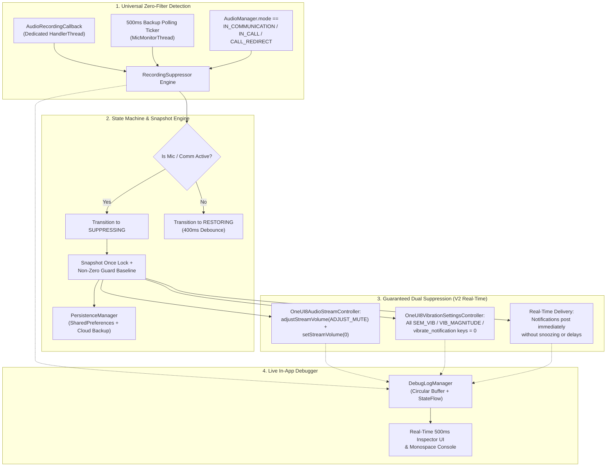

<p align="center">
  <b>English</b> ·
  <a href="docs/i18n/README.ar.md">العربية</a> ·
  <a href="docs/i18n/README.es.md">Español</a> ·
  <a href="docs/i18n/README.fr.md">Français</a> ·
  <a href="docs/i18n/README.de.md">Deutsch</a> ·
  <a href="docs/i18n/README.ru.md">Русский</a> ·
  <a href="docs/i18n/README.pt-BR.md">Português (Brasil)</a> ·
  <a href="docs/i18n/README.tr.md">Türkçe</a> ·
  <a href="docs/i18n/README.ko.md">한국어</a> ·
  <a href="docs/i18n/README.ja.md">日本語</a> ·
  <a href="docs/i18n/README.zh-CN.md">简体中文</a>
</p>

# Samsung Mic Mute App (v3.0)

<p align="center">
  
  
  
  
  
  
</p>

> **A specialized Android utility for Samsung Galaxy devices that automatically suppresses notification sounds and vibrations during active microphone usage without requiring `RECORD_AUDIO` permission. In V3, full multi-language support (11 languages), an instant in-app language switcher, and a secure in-app PayPal donation sheet are included.**

> [!WARNING]
> **⚠️ Important Note:** This tool mutes system-level notification sounds and vibrations. However, it cannot block custom in-app vibrations (e.g., custom vibration settings inside WhatsApp, Telegram, etc.). You must manually disable in-app vibrations inside those specific apps for a completely silent experience.

---

## 📌 Problem Overview

When recording audio or participating in voice/video calls on Samsung Galaxy devices (e.g., WhatsApp voice notes, Snapchat, Instagram stories/reels, Voice Recorder, Camera 4K video recording, Phone calls), incoming notifications produce loud sound bursts and tactile vibration buzzing that bleed into the recorded audio and interrupt communication.

Standard Do-Not-Disturb (DND) modes are cumbersome to manually toggle, and standard Android audio stream methods fail to silence Samsung's proprietary vibration engines.

**Samsung Mic Mute App (V3)** solves this entirely in the background: it automatically detects microphone activation anywhere in the system, immediately mutes notification volume and Samsung vibration intensity to zero, and instantly restores them to their exact baseline the moment recording ends. All notifications continue to arrive and display on your screen in real time without being snoozed, delayed, or flooded later.

---

## 🚀 Key Features & Highlights

- **🔒 Zero `RECORD_AUDIO` Permission (100% Private & Safe):**
  Uses Android's system-level `AudioManager.AudioRecordingCallback` (introduced in API 30+). The app **never** records, listens to, or processes microphone audio. It only monitors whether another application has opened a recording stream.
- **🌐 11 Global Languages & Instant Switcher (V3):**
  Fully translated into 11 languages: Arabic (العربية), English, Spanish (Español), French (Français), German (Deutsch), Russian (Русский), Portuguese (Português), Turkish (Türkçe), Korean (한국어), Japanese (日本語), and Chinese Simplified (简体中文). Includes an in-app language picker (🌐) and Android 13+ Per-App Language setting integration.
- **💳 Secure In-App PayPal Support Sheet (V3):**
  Enables direct support via PayPal's official Hosted Buttons SDK inside a native modal BottomSheet without ever navigating away to an external browser.
- **🛡️ No Invasive Foreground Microphone Type:**
  Avoids Android 14–16 runtime security restrictions by combining a `FOREGROUND_SERVICE_SPECIAL_USE` foreground service (`audio_recording_detection` property) with a persistent `NotificationListenerService`.
- **⚡ Universal Zero-Filter Detection Engine:**
  Triggers on **any** microphone usage across any application without relying on hidden or redacted package names (Android 10+ hides `clientPackageName` for unprivileged apps).
- **🔄 VoIP & Communication Mode Backup Ticker:**
  Includes an active 500ms ticker on a dedicated urgent-priority thread (`THREAD_PRIORITY_URGENT_AUDIO`) that checks for VoIP calls (`MODE_IN_COMMUNICATION`, `MODE_IN_CALL`, `MODE_CALL_REDIRECT`) to eliminate callback latency on WhatsApp, Instagram, and Telegram.
- **🎯 Dual Samsung Sound & Multi-Key Vibration Muting:**
  - **Audio:** Executes both `adjustStreamVolume(ADJUST_MUTE)` and `setStreamVolume(STREAM_NOTIFICATION, 0)`.
  - **Samsung Vibration:** Queries, snapshots, and sets all One UI vibration keys to `0`:
    - `SEM_VIBRATION_NOTIFICATION_INTENSITY` & `sem_vibration_notification_intensity`
    - `VIB_NOTIFICATION_MAGNITUDE` & `vib_notification_magnitude`
    - `vibrate_notification`
    - `notification_vibration_intensity`
    - `vibrate_on` (fallback)
- **📬 Real-Time Silent Delivery:**
  Ensures all notifications arrive and display on screen immediately in real time, completely silenced at the system audio and vibration driver level.
- **🧠 Snapshot Once Lock & Non-Zero Guard:**
  Snapshots system volume and vibration levels strictly once upon transition from `IDLE` → `SUPPRESSING`. Subsequent triggers never overwrite the user's normal volume with `0`. If values read `0` at snapshot time, the Non-Zero Guard restores a healthy persisted baseline.
- **⏱️ 400ms Anti-Glitch Debounce:**
  Delays restoration by 400ms when mic streams stop, preventing rapid on/off audio glitching during successive voice notes.
- **📊 Live In-App Debugger & Diagnostic Console:**
  Features a real-time inspector panel polling every 500ms directly on the dashboard:
  - Active microphone configs count, audio session IDs, and source types.
  - Current `AudioManager.mode`.
  - `STREAM_NOTIFICATION` live volume and mute state.
  - Live integer values of all Samsung vibration keys directly from `Settings.System`.
  - Monospace scrolling event log console with one-tap clipboard copy and vibration key dump.
- **💾 Crash & Reboot Recovery:**
  Automatically restores cached baseline settings after device reboots via `BootRecoveryReceiver` and cloud-synced `PersistenceManager`.
  Delays restoration by 400ms when mic streams stop, preventing rapid on/off audio glitching during successive voice notes.
- **📊 Live In-App Debugger & Diagnostic Console:**
  Features a real-time inspector panel polling every 500ms directly on the dashboard:
  - Active microphone configs count, audio session IDs, and source types.
  - Current `AudioManager.mode`.
  - `STREAM_NOTIFICATION` live volume and mute state.
  - Live integer values of all Samsung vibration keys directly from `Settings.System`.
  - Monospace scrolling event log console with one-tap clipboard copy and vibration key dump.
- **💾 Crash & Reboot Recovery:**
  Automatically restores cached baseline settings after device reboots via `BootRecoveryReceiver` and cloud-synced `PersistenceManager`.

---

## 📱 Compatible Devices & OS Requirements

| Component | Requirement |
| :--- | :--- |
| **Target OS** | Android 11, 12, 13, 14, 15, 16 (API 30 to 36) |
| **Tested Platforms** | **Samsung One UI 6, One UI 7, One UI 8, One UI 9** |
| **Supported Hardware** | Samsung Galaxy S-Series (S20 – S25 Ultra)<br/>Samsung Galaxy Z-Series (Fold & Flip)<br/>Samsung Galaxy Note-Series<br/>Samsung Galaxy A-Series / M-Series / Tab |
| **Non-Samsung Devices** | Compatible with standard Android notification sound muting; Samsung-specific vibration keys gracefully fall back to `NotificationListenerService`. |

---

## 🏗️ Architecture & Technical Stack



### Modular Controller Stack

- **`RecordingSuppressor`:** Thread-safe state orchestrator (`IDLE` ↔ `SUPPRESSING` ↔ `RESTORING`).
- **`AudioStreamController`:** Pluggable audio muting interface:
  - `OneUI8AudioStreamController` (Primary: `STREAM_NOTIFICATION` dual muting).
  - `NotificationChannelAudioController` (Fallback: individual notification channel sound suppression).
- **`VibrationSettingsController`:** Pluggable vibration muting interface:
  - `OneUI8VibrationSettingsController` (Primary: Samsung system settings multi-key muting).
  - `NotificationListenerVibrationController` (Fallback: notification-level vibration pattern cancellation).
  - `AdbSecureSettingsVibrationController` (Development / Enterprise fallback).
- **`SuppressionForegroundService`:** Sticky foreground service with persistent monitoring notification.
- **`SuppressionNotificationListener`:** System-priority host ensuring continuous monitoring survives aggressive OS task killing.

---

## 🛠️ Installation & Setup Guide

### Step 1: Install the APK
Download `SamsungMicMute_V2.apk` from the [Releases](https://github.com/m4wan1/SamsungMicMuteApp/releases) section, or build the APK locally from source:

```bash
git clone https://github.com/m4wan1/SamsungMicMuteApp.git
cd SamsungMicMuteApp
./gradlew assembleDebug
```
The compiled APK will be located at:
`app/build/outputs/apk/debug/app-debug.apk`

---

### Step 2: Grant Permissions
Launch the app. Three clean setup cards will guide you through granting the required permissions:

1. **Write System Settings (`WRITE_SETTINGS`):**
   - Tap **Grant** on Card 3.
   - Toggle **Allow modifying system settings** for *Samsung Mic Mute*.
   - *Purpose:* Allows the app to set Samsung vibration intensity and volume in `Settings.System`.
2. **Notification Listener Access:**
   - Tap **Grant** on Card 3.
   - Enable **Notification Vibration Suppressor** in the device settings.
   - *Purpose:* Provides persistent system priority background monitoring and fallback vibration control.
3. **Ignore Battery Optimization (Unrestricted):**
   - Tap **Grant** on Card 3.
   - Select **Allow** (Unrestricted).
   - *Purpose:* Prevents Samsung One UI from freezing or delaying background audio callback threads when the app is minimized.

#### Alternative Setup via ADB (Fast Setup for Developers):
```bash
# Grant Write System Settings
adb shell appops set com.example.suppressor.debug WRITE_SETTINGS allow

# Grant Notification Listener Access
adb shell cmd notification set_listeners com.example.suppressor.debug/com.example.suppressor.service.SuppressionNotificationListener

# Whitelist from Battery Optimization
adb shell dumpsys deviceidle whitelist +com.example.suppressor.debug
```

---

## 🧪 Usage & Testing

### How to Verify Suppression:
1. Open **Samsung Mic Mute** and verify all three permission badges on Card 3 show **Granted** / **Unrestricted**.
2. Keep the app open or minimize it.
3. Open **WhatsApp** (or **Voice Recorder**, **Snapchat**, or **Camera** video mode).
4. Hold the microphone button to record a voice note.
5. While holding the microphone, look at the app:
   - **Status Badge** instantly changes to: `ACTIVE - Mic in Use (Muted)`.
   - **Saved Volume / Vibration** shows: `Saved Volume: 10 / 15 | Current: 0 (Muted)`.
6. Have a friend send you a notification message (or send an email/notification from another device).
7. **Observe:** The notification arrives silently with **zero sound** and **zero vibration**.
8. Release the microphone button.
9. After a smooth 400ms debounce, volume and vibration automatically return to your exact original settings.

### Using the In-App Live Debugger:
Scroll to **Card 5 (LIVE IN-APP DEBUGGER)** at the bottom of the screen:
- **Live Inspector:** Shows real-time mic configs count, `AudioManager.mode`, stream mute status, and the exact integer values of Samsung vibration keys.
- **Copy Logs:** Copies the full diagnostic dump and Samsung settings keys to your clipboard.
- **Dump Vib Keys:** Scans all settings in `Settings.System` matching `vib` or `noti` and prints their values.

---

## 🔒 Core Constraints & Security Guarantees

| Constraint / Guarantee | Specification & Enforcement in V2 |
| :--- | :--- |
| **Real-Time Silent Notification Delivery** | **Zero Delay / No Snoozing:** Notifications MUST arrive and display on screen immediately in real time. The app strictly avoids `snoozeNotification()`, `cancelNotification()`, or `cancelAllNotifications()`, preventing notification floods when the mic is released. Complete silence relies exclusively on Priority 1 controllers (`OneUI8AudioStreamController` setting `STREAM_NOTIFICATION` to 0, and `OneUI8VibrationSettingsController` setting `sem_vibration_notification_intensity` to 0). |
| **No Microphone Eavesdropping** | `<uses-permission android:name="android.permission.RECORD_AUDIO" tools:node="remove" />` is enforced in `AndroidManifest.xml`. The Android OS physically prevents this app from capturing audio. |
| **No Do-Not-Disturb Interference** | Does not alter Android `NotificationManager.setInterruptionFilter()`. Your DND schedules and starred contact exceptions remain untouched. |
| **No Global Silent Mode** | Does not set `RINGER_MODE_SILENT`. Incoming phone calls and alarms ring at full normal volume. |
| **Local-Only Processing** | Contains zero analytics, zero network requests, and zero remote tracking. |

### ⚠️ In-App Custom Vibrations Disclaimer
> **Important Note:** This tool mutes system-level notification sounds and vibrations. However, it cannot block custom in-app vibrations (e.g., custom vibration settings inside WhatsApp, Telegram, etc.). You must manually disable in-app vibrations inside those specific apps for a completely silent experience.

---

## 📄 License & Terms

Distributed under the **MIT License**.

```
MIT License

Copyright (c) 2026 Marw (m4wan1)

Permission is hereby granted, free of charge, to any person obtaining a copy
of this software and associated documentation files (the "Software"), to deal
in the Software without restriction, including without limitation the rights
to use, copy, modify, merge, publish, distribute, sublicense, and/or sell
copies of the Software, and to permit persons to whom the Software is
furnished to do so, subject to the following conditions:

The above copyright notice and this permission notice shall be included in all
copies or substantial portions of the Software.

THE SOFTWARE IS PROVIDED "AS IS", WITHOUT WARRANTY OF ANY KIND, EXPRESS OR
IMPLIED, INCLUDING BUT NOT LIMITED TO THE WARRANTIES OF MERCHANTABILITY,
FITNESS FOR A PARTICULAR PURPOSE AND NONINFRINGEMENT. IN NO EVENT SHALL THE
AUTHORS OR COPYRIGHT HOLDERS BE LIABLE FOR ANY CLAIM, DAMAGES OR OTHER
LIABILITY, WHETHER IN AN ACTION OF CONTRACT, TORT OR OTHERWISE, ARISING FROM,
OUT OF OR IN CONNECTION WITH THE SOFTWARE OR THE USE OR OTHER DEALINGS IN THE
SOFTWARE.
```

*Disclaimer: This project is an independent open-source utility designed for user privacy and convenience. It is not affiliated with or endorsed by Samsung Electronics Co., Ltd.*
