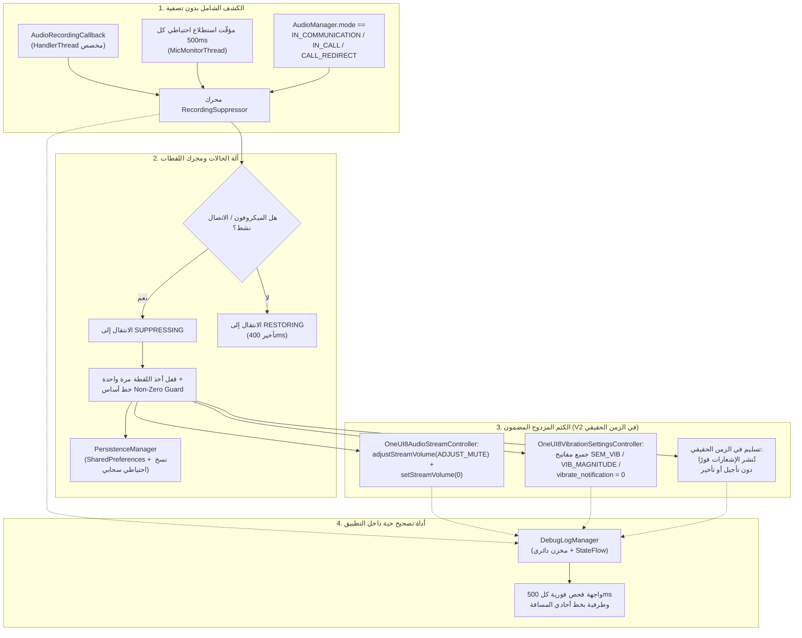

<p align="center">
  <a href="../../README.md">English</a> ·
  <b>العربية</b> ·
  <a href="README.es.md">Español</a> ·
  <a href="README.fr.md">Français</a> ·
  <a href="README.de.md">Deutsch</a> ·
  <a href="README.ru.md">Русский</a> ·
  <a href="README.pt-BR.md">Português (Brasil)</a> ·
  <a href="README.tr.md">Türkçe</a> ·
  <a href="README.ko.md">한국어</a> ·
  <a href="README.ja.md">日本語</a> ·
  <a href="README.zh-CN.md">简体中文</a>
</p>

# Samsung Mic Mute App (v3.0)

<p align="center">
  
  
  
  
  
  
</p>

> **أداة أندرويد متخصصة لأجهزة Samsung Galaxy، تعمل تلقائيًا على كتم أصوات الإشعارات واهتزازاتها أثناء الاستخدام النشط للميكروفون، دون الحاجة إلى إذن `RECORD_AUDIO`. في الإصدار V3، تتوفر الأداة على دعم كامل لتعدد اللغات (11 لغة)، ومبدّل لغة فوري داخل التطبيق، ونافذة تبرع آمنة عبر PayPal داخل التطبيق.**

> [!WARNING]
> **⚠️ ملاحظة مهمة:** تكتم هذه الأداة أصوات إشعارات النظام واهتزازاتها على مستوى النظام. ومع ذلك، فهي لا تستطيع حجب الاهتزازات المخصصة داخل التطبيقات (مثل إعدادات الاهتزاز المخصصة داخل WhatsApp وTelegram وغيرهما). عليك تعطيل الاهتزاز داخل تلك التطبيقات يدويًا للحصول على تجربة صامتة تمامًا.

---

## 📌 نظرة عامة على المشكلة

عند تسجيل الصوت أو المشاركة في مكالمات صوتية/مرئية على أجهزة Samsung Galaxy (مثل الرسائل الصوتية في WhatsApp، وSnapchat، وقصص/مقاطع Instagram، ومسجل الصوت، وتسجيل فيديو 4K بالكاميرا، والمكالمات الهاتفية)، تتسبب الإشعارات الواردة في حدوث دفعات صوتية عالية وطنين اهتزاز ملموس يتسرب إلى الصوت المسجَّل ويقاطع التواصل.

كما أن أوضاع "عدم الإزعاج" (DND) القياسية مرهقة عند تفعيلها وتعطيلها يدويًا، بينما تفشل الطرق القياسية للتعامل مع مسارات الصوت في أندرويد في إسكات محركات الاهتزاز الخاصة بسامسونج.

**Samsung Mic Mute App (V3)** تحل هذه المشكلة بالكامل في الخلفية: فهي تكتشف تفعيل الميكروفون تلقائيًا في أي مكان داخل النظام، وتكتم فورًا مستوى صوت الإشعارات وشدة الاهتزاز في سامسونج إلى الصفر، ثم تعيدهما في الحال إلى قيمتهما الأساسية الدقيقة بمجرد انتهاء التسجيل. وتظل جميع الإشعارات تصل وتُعرض على شاشتك في الزمن الحقيقي دون تأجيل أو تأخير أو تكدّس لاحق.

---

## 🚀 الميزات الرئيسية وأبرز النقاط

- **🔒 بلا إذن `RECORD_AUDIO` إطلاقًا (خصوصية وأمان بنسبة 100%):**
  تعتمد على `AudioManager.AudioRecordingCallback` على مستوى النظام (المتاح منذ API 30+). فالتطبيق **لا** يسجل صوت الميكروفون ولا يستمع إليه ولا يعالجه إطلاقًا. بل يراقب فقط ما إذا كان تطبيق آخر قد فتح مسار تسجيل.
- **🌐 11 لغة عالمية ومبدّل فوري (V3):**
  مترجم بالكامل إلى 11 لغة: العربية، والإنجليزية (English)، والإسبانية (Español)، والفرنسية (Français)، والألمانية (Deutsch)، والروسية (Русский)، والبرتغالية (Português)، والتركية (Türkçe)، والكورية (한국어)، واليابانية (日本語)، والصينية المبسطة (简体中文). ويتضمن منتقي لغة داخل التطبيق (🌐) وتكاملًا مع إعداد "لغة كل تطبيق" في Android 13+.
- **💳 نافذة دعم آمنة عبر PayPal داخل التطبيق (V3):**
  تتيح الدعم المباشر عبر SDK الأزرار المستضافة الرسمي من PayPal داخل نافذة BottomSheet أصلية، دون الانتقال إلى متصفح خارجي إطلاقًا.
- **🛡️ دون نوع ميكروفون أمامي تدخّلي:**
  تتجنب قيود الأمان وقت التشغيل في Android 14–16 من خلال الجمع بين خدمة أمامية من نوع `FOREGROUND_SERVICE_SPECIAL_USE` (بخاصية `audio_recording_detection`) و`NotificationListenerService` دائمة.
- **⚡ محرك كشف شامل بلا تصفية:**
  يُفعَّل عند **أي** استخدام للميكروفون في أي تطبيق، دون الاعتماد على أسماء حزم مخفية أو محجوبة (إذ يخفي Android 10+ القيمة `clientPackageName` عن التطبيقات غير المميزة).
- **🔄 مؤقّت احتياطي لأوضاع VoIP والاتصال:**
  يتضمن مؤقّتًا نشطًا كل 500ms على خيط مخصص بأولوية عاجلة (`THREAD_PRIORITY_URGENT_AUDIO`) يتحقق من مكالمات VoIP (`MODE_IN_COMMUNICATION`، `MODE_IN_CALL`، `MODE_CALL_REDIRECT`) لإزالة تأخر الاستدعاء في WhatsApp وInstagram وTelegram.
- **🎯 كتم مزدوج لصوت سامسونج واهتزازها متعدد المفاتيح:**
  - **الصوت:** ينفّذ كلا الاستدعاءين `adjustStreamVolume(ADJUST_MUTE)` و`setStreamVolume(STREAM_NOTIFICATION, 0)`.
  - **اهتزاز سامسونج:** يستعلم عن جميع مفاتيح اهتزاز One UI ويأخذ لقطة لها ويضبطها على `0`:
    - `SEM_VIBRATION_NOTIFICATION_INTENSITY` و`sem_vibration_notification_intensity`
    - `VIB_NOTIFICATION_MAGNITUDE` و`vib_notification_magnitude`
    - `vibrate_notification`
    - `notification_vibration_intensity`
    - `vibrate_on` (احتياطي)
- **📬 تسليم صامت في الزمن الحقيقي:**
  يضمن وصول جميع الإشعارات وعرضها على الشاشة فورًا في الزمن الحقيقي، مع كتمها بالكامل على مستوى محرك الصوت والاهتزاز في النظام.
- **🧠 قفل اللقطة مرة واحدة وحاجز القيم غير الصفرية:**
  يأخذ لقطة لمستويات صوت النظام والاهتزاز مرة واحدة فقط عند الانتقال من `IDLE` إلى `SUPPRESSING`. ولا تستبدل أي عمليات تفعيل لاحقة مستوى صوت المستخدم الطبيعي بالقيمة `0`. وإذا قُرئت القيم على أنها `0` وقت أخذ اللقطة، يعيد حاجز القيم غير الصفرية ضبط خط أساس سليم محفوظ.
- **⏱️ تأخير مضاد للخلل 400ms:**
  يؤخر الاستعادة 400ms عند توقف مسارات الميكروفون، ما يمنع تقطع الصوت السريع عند التشغيل/الإيقاف المتتالي في الرسائل الصوتية المتتابعة.
- **📊 أداة تصحيح وطرفية تشخيص حية داخل التطبيق:**
  تتضمن لوحة فحص فورية تستعلم كل 500ms مباشرةً من لوحة المعلومات:
  - عدد تهيئات الميكروفون النشطة، ومعرّفات جلسات الصوت، وأنواع المصادر.
  - القيمة الحالية لـ `AudioManager.mode`.
  - مستوى الصوت الحالي `STREAM_NOTIFICATION` وحالة الكتم.
  - القيم الصحيحة الحية لجميع مفاتيح اهتزاز سامسونج مباشرةً من `Settings.System`.
  - طرفية سجل أحداث قابلة للتمرير بخط أحادي المسافة، مع نسخ إلى الحافظة بلمسة واحدة وتفريغ لمفاتيح الاهتزاز.
- **💾 الاستعادة بعد الأعطال وإعادة التشغيل:**
  يعيد تلقائيًا الإعدادات الأساسية المخزنة مؤقتًا بعد إعادة تشغيل الجهاز عبر `BootRecoveryReceiver` و`PersistenceManager` المتزامن سحابيًا.
  يؤخر الاستعادة 400ms عند توقف مسارات الميكروفون، ما يمنع تقطع الصوت السريع عند التشغيل/الإيقاف المتتالي في الرسائل الصوتية المتتابعة.
- **📊 أداة تصحيح وطرفية تشخيص حية داخل التطبيق:**
  تتضمن لوحة فحص فورية تستعلم كل 500ms مباشرةً من لوحة المعلومات:
  - عدد تهيئات الميكروفون النشطة، ومعرّفات جلسات الصوت، وأنواع المصادر.
  - القيمة الحالية لـ `AudioManager.mode`.
  - مستوى الصوت الحالي `STREAM_NOTIFICATION` وحالة الكتم.
  - القيم الصحيحة الحية لجميع مفاتيح اهتزاز سامسونج مباشرةً من `Settings.System`.
  - طرفية سجل أحداث قابلة للتمرير بخط أحادي المسافة، مع نسخ إلى الحافظة بلمسة واحدة وتفريغ لمفاتيح الاهتزاز.
- **💾 الاستعادة بعد الأعطال وإعادة التشغيل:**
  يعيد تلقائيًا الإعدادات الأساسية المخزنة مؤقتًا بعد إعادة تشغيل الجهاز عبر `BootRecoveryReceiver` و`PersistenceManager` المتزامن سحابيًا.

---

## 📱 الأجهزة المتوافقة ومتطلبات نظام التشغيل

| المكوّن | المتطلب |
| :--- | :--- |
| **نظام التشغيل المستهدف** | Android 11, 12, 13, 14, 15, 16 (API 30 to 36) |
| **المنصات المُختبَرة** | **Samsung One UI 6, One UI 7, One UI 8, One UI 9** |
| **الأجهزة المدعومة** | Samsung Galaxy S-Series (S20 – S25 Ultra)<br/>Samsung Galaxy Z-Series (Fold & Flip)<br/>Samsung Galaxy Note-Series<br/>Samsung Galaxy A-Series / M-Series / Tab |
| **الأجهزة غير التابعة لسامسونج** | متوافقة مع كتم أصوات الإشعارات القياسي في أندرويد؛ وتُستخدم مفاتيح الاهتزاز الخاصة بسامسونج كخيار احتياطي سلس عبر `NotificationListenerService`. |

---

## 🏗️ البنية والحزمة التقنية



### حزمة وحدات التحكم المعيارية

- **`RecordingSuppressor`:** منسّق حالات آمن ضد التزامن (`IDLE` ↔ `SUPPRESSING` ↔ `RESTORING`).
- **`AudioStreamController`:** واجهة قابلة للتوصيل لكتم الصوت:
  - `OneUI8AudioStreamController` (أساسي: كتم مزدوج لـ `STREAM_NOTIFICATION`).
  - `NotificationChannelAudioController` (احتياطي: كتم صوت قنوات الإشعارات الفردية).
- **`VibrationSettingsController`:** واجهة قابلة للتوصيل لكتم الاهتزاز:
  - `OneUI8VibrationSettingsController` (أساسي: كتم متعدد المفاتيح لإعدادات نظام سامسونج).
  - `NotificationListenerVibrationController` (احتياطي: إلغاء نمط الاهتزاز على مستوى الإشعار).
  - `AdbSecureSettingsVibrationController` (احتياطي للتطوير / المؤسسات).
- **`SuppressionForegroundService`:** خدمة أمامية ثابتة مع إشعار مراقبة دائم.
- **`SuppressionNotificationListener`:** مضيف بأولوية نظام يضمن استمرار المراقبة في مواجهة الإيقاف القسري للمهام من النظام.

---

## 🛠️ دليل التثبيت والإعداد

### الخطوة 1: تثبيت ملف APK
نزّل `SamsungMicMute_V2.apk` من قسم [Releases](https://github.com/m4wan1/SamsungMicMuteApp/releases)، أو ابنِ ملف APK محليًا من المصدر:

```bash
git clone https://github.com/m4wan1/SamsungMicMuteApp.git
cd SamsungMicMuteApp
./gradlew assembleDebug
```
سيكون ملف APK المُجمَّع في المسار:
`app/build/outputs/apk/debug/app-debug.apk`

---

### الخطوة 2: منح الأذونات
شغّل التطبيق. ستقودك ثلاث بطاقات إعداد واضحة خلال منح الأذونات المطلوبة:

1. **كتابة إعدادات النظام (`WRITE_SETTINGS`):**
   - اضغط **Grant** في البطاقة 3.
   - فعّل **Allow modifying system settings** لتطبيق *Samsung Mic Mute*.
   - *الغرض:* يسمح للتطبيق بضبط شدة الاهتزاز ومستوى الصوت في `Settings.System`.
2. **الوصول إلى مستمع الإشعارات:**
   - اضغط **Grant** في البطاقة 3.
   - فعّل **Notification Vibration Suppressor** في إعدادات الجهاز.
   - *الغرض:* يوفر مراقبة خلفية دائمة بأولوية نظام وتحكمًا احتياطيًا في الاهتزاز.
3. **تجاهل تحسين البطارية (غير مقيّد):**
   - اضغط **Grant** في البطاقة 3.
   - اختر **Allow** (غير مقيّد).
   - *الغرض:* يمنع Samsung One UI من تجميد خيوط استدعاء الصوت في الخلفية أو تأخيرها عند تصغير التطبيق.

#### إعداد بديل عبر ADB (إعداد سريع للمطورين):
```bash
# Grant Write System Settings
adb shell appops set com.example.suppressor.debug WRITE_SETTINGS allow

# Grant Notification Listener Access
adb shell cmd notification set_listeners com.example.suppressor.debug/com.example.suppressor.service.SuppressionNotificationListener

# Whitelist from Battery Optimization
adb shell dumpsys deviceidle whitelist +com.example.suppressor.debug
```

---

## 🧪 الاستخدام والاختبار

### كيفية التحقق من الكتم:
1. افتح **Samsung Mic Mute** وتأكد من أن شارات الأذونات الثلاث في البطاقة 3 تظهر كـ **Granted** / **Unrestricted**.
2. أبقِ التطبيق مفتوحًا أو صغّره.
3. افتح **WhatsApp** (أو **Voice Recorder** أو **Snapchat** أو وضع الفيديو في **Camera**).
4. اضغط مع الاستمرار على زر الميكروفون لتسجيل رسالة صوتية.
5. أثناء الضغط على الميكروفون، راقب التطبيق:
   - تتغير **شارة الحالة** فورًا إلى: `ACTIVE - Mic in Use (Muted)`.
   - يعرض **Saved Volume / Vibration** ما يلي: `Saved Volume: 10 / 15 | Current: 0 (Muted)`.
6. اطلب من صديق إرسال رسالة إشعار إليك (أو أرسل بريدًا إلكترونيًا/إشعارًا من جهاز آخر).
7. **لاحظ:** يصل الإشعار بصمت تام مع **صفر صوت** و**صفر اهتزاز**.
8. أفلت زر الميكروفون.
9. بعد تأخير سلس مقداره 400ms، يعود مستوى الصوت والاهتزاز تلقائيًا إلى إعداداتك الأصلية الدقيقة.

### استخدام أداة التصحيح الحية داخل التطبيق:
مرر إلى **البطاقة 5 (LIVE IN-APP DEBUGGER)** في أسفل الشاشة:
- **Live Inspector:** يعرض عدد تهيئات الميكروفون في الزمن الحقيقي، و`AudioManager.mode`، وحالة كتم المسار، والقيم الصحيحة الدقيقة لمفاتيح اهتزاز سامسونج.
- **Copy Logs:** ينسخ تفريغ التشخيص الكامل ومفاتيح إعدادات سامسونج إلى الحافظة.
- **Dump Vib Keys:** يفحص جميع الإعدادات في `Settings.System` المطابقة لـ `vib` أو `noti` ويطبع قيمها.

---

## 🔒 القيود الأساسية وضمانات الأمان

| القيد / الضمان | المواصفات والتطبيق في V2 |
| :--- | :--- |
| **تسليم صامت للإشعارات في الزمن الحقيقي** | **صفر تأخير / بلا تأجيل:** يجب أن تصل الإشعارات وتُعرض على الشاشة فورًا في الزمن الحقيقي. ويتجنب التطبيق تمامًا `snoozeNotification()` و`cancelNotification()` و`cancelAllNotifications()`، ما يمنع تكدّس الإشعارات عند تحرير الميكروفون. ويعتمد الصمت التام حصريًا على وحدات التحكم ذات الأولوية 1 (`OneUI8AudioStreamController` بضبط `STREAM_NOTIFICATION` على 0، و`OneUI8VibrationSettingsController` بضبط `sem_vibration_notification_intensity` على 0). |
| **لا تنصّت على الميكروفون** | يُفرض السطر `<uses-permission android:name="android.permission.RECORD_AUDIO" tools:node="remove" />` في `AndroidManifest.xml`. ويمنع نظام أندرويد هذا التطبيق فعليًا من التقاط الصوت. |
| **لا تداخل مع "عدم الإزعاج"** | لا يغيّر `NotificationManager.setInterruptionFilter()` في أندرويد. وتبقى جداول DND واستثناءات جهات الاتصال المميزة دون أي مساس. |
| **لا وضع صامت شامل** | لا يضبط `RINGER_MODE_SILENT`. فالمكالمات الهاتفية والمنبهات الواردة ترن بالحجم الطبيعي الكامل. |
| **معالجة محلية فقط** | لا يحتوي على أي تحليلات، ولا أي طلبات شبكة، ولا أي تتبّع عن بُعد. |

### ⚠️ إخلاء مسؤولية بشأن الاهتزازات المخصصة داخل التطبيقات
> **ملاحظة مهمة:** تكتم هذه الأداة أصوات إشعارات النظام واهتزازاتها على مستوى النظام. ومع ذلك، فهي لا تستطيع حجب الاهتزازات المخصصة داخل التطبيقات (مثل إعدادات الاهتزاز المخصصة داخل WhatsApp وTelegram وغيرهما). عليك تعطيل الاهتزاز داخل تلك التطبيقات يدويًا للحصول على تجربة صامتة تمامًا.

---

## 📄 الترخيص والشروط

يُوزَّع هذا المشروع بموجب **MIT License**.

```
MIT License

Copyright (c) 2026 Marw (m4wan1)

Permission is hereby granted, free of charge, to any person obtaining a copy
of this software and associated documentation files (the "Software"), to deal
in the Software without restriction, including without limitation the rights
to use, copy, modify, merge, publish, distribute, sublicense, and/or sell
copies of the Software, and to permit persons to whom the Software is
furnished to do so, subject to the following conditions:

The above copyright notice and this permission notice shall be included in all
copies or substantial portions of the Software.

THE SOFTWARE IS PROVIDED "AS IS", WITHOUT WARRANTY OF ANY KIND, EXPRESS OR
IMPLIED, INCLUDING BUT NOT LIMITED TO THE WARRANTIES OF MERCHANTABILITY,
FITNESS FOR A PARTICULAR PURPOSE AND NONINFRINGEMENT. IN NO EVENT SHALL THE
AUTHORS OR COPYRIGHT HOLDERS BE LIABLE FOR ANY CLAIM, DAMAGES OR OTHER
LIABILITY, WHETHER IN AN ACTION OF CONTRACT, TORT OR OTHERWISE, ARISING FROM,
OUT OF OR IN CONNECTION WITH THE SOFTWARE OR THE USE OR OTHER DEALINGS IN THE
SOFTWARE.
```

*إخلاء مسؤولية: هذا المشروع أداة مساعدة مستقلة مفتوحة المصدر، مصممة لخصوصية المستخدم وراحته. وهو غير تابع لشركة Samsung Electronics Co., Ltd. ولا معتمد منها.*
