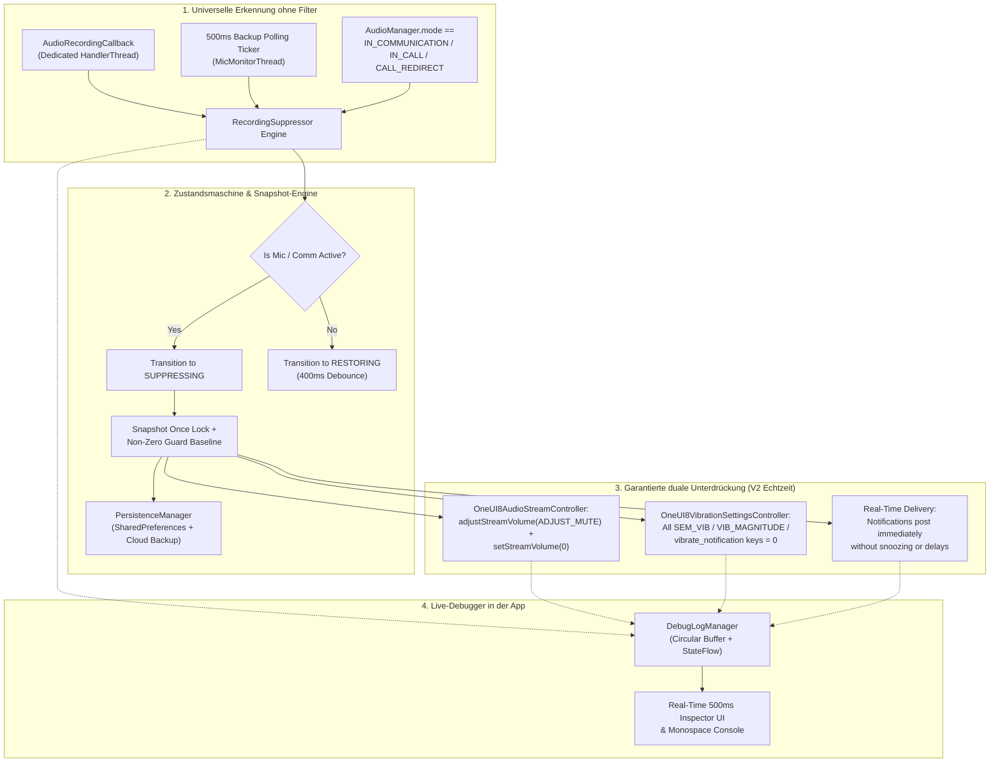

<p align="center">
  <a href="../../README.md">English</a> ·
  <a href="README.ar.md">العربية</a> ·
  <a href="README.es.md">Español</a> ·
  <a href="README.fr.md">Français</a> ·
  <b>Deutsch</b> ·
  <a href="README.ru.md">Русский</a> ·
  <a href="README.pt-BR.md">Português (Brasil)</a> ·
  <a href="README.tr.md">Türkçe</a> ·
  <a href="README.ko.md">한국어</a> ·
  <a href="README.ja.md">日本語</a> ·
  <a href="README.zh-CN.md">简体中文</a>
</p>

# Samsung Mic Mute App (v3.0)

<p align="center">
  
  
  
  
  
  
</p>

> **Ein spezialisiertes Android-Dienstprogramm für Samsung-Galaxy-Geräte, das während einer aktiven Mikrofonnutzung automatisch Benachrichtigungstöne und Vibrationen unterdrückt, ohne die Berechtigung `RECORD_AUDIO` zu benötigen. In V3 sind vollständige Mehrsprachigkeit (11 Sprachen), ein sofortiger Sprachumschalter in der App und ein sicherer PayPal-Spenden-Dialog in der App enthalten.**

> [!WARNING]
> **⚠️ Wichtiger Hinweis:** Dieses Tool schaltet Benachrichtigungstöne und -vibrationen auf Systemebene stumm. Es kann jedoch keine anwendungsspezifischen Vibrationen blockieren (z. B. eigene Vibrationseinstellungen innerhalb von WhatsApp, Telegram usw.). Für ein vollständig lautloses Erlebnis müssen Sie die Vibrationen in diesen Apps manuell deaktivieren.

---

## 📌 Problemübersicht

Bei Audioaufnahmen oder bei Sprach- bzw. Videoanrufen auf Samsung-Galaxy-Geräten (z. B. WhatsApp-Sprachnachrichten, Snapchat, Instagram Stories/Reels, Voice Recorder, 4K-Videoaufnahme mit der Kamera, Telefonanrufe) erzeugen eingehende Benachrichtigungen laute Tonausbrüche und spürbares Vibrationsbrummen, die in die aufgezeichnete Audiospur gelangen und die Kommunikation unterbrechen.

Standardmäßige Nicht-stören-Modi (DND) sind umständlich manuell umzuschalten, und die üblichen Android-Audiostream-Methoden können die proprietären Vibrations-Engines von Samsung nicht stummschalten.

**Samsung Mic Mute App (V3)** löst dieses Problem vollständig im Hintergrund: Sie erkennt automatisch eine Mikrofonaktivierung an jeder Stelle im System, schaltet sofort die Benachrichtigungslautstärke und die Samsung-Vibrationsintensität auf null und stellt beide Werte in dem Moment, in dem die Aufnahme endet, exakt auf ihren Ausgangswert zurück. Alle Benachrichtigungen kommen weiterhin in Echtzeit an und werden auf dem Bildschirm angezeigt, ohne stummgeschaltet, verzögert oder später gebündelt nachgeliefert zu werden.

---

## 🚀 Hauptfunktionen & Highlights

- **🔒 Keine `RECORD_AUDIO`-Berechtigung (100 % privat & sicher):**
  Verwendet Androids systemweites `AudioManager.AudioRecordingCallback` (eingeführt in API 30+). Die App zeichnet **niemals** Mikrofon-Audio auf, hört es nicht ab und verarbeitet es nicht. Sie überwacht lediglich, ob eine andere Anwendung einen Aufnahme-Stream geöffnet hat.
- **🌐 11 globale Sprachen & sofortiger Umschalter (V3):**
  Vollständig übersetzt in 11 Sprachen: Arabisch (العربية), Englisch, Spanisch (Español), Französisch (Français), Deutsch, Russisch (Русский), Portugiesisch (Português), Türkisch (Türkçe), Koreanisch (한국어), Japanisch (日本語) und vereinfachtes Chinesisch (简体中文). Enthält eine Sprachauswahl in der App (🌐) und die Integration der sprachbezogenen App-Einstellung ab Android 13.
- **💳 Sicherer PayPal-Support-Dialog in der App (V3):**
  Ermöglicht direkte Unterstützung über das offizielle Hosted-Buttons-SDK von PayPal in einem nativen modalen BottomSheet, ohne jemals zu einem externen Browser zu wechseln.
- **🛡️ Kein invasiver Foreground-Typ für das Mikrofon:**
  Umgeht die Laufzeit-Sicherheitsbeschränkungen von Android 14–16 durch die Kombination eines Foreground-Service mit `FOREGROUND_SERVICE_SPECIAL_USE` (Eigenschaft `audio_recording_detection`) und eines dauerhaft laufenden `NotificationListenerService`.
- **⚡ Universelle Erkennungs-Engine ohne Filter:**
  Wird bei **jeder** Mikrofonnutzung in jeder Anwendung ausgelöst, ohne auf versteckte oder geschwärzte Paketnamen angewiesen zu sein (ab Android 10 wird `clientPackageName` für nicht privilegierte Apps ausgeblendet).
- **🔄 Backup-Ticker für VoIP- und Kommunikationsmodus:**
  Enthält einen aktiven 500-ms-Ticker auf einem dedizierten Thread mit dringlicher Priorität (`THREAD_PRIORITY_URGENT_AUDIO`), der auf VoIP-Anrufe prüft (`MODE_IN_COMMUNICATION`, `MODE_IN_CALL`, `MODE_CALL_REDIRECT`), um die Callback-Latenz bei WhatsApp, Instagram und Telegram zu beseitigen.
- **🎯 Duale Stummschaltung von Samsung-Ton & Vibrationsschlüsseln:**
  - **Audio:** Führt sowohl `adjustStreamVolume(ADJUST_MUTE)` als auch `setStreamVolume(STREAM_NOTIFICATION, 0)` aus.
  - **Samsung-Vibration:** Liest alle One-UI-Vibrationsschlüssel ab, speichert sie und setzt sie auf `0`:
    - `SEM_VIBRATION_NOTIFICATION_INTENSITY` & `sem_vibration_notification_intensity`
    - `VIB_NOTIFICATION_MAGNITUDE` & `vib_notification_magnitude`
    - `vibrate_notification`
    - `notification_vibration_intensity`
    - `vibrate_on` (Fallback)
- **📬 Lautlose Zustellung in Echtzeit:**
  Stellt sicher, dass alle Benachrichtigungen sofort in Echtzeit ankommen und auf dem Bildschirm angezeigt werden, vollständig stummgeschaltet auf Ebene des System-Audio- und Vibrations-Treibers.
- **🧠 Snapshot-Once-Sperre & Non-Zero-Guard:**
  Speichert Systemlautstärke und Vibrationspegel strikt einmalig beim Übergang von `IDLE` → `SUPPRESSING`. Nachfolgende Auslösungen überschreiben die normale Lautstärke des Nutzers niemals mit `0`. Wenn die Werte zum Zeitpunkt des Snapshots `0` lesen, stellt der Non-Zero-Guard eine gesunde, persistierte Basislinie wieder her.
- **⏱️ 400-ms-Anti-Glitch-Debounce:**
  Verzögert die Wiederherstellung um 400 ms, wenn Mikrofon-Streams enden, und verhindert so schnelles Ein-/Aus-Audioflackern bei aufeinanderfolgenden Sprachnachrichten.
- **📊 Live-Debugger & Diagnosekonsole in der App:**
  Bietet ein Echtzeit-Inspektorpanel, das alle 500 ms direkt im Dashboard abfragt:
  - Anzahl aktiver Mikrofonkonfigurationen, Audio-Session-IDs und Quelltypen.
  - Aktueller `AudioManager.mode`.
  - Live-Lautstärke und Stummstatus von `STREAM_NOTIFICATION`.
  - Live-Ganzzahlwerte aller Samsung-Vibrationsschlüssel direkt aus `Settings.System`.
  - Scrollende Ereignisprotokoll-Konsole in Monospace mit Kopieren per Tippen und Dump der Vibrationsschlüssel.
- **💾 Wiederherstellung nach Absturz & Neustart:**
  Stellt zwischengespeicherte Basislinien-Einstellungen nach Geräteneustarts automatisch wieder her, über `BootRecoveryReceiver` und den cloud-synchronisierten `PersistenceManager`.
  Verzögert die Wiederherstellung um 400 ms, wenn Mikrofon-Streams enden, und verhindert so schnelles Ein-/Aus-Audioflackern bei aufeinanderfolgenden Sprachnachrichten.
- **📊 Live-Debugger & Diagnosekonsole in der App:**
  Bietet ein Echtzeit-Inspektorpanel, das alle 500 ms direkt im Dashboard abfragt:
  - Anzahl aktiver Mikrofonkonfigurationen, Audio-Session-IDs und Quelltypen.
  - Aktueller `AudioManager.mode`.
  - Live-Lautstärke und Stummstatus von `STREAM_NOTIFICATION`.
  - Live-Ganzzahlwerte aller Samsung-Vibrationsschlüssel direkt aus `Settings.System`.
  - Scrollende Ereignisprotokoll-Konsole in Monospace mit Kopieren per Tippen und Dump der Vibrationsschlüssel.
- **💾 Wiederherstellung nach Absturz & Neustart:**
  Stellt zwischengespeicherte Basislinien-Einstellungen nach Geräteneustarts automatisch wieder her, über `BootRecoveryReceiver` und den cloud-synchronisierten `PersistenceManager`.

---

## 📱 Kompatible Geräte & OS-Anforderungen

| Komponente | Anforderung |
| :--- | :--- |
| **Ziel-Betriebssystem** | Android 11, 12, 13, 14, 15, 16 (API 30 bis 36) |
| **Getestete Plattformen** | **Samsung One UI 6, One UI 7, One UI 8, One UI 9** |
| **Unterstützte Hardware** | Samsung Galaxy S-Serie (S20 – S25 Ultra)<br/>Samsung Galaxy Z-Serie (Fold & Flip)<br/>Samsung Galaxy Note-Serie<br/>Samsung Galaxy A-Serie / M-Serie / Tab |
| **Nicht-Samsung-Geräte** | Kompatibel mit dem Standard-Stummschalten von Android-Benachrichtigungstönen; Samsung-spezifische Vibrationsschlüssel fallen sauber auf `NotificationListenerService` zurück. |

---

## 🏗️ Architektur & Technischer Stack



### Modularer Controller-Stack

- **`RecordingSuppressor`:** Thread-sicherer Zustands-Orchestrator (`IDLE` ↔ `SUPPRESSING` ↔ `RESTORING`).
- **`AudioStreamController`:** Austauschbare Schnittstelle zum Stummschalten von Audio:
  - `OneUI8AudioStreamController` (Primär: duale Stummschaltung von `STREAM_NOTIFICATION`).
  - `NotificationChannelAudioController` (Fallback: Unterdrückung des Tons einzelner Benachrichtigungskanäle).
- **`VibrationSettingsController`:** Austauschbare Schnittstelle zum Stummschalten der Vibration:
  - `OneUI8VibrationSettingsController` (Primär: Stummschaltung mehrerer Schlüssel in den Samsung-Systemeinstellungen).
  - `NotificationListenerVibrationController` (Fallback: Aufhebung von Vibrationsmustern auf Benachrichtigungsebene).
  - `AdbSecureSettingsVibrationController` (Fallback für Entwicklung / Enterprise).
- **`SuppressionForegroundService`:** Sticky-Foreground-Service mit dauerhafter Überwachungsbenachrichtigung.
- **`SuppressionNotificationListener`:** Host mit Systempriorität, der die kontinuierliche Überwachung auch bei aggressivem Beenden von Aufgaben durch das OS aufrechterhält.

---

## 🛠️ Installations- & Einrichtungsanleitung

### Schritt 1: APK installieren
Laden Sie `SamsungMicMute_V2.apk` aus dem Bereich [Releases](https://github.com/m4wan1/SamsungMicMuteApp/releases) herunter, oder bauen Sie die APK lokal aus dem Quellcode:

```bash
git clone https://github.com/m4wan1/SamsungMicMuteApp.git
cd SamsungMicMuteApp
./gradlew assembleDebug
```
Die kompilierte APK befindet sich unter:
`app/build/outputs/apk/debug/app-debug.apk`

---

### Schritt 2: Berechtigungen erteilen
Starten Sie die App. Drei übersichtliche Einrichtungskarten führen Sie durch die Vergabe der erforderlichen Berechtigungen:

1. **Systemeinstellungen schreiben (`WRITE_SETTINGS`):**
   - Tippen Sie auf Karte 3 auf **Grant**.
   - Aktivieren Sie **Ändern der Systemeinstellungen zulassen** für *Samsung Mic Mute*.
   - *Zweck:* Ermöglicht der App, Samsung-Vibrationsintensität und -Lautstärke in `Settings.System` zu setzen.
2. **Zugriff auf Benachrichtigungslistener:**
   - Tippen Sie auf Karte 3 auf **Grant**.
   - Aktivieren Sie **Notification Vibration Suppressor** in den Geräteeinstellungen.
   - *Zweck:* Bietet dauerhafte Hintergrundüberwachung mit Systempriorität und eine Fallback-Vibrationssteuerung.
3. **Akku-Optimierung ignorieren (Uneingeschränkt):**
   - Tippen Sie auf Karte 3 auf **Grant**.
   - Wählen Sie **Zulassen** (Uneingeschränkt).
   - *Zweck:* Verhindert, dass Samsung One UI Hintergrund-Threads für Audio-Callbacks einfriert oder verzögert, wenn die App minimiert ist.

#### Alternative Einrichtung über ADB (Schnelle Einrichtung für Entwickler):
```bash
# Grant Write System Settings
adb shell appops set com.example.suppressor.debug WRITE_SETTINGS allow

# Grant Notification Listener Access
adb shell cmd notification set_listeners com.example.suppressor.debug/com.example.suppressor.service.SuppressionNotificationListener

# Whitelist from Battery Optimization
adb shell dumpsys deviceidle whitelist +com.example.suppressor.debug
```

---

## 🧪 Nutzung & Test

### So prüfen Sie die Unterdrückung:
1. Öffnen Sie **Samsung Mic Mute** und prüfen Sie, ob alle drei Berechtigungs-Badges auf Karte 3 **Granted** / **Unrestricted** anzeigen.
2. Lassen Sie die App geöffnet oder minimieren Sie sie.
3. Öffnen Sie **WhatsApp** (oder **Voice Recorder**, **Snapchat** oder den Video-Modus der **Kamera**).
4. Halten Sie die Mikrofontaste gedrückt, um eine Sprachnachricht aufzunehmen.
5. Schauen Sie bei gedrückt gehaltener Mikrofontaste auf die App:
   - Das **Status-Badge** wechselt sofort zu: `ACTIVE - Mic in Use (Muted)`.
   - **Saved Volume / Vibration** zeigt: `Saved Volume: 10 / 15 | Current: 0 (Muted)`.
6. Lassen Sie sich von einem Freund eine Benachrichtigung senden (oder senden Sie eine E-Mail/Benachrichtigung von einem anderen Gerät).
7. **Beobachten Sie:** Die Benachrichtigung kommt lautlos mit **null Ton** und **null Vibration** an.
8. Lassen Sie die Mikrofontaste los.
9. Nach einem sanften 400-ms-Debounce kehren Lautstärke und Vibration automatisch zu Ihren exakten ursprünglichen Einstellungen zurück.

### Verwendung des Live-Debuggers in der App:
Scrollen Sie unten auf dem Bildschirm zu **Karte 5 (LIVE IN-APP DEBUGGER)**:
- **Live-Inspector:** Zeigt in Echtzeit die Anzahl der Mikrofonkonfigurationen, `AudioManager.mode`, den Stummstatus des Streams und die exakten Ganzzahlwerte der Samsung-Vibrationsschlüssel.
- **Copy Logs:** Kopiert den vollständigen Diagnose-Dump und die Samsung-Einstellungsschlüssel in die Zwischenablage.
- **Dump Vib Keys:** Durchsucht alle Einstellungen in `Settings.System`, die auf `vib` oder `noti` passen, und gibt deren Werte aus.

---

## 🔒 Zentrale Einschränkungen & Sicherheitsgarantien

| Einschränkung / Garantie | Spezifikation & Durchsetzung in V2 |
| :--- | :--- |
| **Lautlose Benachrichtigungszustellung in Echtzeit** | **Keine Verzögerung / Kein Zurückhalten:** Benachrichtigungen MÜSSEN sofort in Echtzeit ankommen und auf dem Bildschirm angezeigt werden. Die App vermeidet strikt `snoozeNotification()`, `cancelNotification()` und `cancelAllNotifications()` und verhindert so Benachrichtigungsfluten beim Loslassen des Mikrofons. Vollständige Stille beruht ausschließlich auf den Priority-1-Controllern (`OneUI8AudioStreamController`, der `STREAM_NOTIFICATION` auf 0 setzt, und `OneUI8VibrationSettingsController`, der `sem_vibration_notification_intensity` auf 0 setzt). |
| **Kein Abhören des Mikrofons** | `<uses-permission android:name="android.permission.RECORD_AUDIO" tools:node="remove" />` wird in `AndroidManifest.xml` erzwungen. Das Android-OS hindert diese App physisch daran, Audio aufzuzeichnen. |
| **Keine Beeinträchtigung von Nicht stören** | Ändert `NotificationManager.setInterruptionFilter()` von Android nicht. Ihre DND-Zeitpläne und Ausnahmen für Favoritenkontakte bleiben unberührt. |
| **Kein globaler Lautlosmodus** | Setzt nicht `RINGER_MODE_SILENT`. Eingehende Telefonanrufe und Alarme klingeln mit voller normaler Lautstärke. |
| **Ausschließlich lokale Verarbeitung** | Enthält null Analytik, null Netzwerkanfragen und null Fernverfolgung. |

### ⚠️ Haftungsausschluss zu anwendungsspezifischen Vibrationen
> **Wichtiger Hinweis:** Dieses Tool schaltet Benachrichtigungstöne und -vibrationen auf Systemebene stumm. Es kann jedoch keine anwendungsspezifischen Vibrationen blockieren (z. B. eigene Vibrationseinstellungen innerhalb von WhatsApp, Telegram usw.). Für ein vollständig lautloses Erlebnis müssen Sie die Vibrationen in diesen Apps manuell deaktivieren.

---

## 📄 Lizenz & Bedingungen

Veröffentlicht unter der **MIT License**.

```
MIT License

Copyright (c) 2026 Marw (m4wan1)

Permission is hereby granted, free of charge, to any person obtaining a copy
of this software and associated documentation files (the "Software"), to deal
in the Software without restriction, including without limitation the rights
to use, copy, modify, merge, publish, distribute, sublicense, and/or sell
copies of the Software, and to permit persons to whom the Software is
furnished to do so, subject to the following conditions:

The above copyright notice and this permission notice shall be included in all
copies or substantial portions of the Software.

THE SOFTWARE IS PROVIDED "AS IS", WITHOUT WARRANTY OF ANY KIND, EXPRESS OR
IMPLIED, INCLUDING BUT NOT LIMITED TO THE WARRANTIES OF MERCHANTABILITY,
FITNESS FOR A PARTICULAR PURPOSE AND NONINFRINGEMENT. IN NO EVENT SHALL THE
AUTHORS OR COPYRIGHT HOLDERS BE LIABLE FOR ANY CLAIM, DAMAGES OR OTHER
LIABILITY, WHETHER IN AN ACTION OF CONTRACT, TORT OR OTHERWISE, ARISING FROM,
OUT OF OR IN CONNECTION WITH THE SOFTWARE OR THE USE OR OTHER DEALINGS IN THE
SOFTWARE.
```

*Haftungsausschluss: Dieses Projekt ist ein unabhängiges Open-Source-Dienstprogramm für Datenschutz und Benutzerfreundlichkeit. Es ist nicht mit Samsung Electronics Co., Ltd. verbunden und wird von diesem Unternehmen nicht unterstützt.*
