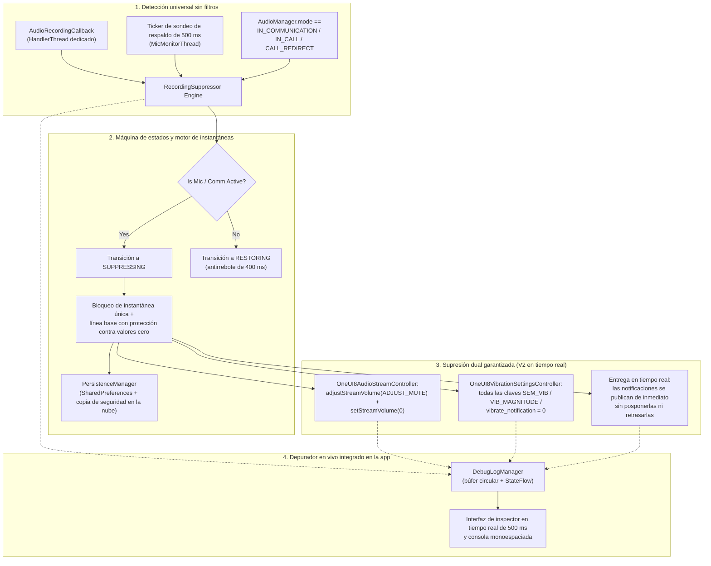

<p align="center">
  <a href="../../README.md">English</a> ·
  <a href="README.ar.md">العربية</a> ·
  <b>Español</b> ·
  <a href="README.fr.md">Français</a> ·
  <a href="README.de.md">Deutsch</a> ·
  <a href="README.ru.md">Русский</a> ·
  <a href="README.pt-BR.md">Português (Brasil)</a> ·
  <a href="README.tr.md">Türkçe</a> ·
  <a href="README.ko.md">한국어</a> ·
  <a href="README.ja.md">日本語</a> ·
  <a href="README.zh-CN.md">简体中文</a>
</p>

# Samsung Mic Mute App (v3.0)

<p align="center">
  
  
  
  
  
  
</p>

> **Una utilidad especializada de Android para dispositivos Samsung Galaxy que suprime automáticamente los sonidos y las vibraciones de las notificaciones durante el uso activo del micrófono sin requerir el permiso `RECORD_AUDIO`. En V3 se incluyen compatibilidad completa con varios idiomas (11 idiomas), un selector de idioma instantáneo dentro de la app y una hoja segura de donaciones de PayPal integrada en la app.**

> [!WARNING]
> **⚠️ Nota importante:** Esta herramienta silencia los sonidos y las vibraciones de las notificaciones a nivel del sistema. Sin embargo, no puede bloquear las vibraciones personalizadas dentro de las apps (p. ej., los ajustes de vibración personalizados de WhatsApp, Telegram, etc.). Debes desactivar manualmente las vibraciones dentro de esas apps concretas para lograr una experiencia completamente silenciosa.

---

## 📌 Descripción general del problema

Cuando grabas audio o participas en llamadas de voz o vídeo en dispositivos Samsung Galaxy (p. ej., notas de voz de WhatsApp, Snapchat, historias/reels de Instagram, Grabadora de voz, grabación de vídeo 4K con la Cámara, llamadas telefónicas), las notificaciones entrantes producen ráfagas de sonido fuertes y zumbidos táctiles de vibración que se filtran en el audio grabado e interrumpen la comunicación.

Los modos estándar de No molestar (DND) son engorrosos de activar manualmente, y los métodos estándar de flujo de audio de Android no consiguen silenciar los motores de vibración propietarios de Samsung.

**Samsung Mic Mute App (V3)** lo resuelve por completo en segundo plano: detecta automáticamente la activación del micrófono en cualquier parte del sistema, silencia de inmediato el volumen de las notificaciones y la intensidad de vibración de Samsung hasta cero, y los restaura al instante a su línea base exacta en el momento en que termina la grabación. Todas las notificaciones siguen llegando y mostrándose en tu pantalla en tiempo real, sin posponerse, retrasarse ni acumularse después.

---

## 🚀 Características y aspectos destacados

- **🔒 Cero permiso `RECORD_AUDIO` (100 % privado y seguro):**
  Utiliza `AudioManager.AudioRecordingCallback` a nivel de sistema de Android (introducido en la API 30+). La app **nunca** graba, escucha ni procesa el audio del micrófono. Solo supervisa si otra aplicación ha abierto un flujo de grabación.
- **🌐 11 idiomas globales y selector instantáneo (V3):**
  Totalmente traducida a 11 idiomas: árabe (العربية), inglés, español (Español), francés (Français), alemán (Deutsch), ruso (Русский), portugués (Português), turco (Türkçe), coreano (한국어), japonés (日本語) y chino simplificado (简体中文). Incluye un selector de idioma dentro de la app (🌐) y la integración con el ajuste de Idioma por aplicación de Android 13+.
- **💳 Hoja segura de soporte con PayPal integrada en la app (V3):**
  Permite el soporte directo mediante el SDK oficial Hosted Buttons de PayPal dentro de un BottomSheet modal nativo, sin salir nunca a un navegador externo.
- **🛡️ Sin tipo de micrófono invasivo en primer plano:**
  Evita las restricciones de seguridad en tiempo de ejecución de Android 14–16 combinando un servicio en primer plano `FOREGROUND_SERVICE_SPECIAL_USE` (propiedad `audio_recording_detection`) con un `NotificationListenerService` persistente.
- **⚡ Motor de detección universal sin filtros:**
  Se activa con **cualquier** uso del micrófono en cualquier aplicación, sin depender de nombres de paquetes ocultos o censurados (Android 10+ oculta `clientPackageName` para las apps sin privilegios).
- **🔄 Ticker de respaldo para VoIP y modo de comunicación:**
  Incluye un ticker activo de 500 ms en un hilo dedicado de prioridad urgente (`THREAD_PRIORITY_URGENT_AUDIO`) que comprueba las llamadas VoIP (`MODE_IN_COMMUNICATION`, `MODE_IN_CALL`, `MODE_CALL_REDIRECT`) para eliminar la latencia de las devoluciones de llamada en WhatsApp, Instagram y Telegram.
- **🎯 Silenciado dual del sonido Samsung y de la vibración multillave:**
  - **Audio:** Ejecuta tanto `adjustStreamVolume(ADJUST_MUTE)` como `setStreamVolume(STREAM_NOTIFICATION, 0)`.
  - **Vibración Samsung:** Consulta, guarda una instantánea y establece todas las claves de vibración de One UI en `0`:
    - `SEM_VIBRATION_NOTIFICATION_INTENSITY` & `sem_vibration_notification_intensity`
    - `VIB_NOTIFICATION_MAGNITUDE` & `vib_notification_magnitude`
    - `vibrate_notification`
    - `notification_vibration_intensity`
    - `vibrate_on` (respaldo)
- **📬 Entrega silenciosa en tiempo real:**
  Garantiza que todas las notificaciones lleguen y se muestren en pantalla inmediatamente en tiempo real, completamente silenciadas en el audio del sistema y a nivel del controlador de vibración.
- **🧠 Bloqueo de instantánea única y protección contra valores cero:**
  Guarda una instantánea de los niveles de volumen y vibración del sistema estrictamente una vez en la transición de `IDLE` → `SUPPRESSING`. Las activaciones posteriores nunca sobrescriben el volumen normal del usuario con `0`. Si los valores se leen como `0` en el momento de la instantánea, la protección Non-Zero Guard restaura una línea base persistida saludable.
- **⏱️ Antirrebote de 400 ms contra fallos:**
  Retrasa la restauración 400 ms cuando se detienen los flujos de micrófono, lo que evita fallos rápidos de audio al encenderse y apagarse durante notas de voz sucesivas.
- **📊 Depurador en vivo y consola de diagnóstico integrados en la app:**
  Incluye un panel de inspección en tiempo real que sondea cada 500 ms directamente en el panel principal:
  - Recuento de configuraciones de micrófono activas, ID de sesión de audio y tipos de origen.
  - Valor actual de `AudioManager.mode`.
  - Volumen en vivo y estado de silencio de `STREAM_NOTIFICATION`.
  - Valores enteros en vivo de todas las claves de vibración de Samsung directamente desde `Settings.System`.
  - Consola de registro de eventos desplazable en monoespaciado con copia al portapapeles en un toque y volcado de claves de vibración.
- **💾 Recuperación ante fallos y reinicios:**
  Restaura automáticamente los ajustes de línea base en caché tras los reinicios del dispositivo mediante `BootRecoveryReceiver` y `PersistenceManager` sincronizado en la nube.
  Retrasa la restauración 400 ms cuando se detienen los flujos de micrófono, lo que evita fallos rápidos de audio al encenderse y apagarse durante notas de voz sucesivas.
- **📊 Depurador en vivo y consola de diagnóstico integrados en la app:**
  Incluye un panel de inspección en tiempo real que sondea cada 500 ms directamente en el panel principal:
  - Recuento de configuraciones de micrófono activas, ID de sesión de audio y tipos de origen.
  - Valor actual de `AudioManager.mode`.
  - Volumen en vivo y estado de silencio de `STREAM_NOTIFICATION`.
  - Valores enteros en vivo de todas las claves de vibración de Samsung directamente desde `Settings.System`.
  - Consola de registro de eventos desplazable en monoespaciado con copia al portapapeles en un toque y volcado de claves de vibración.
- **💾 Recuperación ante fallos y reinicios:**
  Restaura automáticamente los ajustes de línea base en caché tras los reinicios del dispositivo mediante `BootRecoveryReceiver` y `PersistenceManager` sincronizado en la nube.

---

## 📱 Dispositivos compatibles y requisitos del sistema

| Componente | Requisito |
| :--- | :--- |
| **SO objetivo** | Android 11, 12, 13, 14, 15, 16 (API 30 a 36) |
| **Plataformas probadas** | **Samsung One UI 6, One UI 7, One UI 8, One UI 9** |
| **Hardware compatible** | Samsung Galaxy Serie S (S20 – S25 Ultra)<br/>Samsung Galaxy Serie Z (Fold y Flip)<br/>Samsung Galaxy Serie Note<br/>Samsung Galaxy Serie A / Serie M / Tab |
| **Dispositivos que no son Samsung** | Compatible con el silenciado estándar de los sonidos de notificación de Android; las claves de vibración específicas de Samsung recurren correctamente a `NotificationListenerService`. |

---

## 🏗️ Arquitectura y pila técnica



### Pila modular de controladores

- **`RecordingSuppressor`:** Orquestador de estados seguro para hilos (`IDLE` ↔ `SUPPRESSING` ↔ `RESTORING`).
- **`AudioStreamController`:** Interfaz de silenciado de audio conectable:
  - `OneUI8AudioStreamController` (Principal: silenciado dual de `STREAM_NOTIFICATION`).
  - `NotificationChannelAudioController` (Respaldo: supresión del sonido de canales de notificación individuales).
- **`VibrationSettingsController`:** Interfaz de silenciado de vibración conectable:
  - `OneUI8VibrationSettingsController` (Principal: silenciado multillave de los ajustes del sistema de Samsung).
  - `NotificationListenerVibrationController` (Respaldo: cancelación del patrón de vibración a nivel de notificación).
  - `AdbSecureSettingsVibrationController` (Respaldo para desarrollo / empresas).
- **`SuppressionForegroundService`:** Servicio en primer plano persistente con notificación de supervisión permanente.
- **`SuppressionNotificationListener`:** Host con prioridad del sistema que garantiza que la supervisión continua sobreviva a la finalización agresiva de tareas por parte del sistema operativo.

---

## 🛠️ Guía de instalación y configuración

### Paso 1: Instalar el APK
Descarga `SamsungMicMute_V2.apk` desde la sección [Releases](https://github.com/m4wan1/SamsungMicMuteApp/releases) o compila el APK localmente a partir del código fuente:

```bash
git clone https://github.com/m4wan1/SamsungMicMuteApp.git
cd SamsungMicMuteApp
./gradlew assembleDebug
```
El APK compilado se encontrará en:
`app/build/outputs/apk/debug/app-debug.apk`

---

### Paso 2: Conceder permisos
Inicia la app. Tres tarjetas de configuración claras te guiarán para conceder los permisos necesarios:

1. **Escribir ajustes del sistema (`WRITE_SETTINGS`):**
   - Toca **Conceder** en la tarjeta 3.
   - Activa **Permitir modificar los ajustes del sistema** para *Samsung Mic Mute*.
   - *Propósito:* Permite a la app establecer la intensidad de vibración y el volumen de Samsung en `Settings.System`.
2. **Acceso al servicio de escucha de notificaciones:**
   - Toca **Conceder** en la tarjeta 3.
   - Activa **Notification Vibration Suppressor** en los ajustes del dispositivo.
   - *Propósito:* Proporciona supervisión en segundo plano persistente con prioridad del sistema y control de vibración de respaldo.
3. **Ignorar la optimización de batería (sin restricciones):**
   - Toca **Conceder** en la tarjeta 3.
   - Selecciona **Permitir** (Sin restricciones).
   - *Propósito:* Evita que Samsung One UI congele o retrase los hilos de devolución de llamada de audio en segundo plano cuando la app está minimizada.

#### Configuración alternativa mediante ADB (configuración rápida para desarrolladores):
```bash
# Grant Write System Settings
adb shell appops set com.example.suppressor.debug WRITE_SETTINGS allow

# Grant Notification Listener Access
adb shell cmd notification set_listeners com.example.suppressor.debug/com.example.suppressor.service.SuppressionNotificationListener

# Whitelist from Battery Optimization
adb shell dumpsys deviceidle whitelist +com.example.suppressor.debug
```

---

## 🧪 Uso y pruebas

### Cómo verificar la supresión:
1. Abre **Samsung Mic Mute** y verifica que las tres insignias de permisos de la tarjeta 3 muestren **Concedido** / **Sin restricciones**.
2. Mantén la app abierta o minimízala.
3. Abre **WhatsApp** (o **Grabadora de voz**, **Snapchat**, o el modo de vídeo de **Cámara**).
4. Mantén pulsado el botón del micrófono para grabar una nota de voz.
5. Mientras mantienes pulsado el micrófono, observa la app:
   - La **insignia de estado** cambia al instante a: `ACTIVE - Mic in Use (Muted)`.
   - **Volumen / vibración guardados** muestra: `Saved Volume: 10 / 15 | Current: 0 (Muted)`.
6. Pide a un amigo que te envíe un mensaje de notificación (o envía un correo electrónico o una notificación desde otro dispositivo).
7. **Observa:** La notificación llega en silencio con **cero sonido** y **cero vibración**.
8. Suelta el botón del micrófono.
9. Tras un suave antirrebote de 400 ms, el volumen y la vibración vuelven automáticamente a tus ajustes originales exactos.

### Uso del depurador en vivo integrado en la app:
Desplázate hasta la **tarjeta 5 (LIVE IN-APP DEBUGGER)** en la parte inferior de la pantalla:
- **Inspector en vivo:** Muestra el recuento de configuraciones de micrófono en tiempo real, `AudioManager.mode`, el estado de silencio del flujo y los valores enteros exactos de las claves de vibración de Samsung.
- **Copiar registros:** Copia el volcado de diagnóstico completo y las claves de ajustes de Samsung al portapapeles.
- **Dump Vib Keys:** Analiza todos los ajustes de `Settings.System` que coinciden con `vib` o `noti` e imprime sus valores.

---

## 🔒 Restricciones básicas y garantías de seguridad

| Restricción / Garantía | Especificación y aplicación en V2 |
| :--- | :--- |
| **Entrega silenciosa de notificaciones en tiempo real** | **Cero retraso / sin posposición:** Las notificaciones DEBEN llegar y mostrarse en pantalla inmediatamente en tiempo real. La app evita estrictamente `snoozeNotification()`, `cancelNotification()` o `cancelAllNotifications()`, lo que impide avalanchas de notificaciones al soltar el micrófono. El silencio completo depende exclusivamente de los controladores de prioridad 1 (`OneUI8AudioStreamController` estableciendo `STREAM_NOTIFICATION` en 0, y `OneUI8VibrationSettingsController` estableciendo `sem_vibration_notification_intensity` en 0). |
| **Sin escuchas del micrófono** | `<uses-permission android:name="android.permission.RECORD_AUDIO" tools:node="remove" />` está aplicado en `AndroidManifest.xml`. El sistema operativo Android impide físicamente que esta app capture audio. |
| **Sin interferencia con No molestar** | No altera `NotificationManager.setInterruptionFilter()` de Android. Tus programaciones de DND y las excepciones de contactos marcados como favoritos permanecen intactas. |
| **Sin modo silencioso global** | No establece `RINGER_MODE_SILENT`. Las llamadas telefónicas entrantes y las alarmas suenan a volumen normal completo. |
| **Procesamiento solo local** | No contiene analíticas, ni solicitudes de red, ni seguimiento remoto. |

### ⚠️ Aviso sobre las vibraciones personalizadas dentro de las apps
> **Nota importante:** Esta herramienta silencia los sonidos y las vibraciones de las notificaciones a nivel del sistema. Sin embargo, no puede bloquear las vibraciones personalizadas dentro de las apps (p. ej., los ajustes de vibración personalizados de WhatsApp, Telegram, etc.). Debes desactivar manualmente las vibraciones dentro de esas apps concretas para lograr una experiencia completamente silenciosa.

---

## 📄 Licencia y términos

Distribuido bajo la **Licencia MIT**.

```
MIT License

Copyright (c) 2026 Marw (m4wan1)

Permission is hereby granted, free of charge, to any person obtaining a copy
of this software and associated documentation files (the "Software"), to deal
in the Software without restriction, including without limitation the rights
to use, copy, modify, merge, publish, distribute, sublicense, and/or sell
copies of the Software, and to permit persons to whom the Software is
furnished to do so, subject to the following conditions:

The above copyright notice and this permission notice shall be included in all
copies or substantial portions of the Software.

THE SOFTWARE IS PROVIDED "AS IS", WITHOUT WARRANTY OF ANY KIND, EXPRESS OR
IMPLIED, INCLUDING BUT NOT LIMITED TO THE WARRANTIES OF MERCHANTABILITY,
FITNESS FOR A PARTICULAR PURPOSE AND NONINFRINGEMENT. IN NO EVENT SHALL THE
AUTHORS OR COPYRIGHT HOLDERS BE LIABLE FOR ANY CLAIM, DAMAGES OR OTHER
LIABILITY, WHETHER IN AN ACTION OF CONTRACT, TORT OR OTHERWISE, ARISING FROM,
OUT OF OR IN CONNECTION WITH THE SOFTWARE OR THE USE OR OTHER DEALINGS IN THE
SOFTWARE.
```

*Aviso legal: Este proyecto es una utilidad independiente de código abierto diseñada para la privacidad y la comodidad del usuario. No está afiliado ni respaldado por Samsung Electronics Co., Ltd.*
