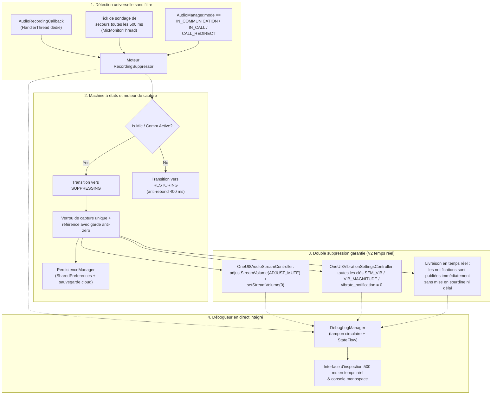

<p align="center">
  <a href="../../README.md">English</a> ·
  <a href="README.ar.md">العربية</a> ·
  <a href="README.es.md">Español</a> ·
  <b>Français</b> ·
  <a href="README.de.md">Deutsch</a> ·
  <a href="README.ru.md">Русский</a> ·
  <a href="README.pt-BR.md">Português (Brasil)</a> ·
  <a href="README.tr.md">Türkçe</a> ·
  <a href="README.ko.md">한국어</a> ·
  <a href="README.ja.md">日本語</a> ·
  <a href="README.zh-CN.md">简体中文</a>
</p>

# Samsung Mic Mute App (v3.0)

<p align="center">
  
  
  
  
  
  
</p>

> **Un utilitaire Android spécialisé pour les appareils Samsung Galaxy qui supprime automatiquement les sons et vibrations de notification pendant l'utilisation active du microphone, sans nécessiter la permission `RECORD_AUDIO`. La V3 inclut la prise en charge complète de plusieurs langues (11 langues), un sélecteur de langue instantané dans l'application et une feuille de don PayPal sécurisée intégrée à l'application.**

> [!WARNING]
> **⚠️ Remarque importante :** Cet outil coupe les sons et les vibrations de notification au niveau système. Il ne peut toutefois pas bloquer les vibrations personnalisées internes aux applications (par exemple, les réglages de vibration personnalisés dans WhatsApp, Telegram, etc.). Vous devez désactiver manuellement les vibrations dans ces applications spécifiques pour une expérience totalement silencieuse.

---

## 📌 Aperçu du problème

Lors d'un enregistrement audio ou d'un appel vocal/vidéo sur un appareil Samsung Galaxy (par exemple, notes vocales WhatsApp, Snapchat, stories/reels Instagram, Enregistreur vocal, enregistrement vidéo 4K avec l'appareil photo, appels téléphoniques), les notifications entrantes produisent de fortes salves sonores et des vibrations tactiles qui s'infiltrent dans l'audio enregistré et interrompent la communication.

Les modes Ne pas déranger (NPD) standard sont fastidieux à activer manuellement, et les méthodes standard de flux audio d'Android ne parviennent pas à faire taire les moteurs de vibration propriétaires de Samsung.

**Samsung Mic Mute App (V3)** résout entièrement ce problème en arrière-plan : elle détecte automatiquement l'activation du microphone n'importe où dans le système, coupe immédiatement le volume des notifications et l'intensité de vibration Samsung à zéro, puis les restaure instantanément à leur valeur de référence exacte dès la fin de l'enregistrement. Toutes les notifications continuent d'arriver et de s'afficher à l'écran en temps réel sans être mises en sourdine, retardées ou déversées plus tard.

---

## 🚀 Fonctionnalités clés et points forts

- **🔒 Aucune permission `RECORD_AUDIO` (100 % privé et sûr) :**
  Utilise l'API système Android `AudioManager.AudioRecordingCallback` (introduite dans l'API 30+). L'application **n'enregistre jamais**, n'écoute jamais et ne traite jamais l'audio du microphone. Elle surveille uniquement si une autre application a ouvert un flux d'enregistrement.
- **🌐 11 langues mondiales et sélecteur instantané (V3) :**
  Entièrement traduite en 11 langues : arabe (العربية), anglais, espagnol (Español), français (Français), allemand (Deutsch), russe (Русский), portugais (Português), turc (Türkçe), coréen (한국어), japonais (日本語) et chinois simplifié (简体中文). Comprend un sélecteur de langue intégré (🌐) et l'intégration du réglage de langue par application d'Android 13+.
- **💳 Feuille de soutien PayPal sécurisée intégrée (V3) :**
  Permet un soutien direct via le SDK officiel Hosted Buttons de PayPal dans une BottomSheet modale native, sans jamais quitter l'application vers un navigateur externe.
- **🛡️ Aucun type de microphone au premier plan intrusif :**
  Évite les restrictions de sécurité d'exécution d'Android 14–16 en combinant un service de premier plan `FOREGROUND_SERVICE_SPECIAL_USE` (propriété `audio_recording_detection`) avec un `NotificationListenerService` persistant.
- **⚡ Moteur de détection universel sans filtre :**
  Se déclenche sur **toute** utilisation du microphone dans n'importe quelle application, sans dépendre de noms de paquets masqués ou expurgés (Android 10+ masque `clientPackageName` pour les applications non privilégiées).
- **🔄 Tick de secours VoIP et mode communication :**
  Inclut un tick actif de 500 ms sur un thread dédié à priorité urgente (`THREAD_PRIORITY_URGENT_AUDIO`) qui vérifie les appels VoIP (`MODE_IN_COMMUNICATION`, `MODE_IN_CALL`, `MODE_CALL_REDIRECT`) afin d'éliminer la latence de rappel sur WhatsApp, Instagram et Telegram.
- **🎯 Double coupure Samsung : son et vibration multi-clés :**
  - **Audio :** Exécute à la fois `adjustStreamVolume(ADJUST_MUTE)` et `setStreamVolume(STREAM_NOTIFICATION, 0)`.
  - **Vibration Samsung :** Interroge, capture et met à `0` toutes les clés de vibration One UI :
    - `SEM_VIBRATION_NOTIFICATION_INTENSITY` & `sem_vibration_notification_intensity`
    - `VIB_NOTIFICATION_MAGNITUDE` & `vib_notification_magnitude`
    - `vibrate_notification`
    - `notification_vibration_intensity`
    - `vibrate_on` (secours)
- **📬 Livraison silencieuse en temps réel :**
  Garantit que toutes les notifications arrivent et s'affichent à l'écran immédiatement en temps réel, totalement silencieuses au niveau du pilote audio et de vibration du système.
- **🧠 Verrou de capture unique et garde anti-zéro :**
  Capture les niveaux de volume et de vibration du système une seule fois, strictement lors de la transition de `IDLE` → `SUPPRESSING`. Les déclenchements suivants n'écrasent jamais le volume normal de l'utilisateur avec `0`. Si les valeurs lues valent `0` au moment de la capture, la garde anti-zéro restaure une valeur de référence persistée saine.
- **⏱️ Anti-rebond de 400 ms contre les scintillements :**
  Retarde la restauration de 400 ms lorsque les flux du microphone s'arrêtent, évitant les coupures audio on/off rapides lors de notes vocales successives.
- **📊 Débogueur et console de diagnostic en direct intégrés :**
  Comprend un panneau d'inspection en temps réel interrogeant toutes les 500 ms directement sur le tableau de bord :
  - Nombre de configurations de microphone actives, ID de session audio et types de source.
  - `AudioManager.mode` actuel.
  - Volume et état de sourdine en direct de `STREAM_NOTIFICATION`.
  - Valeurs entières en direct de toutes les clés de vibration Samsung directement depuis `Settings.System`.
  - Console de journal d'événements défilante en police monospace avec copie dans le presse-papiers en un geste et export des clés de vibration.
- **💾 Récupération après plantage et redémarrage :**
  Restaure automatiquement les paramètres de référence mis en cache après le redémarrage de l'appareil via `BootRecoveryReceiver` et `PersistenceManager` synchronisé dans le cloud.
  Retarde la restauration de 400 ms lorsque les flux du microphone s'arrêtent, évitant les coupures audio on/off rapides lors de notes vocales successives.
- **📊 Débogueur et console de diagnostic en direct intégrés :**
  Comprend un panneau d'inspection en temps réel interrogeant toutes les 500 ms directement sur le tableau de bord :
  - Nombre de configurations de microphone actives, ID de session audio et types de source.
  - `AudioManager.mode` actuel.
  - Volume et état de sourdine en direct de `STREAM_NOTIFICATION`.
  - Valeurs entières en direct de toutes les clés de vibration Samsung directement depuis `Settings.System`.
  - Console de journal d'événements défilante en police monospace avec copie dans le presse-papiers en un geste et export des clés de vibration.
- **💾 Récupération après plantage et redémarrage :**
  Restaure automatiquement les paramètres de référence mis en cache après le redémarrage de l'appareil via `BootRecoveryReceiver` et `PersistenceManager` synchronisé dans le cloud.

---

## 📱 Appareils compatibles et exigences du système

| Composant | Exigence |
| :--- | :--- |
| **Système cible** | Android 11, 12, 13, 14, 15, 16 (API 30 à 36) |
| **Plateformes testées** | **Samsung One UI 6, One UI 7, One UI 8, One UI 9** |
| **Matériel pris en charge** | Samsung Galaxy S-Series (S20 – S25 Ultra)<br/>Samsung Galaxy Z-Series (Fold & Flip)<br/>Samsung Galaxy Note-Series<br/>Samsung Galaxy A-Series / M-Series / Tab |
| **Appareils non Samsung** | Compatible avec la mise en sourdine standard des sons de notification Android ; les clés de vibration spécifiques à Samsung reviennent gracieusement à `NotificationListenerService`. |

---

## 🏗️ Architecture et pile technique



### Pile de contrôleurs modulaire

- **`RecordingSuppressor` :** Orchestrateur d'état thread-safe (`IDLE` ↔ `SUPPRESSING` ↔ `RESTORING`).
- **`AudioStreamController` :** Interface enfichable de mise en sourdine audio :
  - `OneUI8AudioStreamController` (Principal : double mise en sourdine de `STREAM_NOTIFICATION`).
  - `NotificationChannelAudioController` (Secours : suppression du son par canal de notification individuel).
- **`VibrationSettingsController` :** Interface enfichable de mise en sourdine des vibrations :
  - `OneUI8VibrationSettingsController` (Principal : mise en sourdine multi-clés des paramètres système Samsung).
  - `NotificationListenerVibrationController` (Secours : annulation des motifs de vibration au niveau des notifications).
  - `AdbSecureSettingsVibrationController` (Secours développement / entreprise).
- **`SuppressionForegroundService` :** Service de premier plan persistant avec notification de surveillance permanente.
- **`SuppressionNotificationListener` :** Hôte à priorité système garantissant une surveillance continue qui survit à la destruction agressive des tâches par l'OS.

---

## 🛠️ Guide d'installation et de configuration

### Étape 1 : Installer l'APK
Téléchargez `SamsungMicMute_V2.apk` depuis la section [Releases](https://github.com/m4wan1/SamsungMicMuteApp/releases), ou compilez l'APK localement depuis les sources :

```bash
git clone https://github.com/m4wan1/SamsungMicMuteApp.git
cd SamsungMicMuteApp
./gradlew assembleDebug
```
L'APK compilé se trouvera à l'emplacement :
`app/build/outputs/apk/debug/app-debug.apk`

---

### Étape 2 : Accorder les permissions
Lancez l'application. Trois cartes de configuration claires vous guideront pour accorder les permissions requises :

1. **Écrire les paramètres système (`WRITE_SETTINGS`) :**
   - Appuyez sur **Autoriser** sur la Carte 3.
   - Activez **Autoriser la modification des paramètres système** pour *Samsung Mic Mute*.
   - *Objectif :* Permet à l'application de définir l'intensité de vibration et le volume Samsung dans `Settings.System`.
2. **Accès au service d'écoute des notifications :**
   - Appuyez sur **Autoriser** sur la Carte 3.
   - Activez **Notification Vibration Suppressor** dans les paramètres de l'appareil.
   - *Objectif :* Fournit une surveillance persistante en arrière-plan à priorité système et un contrôle de secours des vibrations.
3. **Ignorer l'optimisation de la batterie (Sans restriction) :**
   - Appuyez sur **Autoriser** sur la Carte 3.
   - Sélectionnez **Autoriser** (Sans restriction).
   - *Objectif :* Empêche Samsung One UI de geler ou de retarder les threads de rappel audio en arrière-plan lorsque l'application est réduite.

#### Configuration alternative via ADB (installation rapide pour les développeurs) :
```bash
# Accorder l'écriture des paramètres système
adb shell appops set com.example.suppressor.debug WRITE_SETTINGS allow

# Accorder l'accès au service d'écoute des notifications
adb shell cmd notification set_listeners com.example.suppressor.debug/com.example.suppressor.service.SuppressionNotificationListener

# Ajouter à la liste blanche de l'optimisation de la batterie
adb shell dumpsys deviceidle whitelist +com.example.suppressor.debug
```

---

## 🧪 Utilisation et tests

### Comment vérifier la suppression :
1. Ouvrez **Samsung Mic Mute** et vérifiez que les trois badges de permission de la Carte 3 affichent **Accordée** / **Sans restriction**.
2. Laissez l'application ouverte ou réduisez-la.
3. Ouvrez **WhatsApp** (ou **Enregistreur vocal**, **Snapchat**, ou le mode vidéo de **l'appareil photo**).
4. Maintenez le bouton du microphone pour enregistrer une note vocale.
5. Tout en maintenant le microphone, regardez l'application :
   - Le **badge d'état** passe instantanément à : `ACTIVE - Mic in Use (Muted)`.
   - **Volume / vibration enregistrés** affiche : `Saved Volume: 10 / 15 | Current: 0 (Muted)`.
6. Demandez à un ami de vous envoyer un message de notification (ou envoyez un e-mail/une notification depuis un autre appareil).
7. **Observez :** La notification arrive silencieusement avec **zéro son** et **zéro vibration**.
8. Relâchez le bouton du microphone.
9. Après un anti-rebond fluide de 400 ms, le volume et la vibration reviennent automatiquement à vos réglages d'origine exacts.

### Utiliser le débogueur en direct intégré :
Faites défiler jusqu'à **Carte 5 (DÉBOGUEUR EN DIRECT INTÉGRÉ)** en bas de l'écran :
- **Inspecteur en direct :** Affiche en temps réel le nombre de configurations micro, `AudioManager.mode`, l'état de sourdine du flux et les valeurs entières exactes des clés de vibration Samsung.
- **Copier les journaux :** Copie le vidage de diagnostic complet et les clés de paramètres Samsung dans votre presse-papiers.
- **Exporter les clés de vibration :** Analyse tous les paramètres de `Settings.System` correspondant à `vib` ou `noti` et affiche leurs valeurs.

---

## 🔒 Contraintes fondamentales et garanties de sécurité

| Contrainte / Garantie | Spécification et application en V2 |
| :--- | :--- |
| **Livraison silencieuse des notifications en temps réel** | **Zéro délai / aucune mise en sourdine :** Les notifications DOIVENT arriver et s'afficher à l'écran immédiatement en temps réel. L'application évite strictement `snoozeNotification()`, `cancelNotification()` ou `cancelAllNotifications()`, ce qui empêche les rafales de notifications lorsque le microphone est relâché. Le silence complet repose exclusivement sur les contrôleurs de priorité 1 (`OneUI8AudioStreamController` fixant `STREAM_NOTIFICATION` à 0, et `OneUI8VibrationSettingsController` fixant `sem_vibration_notification_intensity` à 0). |
| **Aucune écoute du microphone** | `<uses-permission android:name="android.permission.RECORD_AUDIO" tools:node="remove" />` est imposé dans `AndroidManifest.xml`. Le système Android empêche physiquement cette application de capturer de l'audio. |
| **Aucune interférence avec Ne pas déranger** | Ne modifie pas `NotificationManager.setInterruptionFilter()` d'Android. Vos programmations NPD et exceptions de contacts favoris restent intactes. |
| **Aucun mode silencieux global** | Ne définit pas `RINGER_MODE_SILENT`. Les appels téléphoniques entrants et les alarmes sonnent à plein volume normal. |
| **Traitement local uniquement** | Ne contient aucune analytique, aucune requête réseau et aucun suivi à distance. |

### ⚠️ Avertissement sur les vibrations personnalisées dans les applications
> **Remarque importante :** Cet outil coupe les sons et les vibrations de notification au niveau système. Il ne peut toutefois pas bloquer les vibrations personnalisées internes aux applications (par exemple, les réglages de vibration personnalisés dans WhatsApp, Telegram, etc.). Vous devez désactiver manuellement les vibrations dans ces applications spécifiques pour une expérience totalement silencieuse.

---

## 📄 Licence et conditions

Distribué sous la **licence MIT**.

```
MIT License

Copyright (c) 2026 Marw (m4wan1)

Permission is hereby granted, free of charge, to any person obtaining a copy
of this software and associated documentation files (the "Software"), to deal
in the Software without restriction, including without limitation the rights
to use, copy, modify, merge, publish, distribute, sublicense, and/or sell
copies of the Software, and to permit persons to whom the Software is
furnished to do so, subject to the following conditions:

The above copyright notice and this permission notice shall be included in all
copies or substantial portions of the Software.

THE SOFTWARE IS PROVIDED "AS IS", WITHOUT WARRANTY OF ANY KIND, EXPRESS OR
IMPLIED, INCLUDING BUT NOT LIMITED TO THE WARRANTIES OF MERCHANTABILITY,
FITNESS FOR A PARTICULAR PURPOSE AND NONINFRINGEMENT. IN NO EVENT SHALL THE
AUTHORS OR COPYRIGHT HOLDERS BE LIABLE FOR ANY CLAIM, DAMAGES OR OTHER
LIABILITY, WHETHER IN AN ACTION OF CONTRACT, TORT OR OTHERWISE, ARISING FROM,
OUT OF OR IN CONNECTION WITH THE SOFTWARE OR THE USE OR OTHER DEALINGS IN THE
SOFTWARE.
```

*Avertissement : Ce projet est un utilitaire open source indépendant conçu pour la confidentialité et le confort de l'utilisateur. Il n'est ni affilié ni approuvé par Samsung Electronics Co., Ltd.*
