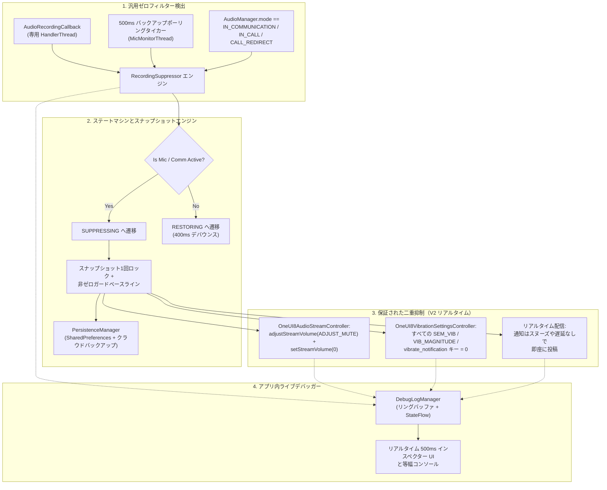

<p align="center">
  <a href="../../README.md">English</a> ·
  <a href="README.ar.md">العربية</a> ·
  <a href="README.es.md">Español</a> ·
  <a href="README.fr.md">Français</a> ·
  <a href="README.de.md">Deutsch</a> ·
  <a href="README.ru.md">Русский</a> ·
  <a href="README.pt-BR.md">Português (Brasil)</a> ·
  <a href="README.tr.md">Türkçe</a> ·
  <a href="README.ko.md">한국어</a> ·
  <b>日本語</b> ·
  <a href="README.zh-CN.md">简体中文</a>
</p>

# Samsung Mic Mute App (v3.0)

<p align="center">
  
  
  
  
  
  
</p>

> **Samsung Galaxy デバイス向けの専用 Android ユーティリティです。`RECORD_AUDIO` 権限を必要とせず、マイク使用中は通知音と振動を自動的に抑制します。V3 では、11 言語の完全な多言語対応、アプリ内での即時言語切り替え、安全なアプリ内 PayPal 寄付シートを搭載しています。**

> [!WARNING]
> **⚠️ 重要なお知らせ:** 本ツールはシステムレベルの通知音と振動をミュートします。ただし、アプリ内の独自振動（WhatsApp、Telegram など内部のカスタム振動設定）はブロックできません。完全な無音を実現するには、該当するアプリ内で振動を手動で無効にしてください。

---

## 📌 問題の概要

Samsung Galaxy デバイスで音声を録音したり、音声／ビデオ通話に参加したりする場面（WhatsApp のボイスメモ、Snapchat、Instagram のストーリー／リール、ボイスレコーダー、カメラの 4K 動画撮影、電話など）では、着信通知によって大きな通知音や触覚振動が発生し、録音中の音声に混入したり通話を妨げたりします。

標準の Do-Not-Disturb（DND）モードは手動での切り替えが煩わしく、標準的な Android のオーディオストリーム方式では Samsung 独自の振動エンジンを無音にできません。

**Samsung Mic Mute App (V3)** はこれをバックグラウンドで完全に解決します。システム内のどこかでマイクがアクティブになったことを自動で検出し、通知音量と Samsung の振動強度を直ちにゼロにし、録音が終了した瞬間に元のベースラインへ正確に復元します。通知はすべてリアルタイムで画面に届いて表示され、スヌーズ・遅延・後からの一括通知は発生しません。

---

## 🚀 主な機能とハイライト

- **🔒 `RECORD_AUDIO` 権限ゼロ（100% プライベートで安全）:**
  Android のシステムレベル API `AudioManager.AudioRecordingCallback`（API 30 以降で導入）を使用します。本アプリはマイク音声を**決して**録音・聴取・処理しません。他のアプリが録音ストリームを開いたかどうかのみを監視します。
- **🌐 11 言語対応と即時切り替え（V3）:**
  アラビア語（العربية）、英語、スペイン語（Español）、フランス語（Français）、ドイツ語（Deutsch）、ロシア語（Русский）、ポルトガル語（Português）、トルコ語（Türkçe）、韓国語（한국어）、日本語（日本語）、簡体字中国語（简体中文）の 11 言語に完全対応しています。アプリ内言語ピッカー（🌐）と Android 13 以降のアプリ別言語設定への統合を備えています。
- **💳 安全なアプリ内 PayPal サポートシート（V3）:**
  PayPal 公式の Hosted Buttons SDK をネイティブのモーダル BottomSheet 内で利用し、外部ブラウザへ遷移することなく直接サポートできます。
- **🛡️ 侵襲的なフォアグラウンドマイクタイプを使用しない:**
  `FOREGROUND_SERVICE_SPECIAL_USE` フォアグラウンドサービス（`audio_recording_detection` プロパティ）と常駐の `NotificationListenerService` を組み合わせることで、Android 14〜16 の実行時セキュリティ制限を回避します。
- **⚡ 汎用ゼロフィルター検出エンジン:**
  非表示または秘匿されたパッケージ名に依存せず、あらゆるアプリの**あらゆる**マイク使用でトリガーします（Android 10 以降、非特権アプリでは `clientPackageName` が隠蔽されます）。
- **🔄 VoIP と通信モードのバックアップタイカー:**
  専用の緊急優先度スレッド（`THREAD_PRIORITY_URGENT_AUDIO`）上で 500ms のアクティブなタイカーを実行し、VoIP 通話（`MODE_IN_COMMUNICATION`、`MODE_IN_CALL`、`MODE_CALL_REDIRECT`）を監視して、WhatsApp、Instagram、Telegram でのコールバック遅延を解消します。
- **🎯 Samsung のサウンドと複数キー振動の二重ミュート:**
  - **オーディオ:** `adjustStreamVolume(ADJUST_MUTE)` と `setStreamVolume(STREAM_NOTIFICATION, 0)` の両方を実行します。
  - **Samsung の振動:** すべての One UI 振動キーを照会・スナップショットし、`0` に設定します:
    - `SEM_VIBRATION_NOTIFICATION_INTENSITY` と `sem_vibration_notification_intensity`
    - `VIB_NOTIFICATION_MAGNITUDE` と `vib_notification_magnitude`
    - `vibrate_notification`
    - `notification_vibration_intensity`
    - `vibrate_on`（フォールバック）
- **📬 リアルタイムのサイレント配信:**
  すべての通知が即座にリアルタイムで画面に届いて表示されることを保証し、システムのオーディオおよび振動ドライバーレベルで完全に無音化します。
- **🧠 スナップショット1回ロックと非ゼロガード:**
  システムの音量と振動レベルは、`IDLE` → `SUPPRESSING` への遷移時に厳密に一度だけスナップショットされます。以降のトリガーでユーザーの通常音量が `0` で上書きされることはありません。スナップショット時に値が `0` と読み取られた場合、非ゼロガードが健全な永続ベースラインを復元します。
- **⏱️ 400ms のアンチグリッチデバウンス:**
  マイクストリームが停止した際に復元を 400ms 遅延させ、連続するボイスメモ間での音声のオン／オフによるグリッチを防ぎます。
- **📊 アプリ内ライブデバッガーと診断コンソール:**
  ダッシュボード上で 500ms ごとにポーリングするリアルタイムインスペクタパネルを備えています:
  - アクティブなマイク設定数、オーディオセッション ID、ソースタイプ。
  - 現在の `AudioManager.mode`。
  - `STREAM_NOTIFICATION` のライブ音量とミュート状態。
  - `Settings.System` から直接取得した、すべての Samsung 振動キーのライブ整数値。
  - ワンタップでクリップボードへコピーできる等幅スクロール式イベントログコンソールと振動キーダンプ。
- **💾 クラッシュと再起動からの復旧:**
  デバイスの再起動後、`BootRecoveryReceiver` とクラウド同期された `PersistenceManager` を介して、キャッシュされたベースライン設定を自動的に復元します。
  マイクストリームが停止した際に復元を 400ms 遅延させ、連続するボイスメモ間での音声のオン／オフによるグリッチを防ぎます。
- **📊 アプリ内ライブデバッガーと診断コンソール:**
  ダッシュボード上で 500ms ごとにポーリングするリアルタイムインスペクタパネルを備えています:
  - アクティブなマイク設定数、オーディオセッション ID、ソースタイプ。
  - 現在の `AudioManager.mode`。
  - `STREAM_NOTIFICATION` のライブ音量とミュート状態。
  - `Settings.System` から直接取得した、すべての Samsung 振動キーのライブ整数値。
  - ワンタップでクリップボードへコピーできる等幅スクロール式イベントログコンソールと振動キーダンプ。
- **💾 クラッシュと再起動からの復旧:**
  デバイスの再起動後、`BootRecoveryReceiver` とクラウド同期された `PersistenceManager` を介して、キャッシュされたベースライン設定を自動的に復元します。

---

## 📱 対応デバイスと OS 要件

| コンポーネント | 要件 |
| :--- | :--- |
| **対象 OS** | Android 11、12、13、14、15、16（API 30 〜 36） |
| **検証済みプラットフォーム** | **Samsung One UI 6、One UI 7、One UI 8、One UI 9** |
| **対応ハードウェア** | Samsung Galaxy S シリーズ（S20 〜 S25 Ultra）<br/>Samsung Galaxy Z シリーズ（Fold および Flip）<br/>Samsung Galaxy Note シリーズ<br/>Samsung Galaxy A シリーズ／M シリーズ／Tab |
| **Samsung 以外のデバイス** | 標準的な Android の通知音ミュートに対応します。Samsung 固有の振動キーは `NotificationListenerService` へ適切にフォールバックします。 |

---

## 🏗️ アーキテクチャと技術スタック



### モジュール式コントローラスタック

- **`RecordingSuppressor`:** スレッドセーフな状態オーケストレーター（`IDLE` ↔ `SUPPRESSING` ↔ `RESTORING`）。
- **`AudioStreamController`:** プラグ可能なオーディオミュートインターフェース:
  - `OneUI8AudioStreamController`（プライマリ: `STREAM_NOTIFICATION` の二重ミュート）。
  - `NotificationChannelAudioController`（フォールバック: 通知チャネル単位のサウンド抑制）。
- **`VibrationSettingsController`:** プラグ可能な振動ミュートインターフェース:
  - `OneUI8VibrationSettingsController`（プライマリ: Samsung システム設定の複数キーミュート）。
  - `NotificationListenerVibrationController`（フォールバック: 通知レベルの振動パターンキャンセル）。
  - `AdbSecureSettingsVibrationController`（開発／エンタープライズ向けフォールバック）。
- **`SuppressionForegroundService`:** 常駐監視通知を伴うスティッキーなフォアグラウンドサービス。
- **`SuppressionNotificationListener`:** 積極的な OS のタスクキルを生き延びて継続監視を保証する、システム優先度のホスト。

---

## 🛠️ インストールとセットアップガイド

### ステップ 1: APK のインストール
[Releases](https://github.com/m4wan1/SamsungMicMuteApp/releases) セクションから `SamsungMicMute_V2.apk` をダウンロードするか、ソースからローカルで APK をビルドします:

```bash
git clone https://github.com/m4wan1/SamsungMicMuteApp.git
cd SamsungMicMuteApp
./gradlew assembleDebug
```
コンパイルされた APK は次の場所に生成されます:
`app/build/outputs/apk/debug/app-debug.apk`

---

### ステップ 2: 権限の付与
アプリを起動します。3 つの分かりやすいセットアップカードが、必要な権限の付与を案内します:

1. **システム設定の書き込み（`WRITE_SETTINGS`）:**
   - カード 3 の**許可**をタップします。
   - *Samsung Mic Mute* に対して**システム設定の変更を許可**をオンにします。
   - *目的:* `Settings.System` で Samsung の振動強度と音量を設定できるようにします。
2. **通知リスナーへのアクセス:**
   - カード 3 の**許可**をタップします。
   - デバイス設定で**Notification Vibration Suppressor**を有効にします。
   - *目的:* システム優先度の常駐バックグラウンド監視と、フォールバックの振動制御を提供します。
3. **バッテリー最適化の除外（無制限）:**
   - カード 3 の**許可**をタップします。
   - **許可**（無制限）を選択します。
   - *目的:* アプリが最小化された際に、Samsung One UI がバックグラウンドのオーディオコールバックスレッドをフリーズまたは遅延させるのを防ぎます。

#### ADB による代替セットアップ（開発者向けの高速セットアップ）:
```bash
# Grant Write System Settings
adb shell appops set com.example.suppressor.debug WRITE_SETTINGS allow

# Grant Notification Listener Access
adb shell cmd notification set_listeners com.example.suppressor.debug/com.example.suppressor.service.SuppressionNotificationListener

# Whitelist from Battery Optimization
adb shell dumpsys deviceidle whitelist +com.example.suppressor.debug
```

---

## 🧪 使用方法とテスト

### 抑制の確認方法:
1. **Samsung Mic Mute** を開き、カード 3 の 3 つの権限バッジすべてが**許可済み**／**無制限**と表示されることを確認します。
2. アプリを開いたままにするか、最小化します。
3. **WhatsApp**（または**ボイスレコーダー**、**Snapchat**、**カメラ**の動画モード）を開きます。
4. マイクボタンを押し続けてボイスメモを録音します。
5. マイクを押し続けたまま、アプリを確認します:
   - **ステータスバッジ**が即座に `ACTIVE - Mic in Use (Muted)` に変わります。
   - **保存された音量／振動**に `Saved Volume: 10 / 15 | Current: 0 (Muted)` と表示されます。
6. 友人に通知メッセージを送ってもらう（または別のデバイスからメール／通知を送る）ようにします。
7. **確認:** 通知は**音ゼロ**・**振動ゼロ**で静かに届きます。
8. マイクボタンを離します。
9. 400ms のスムーズなデバウンスの後、音量と振動が元の設定へ正確に自動復元されます。

### アプリ内ライブデバッガーの使用:
画面下部の**カード 5（LIVE IN-APP DEBUGGER）**までスクロールします:
- **ライブインスペクター:** リアルタイムのマイク設定数、`AudioManager.mode`、ストリームのミュート状態、Samsung 振動キーの正確な整数値を表示します。
- **ログをコピー:** 完全な診断ダンプと Samsung 設定キーをクリップボードにコピーします。
- **振動キーをダンプ:** `Settings.System` 内の `vib` または `noti` に一致するすべての設定をスキャンし、その値を出力します。

---

## 🔒 中核となる制約とセキュリティ保証

| 制約／保証 | V2 における仕様と適用方法 |
| :--- | :--- |
| **リアルタイムのサイレント通知配信** | **遅延ゼロ／スヌーズなし:** 通知は必ずリアルタイムで即座に届き、画面に表示されなければなりません。本アプリは `snoozeNotification()`、`cancelNotification()`、`cancelAllNotifications()` を厳格に使用せず、マイク解放時の通知の一斉流入を防ぎます。完全な無音は、優先度 1 のコントローラ（`STREAM_NOTIFICATION` を 0 にする `OneUI8AudioStreamController` と、`sem_vibration_notification_intensity` を 0 にする `OneUI8VibrationSettingsController`）のみに依存します。 |
| **マイクの盗聴を行わない** | `AndroidManifest.xml` で `<uses-permission android:name="android.permission.RECORD_AUDIO" tools:node="remove" />` が適用されています。Android OS は、本アプリによる音声キャプチャを物理的に防止します。 |
| **Do-Not-Disturb に干渉しない** | Android の `NotificationManager.setInterruptionFilter()` を変更しません。DND のスケジュールやお気に入り連絡先の例外はそのまま維持されます。 |
| **グローバルサイレントモードを使用しない** | `RINGER_MODE_SILENT` を設定しません。着信電話やアラームは通常どおりの最大音量で鳴ります。 |
| **ローカル限定の処理** | アナリティクス、ネットワークリクエスト、リモートトラッキングは一切含まれていません。 |

### ⚠️ アプリ内カスタム振動に関する免責事項
> **重要なお知らせ:** 本ツールはシステムレベルの通知音と振動をミュートします。ただし、アプリ内の独自振動（WhatsApp、Telegram など内部のカスタム振動設定）はブロックできません。完全な無音を実現するには、該当するアプリ内で振動を手動で無効にしてください。

---

## 📄 ライセンスと利用条件

**MIT License** の下で配布されています。

```
MIT License

Copyright (c) 2026 Marw (m4wan1)

Permission is hereby granted, free of charge, to any person obtaining a copy
of this software and associated documentation files (the "Software"), to deal
in the Software without restriction, including without limitation the rights
to use, copy, modify, merge, publish, distribute, sublicense, and/or sell
copies of the Software, and to permit persons to whom the Software is
furnished to do so, subject to the following conditions:

The above copyright notice and this permission notice shall be included in all
copies or substantial portions of the Software.

THE SOFTWARE IS PROVIDED "AS IS", WITHOUT WARRANTY OF ANY KIND, EXPRESS OR
IMPLIED, INCLUDING BUT NOT LIMITED TO THE WARRANTIES OF MERCHANTABILITY,
FITNESS FOR A PARTICULAR PURPOSE AND NONINFRINGEMENT. IN NO EVENT SHALL THE
AUTHORS OR COPYRIGHT HOLDERS BE LIABLE FOR ANY CLAIM, DAMAGES OR OTHER
LIABILITY, WHETHER IN AN ACTION OF CONTRACT, TORT OR OTHERWISE, ARISING FROM,
OUT OF OR IN CONNECTION WITH THE SOFTWARE OR THE USE OR OTHER DEALINGS IN THE
SOFTWARE.
```

*免責事項: 本プロジェクトは、ユーザーのプライバシーと利便性のために設計された独立したオープンソースユーティリティです。Samsung Electronics Co., Ltd. とは提携しておらず、承認も受けていません。*
