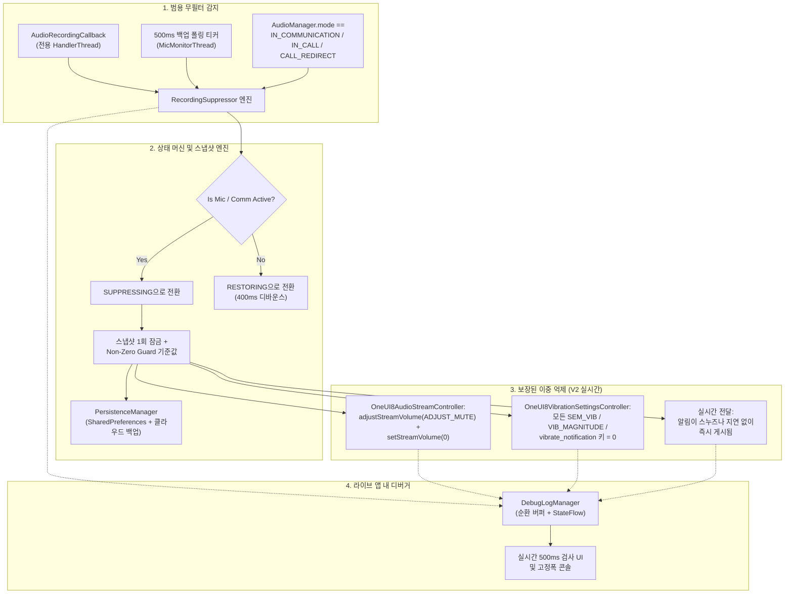

<p align="center">
  <a href="../../README.md">English</a> ·
  <a href="README.ar.md">العربية</a> ·
  <a href="README.es.md">Español</a> ·
  <a href="README.fr.md">Français</a> ·
  <a href="README.de.md">Deutsch</a> ·
  <a href="README.ru.md">Русский</a> ·
  <a href="README.pt-BR.md">Português (Brasil)</a> ·
  <a href="README.tr.md">Türkçe</a> ·
  <b>한국어</b> ·
  <a href="README.ja.md">日本語</a> ·
  <a href="README.zh-CN.md">简体中文</a>
</p>

# Samsung Mic Mute App (v3.0)

<p align="center">
  
  
  
  
  
  
</p>

> **Samsung Galaxy 기기를 위한 특화 Android 유틸리티로, `RECORD_AUDIO` 권한 없이 마이크가 사용 중인 동안 알림음과 진동을 자동으로 억제합니다. V3에는 완전한 다국어 지원(11개 언어), 즉시 사용 가능한 앱 내 언어 전환기, 안전한 앱 내 PayPal 후원 시트가 포함되어 있습니다.**

> [!WARNING]
> **⚠️ 중요 참고:** 이 도구는 시스템 수준의 알림음과 진동을 음소거합니다. 다만 앱 내부의 사용자 지정 진동(예: WhatsApp, Telegram 등의 앱 내 진동 설정)은 차단할 수 없습니다. 완전한 무음 환경을 위해서는 해당 앱 내에서 진동을 직접 비활성화해야 합니다.

---

## 📌 문제 개요

Samsung Galaxy 기기에서 오디오를 녹음하거나 음성/영상 통화에 참여할 때(예: WhatsApp 음성 메시지, Snapchat, Instagram 스토리/릴스, 음성 녹음기, 카메라 4K 동영상 녹화, 전화 통화) 수신 알림이 큰 소리와 진동으로 발생하여 녹음된 오디오에 섞이고 대화를 방해합니다.

표준 방해 금지(DND) 모드는 수동으로 전환하기 번거롭고, 표준 Android 오디오 스트림 방식으로는 Samsung의 독자적인 진동 엔진을 무음으로 만들 수 없습니다.

**Samsung Mic Mute App (V3)** 는 이를 백그라운드에서 완전히 해결합니다. 시스템 어디에서든 마이크 활성화를 자동으로 감지하고, 즉시 알림 볼륨과 Samsung 진동 세기를 0으로 음소거하며, 녹음이 끝나는 순간 정확한 기준값으로 즉시 복원합니다. 모든 알림은 계속 실시간으로 도착해 화면에 표시되며, 스누즈되거나 지연되거나 나중에 몰아서 표시되지 않습니다.

---

## 🚀 주요 기능 및 하이라이트

- **🔒 `RECORD_AUDIO` 권한 제로 (100% 개인정보 보호 및 안전):**
  Android의 시스템 수준 `AudioManager.AudioRecordingCallback`(API 30+에서 도입)을 사용합니다. 이 앱은 마이크 오디오를 **절대** 녹음, 청취 또는 처리하지 않습니다. 다른 앱이 녹음 스트림을 열었는지 여부만 모니터링합니다.
- **🌐 11개 글로벌 언어 및 즉시 전환기 (V3):**
  아랍어(العربية), 영어, 스페인어(Español), 프랑스어(Français), 독일어(Deutsch), 러시아어(Русский), 포르투갈어(Português), 터키어(Türkçe), 한국어(한국어), 일본어(日本語), 중국어 간체(简体中文) 등 11개 언어로 완전히 번역되었습니다. 앱 내 언어 선택기(🌐)와 Android 13+ 앱별 언어 설정 통합을 포함합니다.
- **💳 안전한 앱 내 PayPal 후원 시트 (V3):**
  외부 브라우저로 이동하지 않고 네이티브 모달 BottomSheet 안에서 PayPal 공식 Hosted Buttons SDK를 통해 직접 후원할 수 있습니다.
- **🛡️ 비침습적 포그라운드 마이크 유형:**
  `FOREGROUND_SERVICE_SPECIAL_USE` 포그라운드 서비스(`audio_recording_detection` 속성)와 상시 `NotificationListenerService`를 결합하여 Android 14–16의 런타임 보안 제한을 회피합니다.
- **⚡ 범용 무필터 감지 엔진:**
  숨겨지거나 가려진 패키지 이름에 의존하지 않고 모든 앱의 **모든** 마이크 사용에서 트리거됩니다(Android 10+에서는 권한 없는 앱에 `clientPackageName`이 숨겨집니다).
- **🔄 VoIP 및 통신 모드 백업 티커:**
  전용 긴급 우선순위 스레드(`THREAD_PRIORITY_URGENT_AUDIO`)에서 500ms 티커를 실행하여 VoIP 통화(`MODE_IN_COMMUNICATION`, `MODE_IN_CALL`, `MODE_CALL_REDIRECT`)를 확인하고 WhatsApp, Instagram, Telegram에서의 콜백 지연을 제거합니다.
- **🎯 Samsung 사운드 이중 및 다중 키 진동 음소거:**
  - **오디오:** `adjustStreamVolume(ADJUST_MUTE)`와 `setStreamVolume(STREAM_NOTIFICATION, 0)`를 모두 실행합니다.
  - **Samsung 진동:** 모든 One UI 진동 키를 조회, 스냅샷, `0`으로 설정합니다:
    - `SEM_VIBRATION_NOTIFICATION_INTENSITY` & `sem_vibration_notification_intensity`
    - `VIB_NOTIFICATION_MAGNITUDE` & `vib_notification_magnitude`
    - `vibrate_notification`
    - `notification_vibration_intensity`
    - `vibrate_on` (대체)
- **📬 실시간 무음 전달:**
  모든 알림이 즉시 실시간으로 도착해 화면에 표시되며, 시스템 오디오 및 진동 드라이버 수준에서 완전히 무음 처리됩니다.
- **🧠 스냅샷 1회 잠금 및 Non-Zero Guard:**
  `IDLE` → `SUPPRESSING` 전환 시 시스템 볼륨과 진동 수준을 엄격히 한 번만 스냅샷합니다. 이후 트리거는 사용자의 정상 볼륨을 `0`으로 덮어쓰지 않습니다. 스냅샷 시점에 값이 `0`으로 읽히면 Non-Zero Guard가 정상적인 영구 기준값을 복원합니다.
- **⏱️ 400ms 글리치 방지 디바운스:**
  마이크 스트림이 중지되면 복원을 400ms 지연하여 연속된 음성 메시지 중 빠른 온/오프 오디오 글리치를 방지합니다.
- **📊 앱 내 라이브 디버거 및 진단 콘솔:**
  대시보드에서 500ms마다 폴링하는 실시간 검사 패널을 제공합니다:
  - 활성 마이크 구성 수, 오디오 세션 ID, 소스 유형.
  - 현재 `AudioManager.mode`.
  - `STREAM_NOTIFICATION` 라이브 볼륨 및 음소거 상태.
  - `Settings.System`에서 직접 읽은 모든 Samsung 진동 키의 실시간 정수 값.
  - 원탭 클립보드 복사 및 진동 키 덤프 기능이 있는 고정폭 스크롤 이벤트 로그 콘솔.
- **💾 충돌 및 재부팅 복구:**
  `BootRecoveryReceiver`와 클라우드 동기화 `PersistenceManager`를 통해 기기 재부팅 후 캐시된 기준 설정을 자동으로 복원합니다.
  마이크 스트림이 중지되면 복원을 400ms 지연하여 연속된 음성 메시지 중 빠른 온/오프 오디오 글리치를 방지합니다.
- **📊 앱 내 라이브 디버거 및 진단 콘솔:**
  대시보드에서 500ms마다 폴링하는 실시간 검사 패널을 제공합니다:
  - 활성 마이크 구성 수, 오디오 세션 ID, 소스 유형.
  - 현재 `AudioManager.mode`.
  - `STREAM_NOTIFICATION` 라이브 볼륨 및 음소거 상태.
  - `Settings.System`에서 직접 읽은 모든 Samsung 진동 키의 실시간 정수 값.
  - 원탭 클립보드 복사 및 진동 키 덤프 기능이 있는 고정폭 스크롤 이벤트 로그 콘솔.
- **💾 충돌 및 재부팅 복구:**
  `BootRecoveryReceiver`와 클라우드 동기화 `PersistenceManager`를 통해 기기 재부팅 후 캐시된 기준 설정을 자동으로 복원합니다.

---

## 📱 호환 기기 및 OS 요구 사항

| 구성 요소 | 요구 사항 |
| :--- | :--- |
| **대상 OS** | Android 11, 12, 13, 14, 15, 16 (API 30 ~ 36) |
| **테스트된 플랫폼** | **Samsung One UI 6, One UI 7, One UI 8, One UI 9** |
| **지원 하드웨어** | Samsung Galaxy S 시리즈 (S20 – S25 Ultra)<br/>Samsung Galaxy Z 시리즈 (Fold & Flip)<br/>Samsung Galaxy Note 시리즈<br/>Samsung Galaxy A 시리즈 / M 시리즈 / Tab |
| **비 Samsung 기기** | 표준 Android 알림음 음소거와 호환되며, Samsung 전용 진동 키는 `NotificationListenerService`로 자연스럽게 대체됩니다. |

---

## 🏗️ 아키텍처 및 기술 스택



### 모듈식 컨트롤러 스택

- **`RecordingSuppressor`:** 스레드 안전 상태 오케스트레이터(`IDLE` ↔ `SUPPRESSING` ↔ `RESTORING`).
- **`AudioStreamController`:** 플러그인 방식 오디오 음소거 인터페이스:
  - `OneUI8AudioStreamController` (기본: `STREAM_NOTIFICATION` 이중 음소거).
  - `NotificationChannelAudioController` (대체: 개별 알림 채널 소리 억제).
- **`VibrationSettingsController`:** 플러그인 방식 진동 음소거 인터페이스:
  - `OneUI8VibrationSettingsController` (기본: Samsung 시스템 설정 다중 키 음소거).
  - `NotificationListenerVibrationController` (대체: 알림 수준 진동 패턴 취소).
  - `AdbSecureSettingsVibrationController` (개발 / 엔터프라이즈 대체).
- **`SuppressionForegroundService`:** 지속적인 모니터링 알림이 있는 스티키 포그라운드 서비스.
- **`SuppressionNotificationListener`:** 공격적인 OS 작업 종료에서도 지속 모니터링이 살아남도록 보장하는 시스템 우선순위 호스트.

---

## 🛠️ 설치 및 설정 가이드

### 1단계: APK 설치
[Releases](https://github.com/m4wan1/SamsungMicMuteApp/releases) 섹션에서 `SamsungMicMute_V2.apk`를 다운로드하거나 소스에서 로컬로 APK를 빌드합니다:

```bash
git clone https://github.com/m4wan1/SamsungMicMuteApp.git
cd SamsungMicMuteApp
./gradlew assembleDebug
```
컴파일된 APK는 다음 위치에 생성됩니다:
`app/build/outputs/apk/debug/app-debug.apk`

---

### 2단계: 권한 부여
앱을 실행합니다. 세 개의 깔끔한 설정 카드가 필요한 권한 부여 과정을 안내합니다:

1. **시스템 설정 쓰기 (`WRITE_SETTINGS`):**
   - 카드 3에서 **Grant** 를 탭합니다.
   - *Samsung Mic Mute* 에 대해 **Allow modifying system settings** 를 켭니다.
   - *목적:* 앱이 `Settings.System`에서 Samsung 진동 세기와 볼륨을 설정할 수 있게 합니다.
2. **알림 리스너 접근:**
   - 카드 3에서 **Grant** 를 탭합니다.
   - 기기 설정에서 **Notification Vibration Suppressor** 를 활성화합니다.
   - *목적:* 지속적인 시스템 우선순위 백그라운드 모니터링과 대체 진동 제어를 제공합니다.
3. **배터리 최적화 무시(제한 없음):**
   - 카드 3에서 **Grant** 를 탭합니다.
   - **Allow** (Unrestricted)를 선택합니다.
   - *목적:* 앱이 최소화되었을 때 Samsung One UI가 백그라운드 오디오 콜백 스레드를 정지시키거나 지연시키는 것을 방지합니다.

#### ADB를 통한 대체 설정 (개발자를 위한 빠른 설정):
```bash
# Grant Write System Settings
adb shell appops set com.example.suppressor.debug WRITE_SETTINGS allow

# Grant Notification Listener Access
adb shell cmd notification set_listeners com.example.suppressor.debug/com.example.suppressor.service.SuppressionNotificationListener

# Whitelist from Battery Optimization
adb shell dumpsys deviceidle whitelist +com.example.suppressor.debug
```

---

## 🧪 사용 및 테스트

### 억제 확인 방법:
1. **Samsung Mic Mute** 를 열고 카드 3의 세 가지 권한 배지가 모두 **Granted** / **Unrestricted** 로 표시되는지 확인합니다.
2. 앱을 열어 두거나 최소화합니다.
3. **WhatsApp** (또는 **Voice Recorder**, **Snapchat**, **Camera** 동영상 모드)을 엽니다.
4. 마이크 버튼을 길게 눌러 음성 메시지를 녹음합니다.
5. 마이크를 누른 상태에서 앱을 확인합니다:
   - **상태 배지**가 즉시 다음으로 변경됩니다: `ACTIVE - Mic in Use (Muted)`.
   - **Saved Volume / Vibration** 에 다음이 표시됩니다: `Saved Volume: 10 / 15 | Current: 0 (Muted)`.
6. 친구에게 알림 메시지를 받거나 다른 기기에서 이메일/알림을 보냅니다.
7. **관찰:** 알림이 **소리 없이**, **진동 없이** 조용히 도착합니다.
8. 마이크 버튼을 놓습니다.
9. 부드러운 400ms 디바운스 후 볼륨과 진동이 정확한 원래 설정으로 자동 복원됩니다.

### 앱 내 라이브 디버거 사용:
화면 하단의 **Card 5 (LIVE IN-APP DEBUGGER)** 로 스크롤합니다:
- **Live Inspector:** 실시간 마이크 구성 수, `AudioManager.mode`, 스트림 음소거 상태, Samsung 진동 키의 정확한 정수 값을 표시합니다.
- **Copy Logs:** 전체 진단 덤프와 Samsung 설정 키를 클립보드에 복사합니다.
- **Dump Vib Keys:** `Settings.System`에서 `vib` 또는 `noti`와 일치하는 모든 설정을 스캔하고 값을 출력합니다.

---

## 🔒 핵심 제약 사항 및 보안 보장

| 제약 / 보장 | V2에서의 사양 및 적용 |
| :--- | :--- |
| **실시간 무음 알림 전달** | **지연 제로 / 스누즈 없음:** 알림은 반드시 실시간으로 즉시 도착하고 화면에 표시되어야 합니다. 앱은 `snoozeNotification()`, `cancelNotification()`, `cancelAllNotifications()`를 엄격히 사용하지 않아 마이크 해제 시 알림 폭주를 방지합니다. 완전한 무음은 전적으로 우선순위 1 컨트롤러(`OneUI8AudioStreamController`가 `STREAM_NOTIFICATION`을 0으로, `OneUI8VibrationSettingsController`가 `sem_vibration_notification_intensity`를 0으로 설정)에 의존합니다. |
| **마이크 도청 없음** | `<uses-permission android:name="android.permission.RECORD_AUDIO" tools:node="remove" />` 가 `AndroidManifest.xml`에 적용되어 있습니다. Android OS가 이 앱의 오디오 캡처를 물리적으로 차단합니다. |
| **방해 금지 모드 간섭 없음** | Android `NotificationManager.setInterruptionFilter()`를 변경하지 않습니다. DND 일정과 중요 연락처 예외는 그대로 유지됩니다. |
| **전역 무음 모드 없음** | `RINGER_MODE_SILENT`를 설정하지 않습니다. 수신 전화와 알람은 정상 볼륨으로 울립니다. |
| **로컬 전용 처리** | 분석, 네트워크 요청, 원격 추적이 전혀 없습니다. |

### ⚠️ 앱 내 사용자 지정 진동 관련 고지
> **중요 참고:** 이 도구는 시스템 수준의 알림음과 진동을 음소거합니다. 다만 앱 내부의 사용자 지정 진동(예: WhatsApp, Telegram 등의 앱 내 진동 설정)은 차단할 수 없습니다. 완전한 무음 환경을 위해서는 해당 앱 내에서 진동을 직접 비활성화해야 합니다.

---

## 📄 라이선스 및 약관

**MIT License** 에 따라 배포됩니다.

```
MIT License

Copyright (c) 2026 Marw (m4wan1)

Permission is hereby granted, free of charge, to any person obtaining a copy
of this software and associated documentation files (the "Software"), to deal
in the Software without restriction, including without limitation the rights
to use, copy, modify, merge, publish, distribute, sublicense, and/or sell
copies of the Software, and to permit persons to whom the Software is
furnished to do so, subject to the following conditions:

The above copyright notice and this permission notice shall be included in all
copies or substantial portions of the Software.

THE SOFTWARE IS PROVIDED "AS IS", WITHOUT WARRANTY OF ANY KIND, EXPRESS OR
IMPLIED, INCLUDING BUT NOT LIMITED TO THE WARRANTIES OF MERCHANTABILITY,
FITNESS FOR A PARTICULAR PURPOSE AND NONINFRINGEMENT. IN NO EVENT SHALL THE
AUTHORS OR COPYRIGHT HOLDERS BE LIABLE FOR ANY CLAIM, DAMAGES OR OTHER
LIABILITY, WHETHER IN AN ACTION OF CONTRACT, TORT OR OTHERWISE, ARISING FROM,
OUT OF OR IN CONNECTION WITH THE SOFTWARE OR THE USE OR OTHER DEALINGS IN THE
SOFTWARE.
```

*고지: 이 프로젝트는 사용자 개인정보 보호와 편의를 위해 설계된 독립 오픈소스 유틸리티입니다. Samsung Electronics Co., Ltd.와 제휴하거나 승인받지 않았습니다.*
