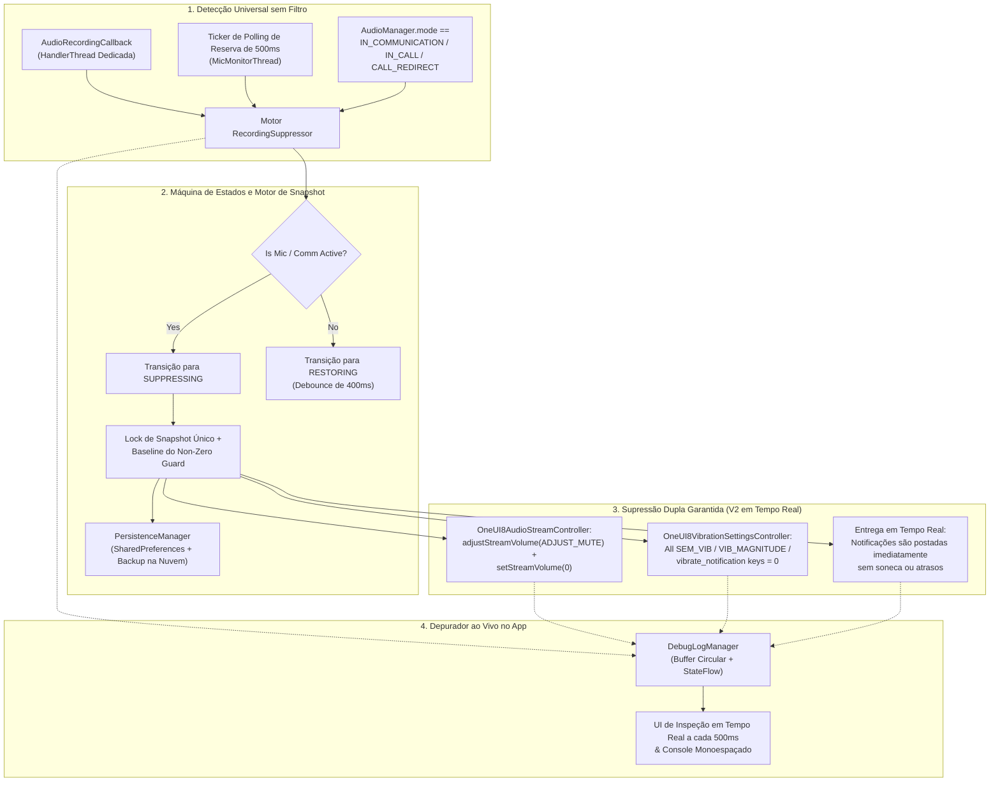

<p align="center">
  <a href="../../README.md">English</a> ·
  <a href="README.ar.md">العربية</a> ·
  <a href="README.es.md">Español</a> ·
  <a href="README.fr.md">Français</a> ·
  <a href="README.de.md">Deutsch</a> ·
  <a href="README.ru.md">Русский</a> ·
  <b>Português (Brasil)</b> ·
  <a href="README.tr.md">Türkçe</a> ·
  <a href="README.ko.md">한국어</a> ·
  <a href="README.ja.md">日本語</a> ·
  <a href="README.zh-CN.md">简体中文</a>
</p>

# Samsung Mic Mute App (v3.0)

<p align="center">
  
  
  
  
  
  
</p>

> **Um utilitário Android especializado para dispositivos Samsung Galaxy que suprime automaticamente sons e vibrações de notificação durante o uso ativo do microfone, sem exigir a permissão `RECORD_AUDIO`. Na V3, estão incluídos suporte completo a múltiplos idiomas (11 idiomas), um seletor de idioma instantâneo dentro do app e uma planilha segura de doação via PayPal integrada ao app.**

> [!WARNING]
> **⚠️ Nota Importante:** Esta ferramenta silencia sons e vibrações de notificação em nível de sistema. No entanto, ela não consegue bloquear vibrações personalizadas dentro dos apps (por exemplo, configurações de vibração personalizadas no WhatsApp, Telegram, etc.). Você precisa desativar manualmente as vibrações dentro desses apps específicos para obter uma experiência completamente silenciosa.

---

## 📌 Visão Geral do Problema

Ao gravar áudio ou participar de chamadas de voz/vídeo em dispositivos Samsung Galaxy (por exemplo, mensagens de voz no WhatsApp, Snapchat, stories/reels do Instagram, Gravador de Voz, gravação de vídeo 4K na Câmera, chamadas telefônicas), as notificações recebidas produzem estalos altos de som e zumbidos de vibração tátil que vazam para o áudio gravado e interrompem a comunicação.

Os modos Não Perturbe (DND) padrão são trabalhosos de alternar manualmente, e os métodos padrão de stream de áudio do Android falham em silenciar os mecanismos de vibração proprietários da Samsung.

O **Samsung Mic Mute App (V3)** resolve isso inteiramente em segundo plano: ele detecta automaticamente a ativação do microfone em qualquer lugar do sistema, imediatamente zera o volume de notificação e a intensidade de vibração da Samsung, e restaura instantaneamente esses valores à linha de base exata no momento em que a gravação termina. Todas as notificações continuam chegando e aparecendo na sua tela em tempo real, sem serem silenciadas, atrasadas ou acumuladas para depois.

---

## 🚀 Principais Recursos e Destaques

- **🔒 Zero Permissão `RECORD_AUDIO` (100% Privado e Seguro):**
  Usa o `AudioManager.AudioRecordingCallback` em nível de sistema do Android (introduzido na API 30+). O app **nunca** grava, escuta ou processa o áudio do microfone. Ele apenas monitora se outro aplicativo abriu um stream de gravação.
- **🌐 11 Idiomas Globais e Seletor Instantâneo (V3):**
  Totalmente traduzido para 11 idiomas: árabe (العربية), inglês, espanhol (Español), francês (Français), alemão (Deutsch), russo (Русский), português (Português), turco (Türkçe), coreano (한국어), japonês (日本語) e chinês simplificado (简体中文). Inclui um seletor de idioma dentro do app (🌐) e integração com a configuração de Idioma por Aplicativo do Android 13+.
- **💳 Planilha Segura de Apoio via PayPal no App (V3):**
  Permite apoio direto por meio do SDK oficial Hosted Buttons do PayPal dentro de um BottomSheet modal nativo, sem nunca sair para um navegador externo.
- **🛡️ Sem Tipo Invasivo de Microfone em Primeiro Plano:**
  Evita as restrições de segurança em tempo de execução do Android 14–16 combinando um serviço em primeiro plano `FOREGROUND_SERVICE_SPECIAL_USE` (propriedade `audio_recording_detection`) com um `NotificationListenerService` persistente.
- **⚡ Motor de Detecção Universal sem Filtro:**
  Dispara em **qualquer** uso do microfone em qualquer aplicativo, sem depender de nomes de pacotes ocultos ou censurados (o Android 10+ oculta `clientPackageName` para apps sem privilégios).
- **🔄 Ticker de Reserva para VoIP e Modo de Comunicação:**
  Inclui um ticker ativo de 500ms em uma thread dedicada de prioridade urgente (`THREAD_PRIORITY_URGENT_AUDIO`) que verifica chamadas VoIP (`MODE_IN_COMMUNICATION`, `MODE_IN_CALL`, `MODE_CALL_REDIRECT`) para eliminar a latência de callback no WhatsApp, Instagram e Telegram.
- **🎯 Silenciamento Duplo de Som Samsung e Vibração Multi-Chave:**
  - **Áudio:** Executa tanto `adjustStreamVolume(ADJUST_MUTE)` quanto `setStreamVolume(STREAM_NOTIFICATION, 0)`.
  - **Vibração Samsung:** Consulta, tira snapshot e define todas as chaves de vibração da One UI como `0`:
    - `SEM_VIBRATION_NOTIFICATION_INTENSITY` & `sem_vibration_notification_intensity`
    - `VIB_NOTIFICATION_MAGNITUDE` & `vib_notification_magnitude`
    - `vibrate_notification`
    - `notification_vibration_intensity`
    - `vibrate_on` (fallback)
- **📬 Entrega Silenciosa em Tempo Real:**
  Garante que todas as notificações cheguem e apareçam na tela imediatamente em tempo real, totalmente silenciadas no nível do áudio do sistema e do driver de vibração.
- **🧠 Lock de Snapshot Único e Non-Zero Guard:**
  Tira snapshots dos níveis de volume e vibração do sistema estritamente uma vez na transição de `IDLE` → `SUPPRESSING`. Disparos subsequentes nunca sobrescrevem o volume normal do usuário com `0`. Se os valores forem lidos como `0` no momento do snapshot, o Non-Zero Guard restaura uma linha de base persistida saudável.
- **⏱️ Debounce Anti-Glitch de 400ms:**
  Atrasa a restauração em 400ms quando os streams de microfone param, evitando glitches rápidos de áudio liga/desliga durante mensagens de voz sucessivas.
- **📊 Depurador e Console de Diagnóstico ao Vivo no App:**
  Possui um painel inspetor em tempo real que consulta a cada 500ms diretamente no dashboard:
  - Contagem de configurações de microfone ativas, IDs de sessão de áudio e tipos de origem.
  - `AudioManager.mode` atual.
  - Volume e estado de mudo em tempo real do `STREAM_NOTIFICATION`.
  - Valores inteiros em tempo real de todas as chaves de vibração da Samsung, diretamente de `Settings.System`.
  - Console de log de eventos com rolagem em fonte monoespaçada, com cópia para a área de transferência em um toque e dump das chaves de vibração.
- **💾 Recuperação de Crash e Reinicialização:**
  Restaura automaticamente as configurações de linha de base em cache após reinicializações do dispositivo, via `BootRecoveryReceiver` e `PersistenceManager` sincronizado na nuvem.
  Atrasa a restauração em 400ms quando os streams de microfone param, evitando glitches rápidos de áudio liga/desliga durante mensagens de voz sucessivas.
- **📊 Depurador e Console de Diagnóstico ao Vivo no App:**
  Possui um painel inspetor em tempo real que consulta a cada 500ms diretamente no dashboard:
  - Contagem de configurações de microfone ativas, IDs de sessão de áudio e tipos de origem.
  - `AudioManager.mode` atual.
  - Volume e estado de mudo em tempo real do `STREAM_NOTIFICATION`.
  - Valores inteiros em tempo real de todas as chaves de vibração da Samsung, diretamente de `Settings.System`.
  - Console de log de eventos com rolagem em fonte monoespaçada, com cópia para a área de transferência em um toque e dump das chaves de vibração.
- **💾 Recuperação de Crash e Reinicialização:**
  Restaura automaticamente as configurações de linha de base em cache após reinicializações do dispositivo, via `BootRecoveryReceiver` e `PersistenceManager` sincronizado na nuvem.

---

## 📱 Dispositivos Compatíveis e Requisitos de SO

| Componente | Requisito |
| :--- | :--- |
| **SO Alvo** | Android 11, 12, 13, 14, 15, 16 (API 30 a 36) |
| **Plataformas Testadas** | **Samsung One UI 6, One UI 7, One UI 8, One UI 9** |
| **Hardware Suportado** | Samsung Galaxy Série S (S20 – S25 Ultra)<br/>Samsung Galaxy Série Z (Fold & Flip)<br/>Samsung Galaxy Série Note<br/>Samsung Galaxy Série A / Série M / Tab |
| **Dispositivos Não Samsung** | Compatível com o silenciamento padrão de sons de notificação do Android; as chaves de vibração específicas da Samsung fazem fallback de forma elegante para o `NotificationListenerService`. |

---

## 🏗️ Arquitetura e Stack Técnica



### Stack de Controladores Modulares

- **`RecordingSuppressor`:** Orquestrador de estado thread-safe (`IDLE` ↔ `SUPPRESSING` ↔ `RESTORING`).
- **`AudioStreamController`:** Interface plugável de silenciamento de áudio:
  - `OneUI8AudioStreamController` (Principal: silenciamento duplo do `STREAM_NOTIFICATION`).
  - `NotificationChannelAudioController` (Fallback: supressão de som por canal de notificação individual).
- **`VibrationSettingsController`:** Interface plugável de silenciamento de vibração:
  - `OneUI8VibrationSettingsController` (Principal: silenciamento multi-chave nas configurações de sistema da Samsung).
  - `NotificationListenerVibrationController` (Fallback: cancelamento do padrão de vibração no nível da notificação).
  - `AdbSecureSettingsVibrationController` (Fallback para Desenvolvimento / Enterprise).
- **`SuppressionForegroundService`:** Serviço em primeiro plano sticky com notificação persistente de monitoramento.
- **`SuppressionNotificationListener`:** Host com prioridade de sistema que garante que o monitoramento contínuo sobreviva ao encerramento agressivo de tarefas pelo SO.

---

## 🛠️ Guia de Instalação e Configuração

### Etapa 1: Instalar o APK
Baixe o `SamsungMicMute_V2.apk` na seção [Releases](https://github.com/m4wan1/SamsungMicMuteApp/releases), ou compile o APK localmente a partir do código-fonte:

```bash
git clone https://github.com/m4wan1/SamsungMicMuteApp.git
cd SamsungMicMuteApp
./gradlew assembleDebug
```
O APK compilado estará localizado em:
`app/build/outputs/apk/debug/app-debug.apk`

---

### Etapa 2: Conceder Permissões
Abra o app. Três cartões de configuração limpos vão orientá-lo na concessão das permissões necessárias:

1. **Escrever Configurações do Sistema (`WRITE_SETTINGS`):**
   - Toque em **Conceder** no Cartão 3.
   - Ative **Permitir modificar configurações do sistema** para o *Samsung Mic Mute*.
   - *Propósito:* Permite que o app defina a intensidade de vibração e o volume da Samsung em `Settings.System`.
2. **Acesso ao Listener de Notificações:**
   - Toque em **Conceder** no Cartão 3.
   - Ative o **Notification Vibration Suppressor** nas configurações do dispositivo.
   - *Propósito:* Fornece monitoramento persistente em segundo plano com prioridade de sistema e controle de vibração de fallback.
3. **Ignorar Otimização de Bateria (Sem Restrições):**
   - Toque em **Conceder** no Cartão 3.
   - Selecione **Permitir** (Sem restrições).
   - *Propósito:* Evita que a Samsung One UI congele ou atrase as threads de callback de áudio em segundo plano quando o app é minimizado.

#### Configuração Alternativa via ADB (Configuração Rápida para Desenvolvedores):
```bash
# Grant Write System Settings
adb shell appops set com.example.suppressor.debug WRITE_SETTINGS allow

# Grant Notification Listener Access
adb shell cmd notification set_listeners com.example.suppressor.debug/com.example.suppressor.service.SuppressionNotificationListener

# Whitelist from Battery Optimization
adb shell dumpsys deviceidle whitelist +com.example.suppressor.debug
```

---

## 🧪 Uso e Testes

### Como Verificar a Supressão:
1. Abra o **Samsung Mic Mute** e verifique se os três selos de permissão no Cartão 3 mostram **Concedido** / **Sem restrições**.
2. Mantenha o app aberto ou minimize-o.
3. Abra o **WhatsApp** (ou o **Gravador de Voz**, o **Snapchat**, ou o modo vídeo da **Câmera**).
4. Segure o botão do microfone para gravar uma mensagem de voz.
5. Enquanto segura o microfone, observe o app:
   - O **Selo de Status** muda instantaneamente para: `ACTIVE - Mic in Use (Muted)`.
   - O **Volume / Vibração Salvos** mostra: `Saved Volume: 10 / 15 | Current: 0 (Muted)`.
6. Peça a um amigo para enviar uma mensagem de notificação (ou envie um e-mail/notificação de outro dispositivo).
7. **Observe:** A notificação chega silenciosamente, com **zero som** e **zero vibração**.
8. Solte o botão do microfone.
9. Após um debounce suave de 400ms, o volume e a vibração retornam automaticamente às suas configurações originais exatas.

### Usando o Depurador ao Vivo no App:
Role até o **Cartão 5 (LIVE IN-APP DEBUGGER)** na parte inferior da tela:
- **Inspetor ao Vivo:** Mostra em tempo real a contagem de configurações de microfone, o `AudioManager.mode`, o status de mudo do stream e os valores inteiros exatos das chaves de vibração da Samsung.
- **Copiar Logs:** Copia o dump completo de diagnóstico e as chaves de configurações da Samsung para a área de transferência.
- **Dump Vib Keys:** Verifica todas as configurações em `Settings.System` que correspondem a `vib` ou `noti` e exibe seus valores.

---

## 🔒 Restrições Essenciais e Garantias de Segurança

| Restrição / Garantia | Especificação e Aplicação na V2 |
| :--- | :--- |
| **Entrega Silenciosa de Notificações em Tempo Real** | **Zero Atraso / Sem Soneca:** As notificações DEVEM chegar e aparecer na tela imediatamente em tempo real. O app evita estritamente `snoozeNotification()`, `cancelNotification()` ou `cancelAllNotifications()`, prevenindo enxurradas de notificações quando o microfone é liberado. O silêncio completo depende exclusivamente dos controladores de Prioridade 1 (`OneUI8AudioStreamController` definindo `STREAM_NOTIFICATION` como 0, e `OneUI8VibrationSettingsController` definindo `sem_vibration_notification_intensity` como 0). |
| **Sem Espionagem do Microfone** | `<uses-permission android:name="android.permission.RECORD_AUDIO" tools:node="remove" />` é imposto no `AndroidManifest.xml`. O sistema operacional Android impede fisicamente que este app capture áudio. |
| **Sem Interferência no Não Perturbe** | Não altera o `NotificationManager.setInterruptionFilter()` do Android. Suas programações de DND e exceções de contatos favoritos permanecem intactas. |
| **Sem Modo Silencioso Global** | Não define `RINGER_MODE_SILENT`. Chamadas telefônicas recebidas e alarmes tocam no volume normal máximo. |
| **Processamento Apenas Local** | Contém zero análises, zero requisições de rede e zero rastreamento remoto. |

### ⚠️ Aviso Sobre Vibrações Personalizadas no App
> **Nota Importante:** Esta ferramenta silencia sons e vibrações de notificação em nível de sistema. No entanto, ela não consegue bloquear vibrações personalizadas dentro dos apps (por exemplo, configurações de vibração personalizadas no WhatsApp, Telegram, etc.). Você precisa desativar manualmente as vibrações dentro desses apps específicos para obter uma experiência completamente silenciosa.

---

## 📄 Licença e Termos

Distribuído sob a **Licença MIT**.

```
MIT License

Copyright (c) 2026 Marw (m4wan1)

Permission is hereby granted, free of charge, to any person obtaining a copy
of this software and associated documentation files (the "Software"), to deal
in the Software without restriction, including without limitation the rights
to use, copy, modify, merge, publish, distribute, sublicense, and/or sell
copies of the Software, and to permit persons to whom the Software is
furnished to do so, subject to the following conditions:

The above copyright notice and this permission notice shall be included in all
copies or substantial portions of the Software.

THE SOFTWARE IS PROVIDED "AS IS", WITHOUT WARRANTY OF ANY KIND, EXPRESS OR
IMPLIED, INCLUDING BUT NOT LIMITED TO THE WARRANTIES OF MERCHANTABILITY,
FITNESS FOR A PARTICULAR PURPOSE AND NONINFRINGEMENT. IN NO EVENT SHALL THE
AUTHORS OR COPYRIGHT HOLDERS BE LIABLE FOR ANY CLAIM, DAMAGES OR OTHER
LIABILITY, WHETHER IN AN ACTION OF CONTRACT, TORT OR OTHERWISE, ARISING FROM,
OUT OF OR IN CONNECTION WITH THE SOFTWARE OR THE USE OR OTHER DEALINGS IN THE
SOFTWARE.
```

*Aviso legal: Este projeto é um utilitário independente de código aberto, projetado para a privacidade e a conveniência do usuário. Não é afiliado nem endossado pela Samsung Electronics Co., Ltd.*
