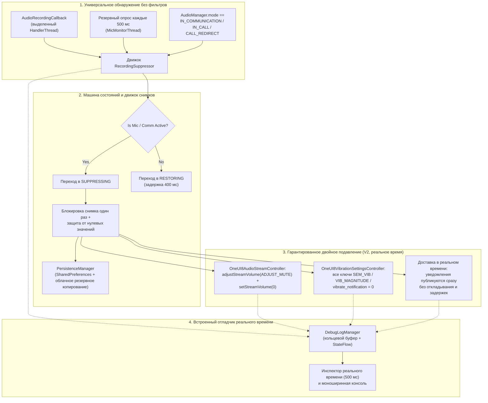

<p align="center">
  <a href="../../README.md">English</a> ·
  <a href="README.ar.md">العربية</a> ·
  <a href="README.es.md">Español</a> ·
  <a href="README.fr.md">Français</a> ·
  <a href="README.de.md">Deutsch</a> ·
  <b>Русский</b> ·
  <a href="README.pt-BR.md">Português (Brasil)</a> ·
  <a href="README.tr.md">Türkçe</a> ·
  <a href="README.ko.md">한국어</a> ·
  <a href="README.ja.md">日本語</a> ·
  <a href="README.zh-CN.md">简体中文</a>
</p>

# Samsung Mic Mute App (v3.0)

<p align="center">
  
  
  
  
  
  
</p>

> **Специализированная утилита для Android для устройств Samsung Galaxy, которая автоматически подавляет звуки уведомлений и вибрацию при активном использовании микрофона, не требуя разрешения `RECORD_AUDIO`. В версии V3 добавлены полная поддержка нескольких языков (11 языков), мгновенный переключатель языка внутри приложения и защищённая встроенная форма для пожертвований через PayPal.**

> [!WARNING]
> **⚠️ Важно:** Этот инструмент отключает системные звуки уведомлений и вибрацию. Однако он не может блокировать пользовательские вибрации внутри приложений (например, собственные настройки вибрации в WhatsApp, Telegram и т. п.). Для полностью бесшумной работы необходимо вручную отключить вибрацию внутри этих приложений.

---

## 📌 Обзор проблемы

При записи звука или участии в голосовых и видеозвонках на устройствах Samsung Galaxy (например, голосовые заметки WhatsApp, Snapchat, истории и Reels в Instagram, диктофон, запись видео 4K в камере, телефонные звонки) входящие уведомления вызывают громкие звуковые всплески и тактильную вибрацию, которые попадают в записываемый звук и прерывают общение.

Стандартные режимы «Не беспокоить» (DND) неудобно включать вручную, а стандартные методы работы со звуковыми потоками Android не позволяют отключить фирменные вибродвижки Samsung.

**Samsung Mic Mute App (V3)** полностью решает эту проблему в фоновом режиме: приложение автоматически обнаруживает активацию микрофона в любой точке системы, немедленно снижает громкость уведомлений и интенсивность вибрации Samsung до нуля и мгновенно восстанавливает их до точного исходного уровня в момент окончания записи. Все уведомления продолжают приходить и отображаться на экране в реальном времени, не откладываясь, не задерживаясь и не появляясь массово позже.

---

## 🚀 Ключевые возможности и преимущества

- **🔒 Нулевое разрешение `RECORD_AUDIO` (100% приватность и безопасность):**
  Использует системный `AudioManager.AudioRecordingCallback` (появился в API 30+). Приложение **никогда** не записывает, не прослушивает и не обрабатывает звук с микрофона. Оно лишь отслеживает, открыло ли другое приложение поток записи.
- **🌐 11 мировых языков и мгновенное переключение (V3):**
  Полностью переведено на 11 языков: арабский (العربية), английский, испанский (Español), французский (Français), немецкий (Deutsch), русский (Русский), португальский (Português), турецкий (Türkçe), корейский (한국어), японский (日本語) и китайский упрощённый (简体中文). Включает выбор языка внутри приложения (🌐) и интеграцию с настройкой языка для отдельного приложения в Android 13+.
- **💳 Защищённая встроенная форма поддержки PayPal (V3):**
  Позволяет поддержать проект напрямую через официальный Hosted Buttons SDK от PayPal в нативном модальном BottomSheet, не переходя во внешний браузер.
- **🛡️ Без инвазивного типа foreground-сервиса микрофона:**
  Обходит ограничения безопасности Android 14–16 во время выполнения, сочетая foreground-сервис `FOREGROUND_SERVICE_SPECIAL_USE` (свойство `audio_recording_detection`) с постоянным `NotificationListenerService`.
- **⚡ Универсальный движок обнаружения без фильтров:**
  Срабатывает при **любом** использовании микрофона в любом приложении, не полагаясь на скрытые или отредактированные имена пакетов (в Android 10+ значение `clientPackageName` скрыто от непривилегированных приложений).
- **🔄 Резервный тикер режима VoIP и связи:**
  Включает активный тикер с интервалом 500 мс в отдельном потоке с приоритетом urgent (`THREAD_PRIORITY_URGENT_AUDIO`), который проверяет наличие VoIP-вызовов (`MODE_IN_COMMUNICATION`, `MODE_IN_CALL`, `MODE_CALL_REDIRECT`), чтобы устранить задержку callback в WhatsApp, Instagram и Telegram.
- **🎯 Двойное отключение звука Samsung и мультиключевое отключение вибрации:**
  - **Звук:** Выполняет как `adjustStreamVolume(ADJUST_MUTE)`, так и `setStreamVolume(STREAM_NOTIFICATION, 0)`.
  - **Вибрация Samsung:** Запрашивает, сохраняет снимок и устанавливает все ключи вибрации One UI в `0`:
    - `SEM_VIBRATION_NOTIFICATION_INTENSITY` и `sem_vibration_notification_intensity`
    - `VIB_NOTIFICATION_MAGNITUDE` и `vib_notification_magnitude`
    - `vibrate_notification`
    - `notification_vibration_intensity`
    - `vibrate_on` (резервный вариант)
- **📬 Бесшумная доставка в реальном времени:**
  Гарантирует, что все уведомления приходят и отображаются на экране немедленно, в реальном времени, будучи полностью беззвучными на уровне системного аудиодрайвера и драйвера вибрации.
- **🧠 Блокировка снимка при первом срабатывании и защита от нулевых значений:**
  Сохраняет снимок системной громкости и уровней вибрации строго один раз при переходе из `IDLE` → `SUPPRESSING`. Последующие срабатывания никогда не перезаписывают обычную громкость пользователя значением `0`. Если в момент снимка значения равны `0`, защита от нулевых значений восстанавливает корректный сохранённый базовый уровень.
- **⏱️ Антиглитч-дебонсинг 400 мс:**
  Задерживает восстановление на 400 мс после остановки потоков микрофона, предотвращая быстрое мигание звука при последовательной записи голосовых заметок.
- **📊 Встроенный отладчик и диагностическая консоль:**
  Содержит панель инспектора реального времени, опрашивающую состояние каждые 500 мс прямо на главном экране:
  - Количество активных конфигураций микрофона, идентификаторы аудиосессий и типы источников.
  - Текущее значение `AudioManager.mode`.
  - Текущая громкость и состояние отключения звука для `STREAM_NOTIFICATION`.
  - Живые целочисленные значения всех ключей вибрации Samsung напрямую из `Settings.System`.
  - Монохромная прокручиваемая консоль журнала событий с копированием в буфер обмена одним нажатием и выгрузкой ключей вибрации.
- **💾 Восстановление после сбоев и перезагрузки:**
  Автоматически восстанавливает кэшированные базовые настройки после перезагрузки устройства через `BootRecoveryReceiver` и синхронизируемый с облаком `PersistenceManager`.
  Задерживает восстановление на 400 мс после остановки потоков микрофона, предотвращая быстрое мигание звука при последовательной записи голосовых заметок.
- **📊 Встроенный отладчик и диагностическая консоль:**
  Содержит панель инспектора реального времени, опрашивающую состояние каждые 500 мс прямо на главном экране:
  - Количество активных конфигураций микрофона, идентификаторы аудиосессий и типы источников.
  - Текущее значение `AudioManager.mode`.
  - Текущая громкость и состояние отключения звука для `STREAM_NOTIFICATION`.
  - Живые целочисленные значения всех ключей вибрации Samsung напрямую из `Settings.System`.
  - Монохромная прокручиваемая консоль журнала событий с копированием в буфер обмена одним нажатием и выгрузкой ключей вибрации.
- **💾 Восстановление после сбоев и перезагрузки:**
  Автоматически восстанавливает кэшированные базовые настройки после перезагрузки устройства через `BootRecoveryReceiver` и синхронизируемый с облаком `PersistenceManager`.

---

## 📱 Совместимые устройства и требования к ОС

| Компонент | Требование |
| :--- | :--- |
| **Целевая ОС** | Android 11, 12, 13, 14, 15, 16 (API 30–36) |
| **Протестированные платформы** | **Samsung One UI 6, One UI 7, One UI 8, One UI 9** |
| **Поддерживаемое оборудование** | Samsung Galaxy S-Series (S20 – S25 Ultra)<br/>Samsung Galaxy Z-Series (Fold и Flip)<br/>Samsung Galaxy Note-Series<br/>Samsung Galaxy A-Series / M-Series / Tab |
| **Устройства не Samsung** | Совместимо со стандартным отключением звука уведомлений Android; фирменные ключи вибрации Samsung корректно переходят на резервный `NotificationListenerService`. |

---

## 🏗️ Архитектура и технический стек



### Модульный стек контроллеров

- **`RecordingSuppressor`:** Потокобезопасный оркестратор состояний (`IDLE` ↔ `SUPPRESSING` ↔ `RESTORING`).
- **`AudioStreamController`:** Подключаемый интерфейс отключения звука:
  - `OneUI8AudioStreamController` (основной: двойное отключение `STREAM_NOTIFICATION`).
  - `NotificationChannelAudioController` (резервный: подавление звука отдельных каналов уведомлений).
- **`VibrationSettingsController`:** Подключаемый интерфейс отключения вибрации:
  - `OneUI8VibrationSettingsController` (основной: мультиключевое отключение системных настроек Samsung).
  - `NotificationListenerVibrationController` (резервный: отмена виброшаблонов на уровне уведомлений).
  - `AdbSecureSettingsVibrationController` (резервный для разработки / корпоративного использования).
- **`SuppressionForegroundService`:** Липкий foreground-сервис с постоянным уведомлением мониторинга.
- **`SuppressionNotificationListener`:** Хост системного приоритета, обеспечивающий непрерывный мониторинг даже при агрессивном завершении задач ОС.

---

## 🛠️ Установка и настройка

### Шаг 1: Установите APK
Скачайте `SamsungMicMute_V2.apk` из раздела [Releases](https://github.com/m4wan1/SamsungMicMuteApp/releases) или соберите APK локально из исходного кода:

```bash
git clone https://github.com/m4wan1/SamsungMicMuteApp.git
cd SamsungMicMuteApp
./gradlew assembleDebug
```
Скомпилированный APK будет находиться по пути:
`app/build/outputs/apk/debug/app-debug.apk`

---

### Шаг 2: Предоставьте разрешения
Запустите приложение. Три аккуратные карточки настройки проведут вас через предоставление необходимых разрешений:

1. **Запись системных настроек (`WRITE_SETTINGS`):**
   - Нажмите **Grant** на карточке 3.
   - Включите **Allow modifying system settings** для *Samsung Mic Mute*.
   - *Назначение:* Позволяет приложению устанавливать интенсивность вибрации и громкость Samsung в `Settings.System`.
2. **Доступ к прослушивателю уведомлений:**
   - Нажмите **Grant** на карточке 3.
   - Включите **Notification Vibration Suppressor** в настройках устройства.
   - *Назначение:* Обеспечивает постоянный фоновый мониторинг с системным приоритетом и резервное управление вибрацией.
3. **Игнорирование оптимизации батареи (без ограничений):**
   - Нажмите **Grant** на карточке 3.
   - Выберите **Allow** (Unrestricted).
   - *Назначение:* Не позволяет Samsung One UI замораживать или задерживать фоновые потоки аудио-callback, когда приложение свёрнуто.

#### Альтернативная настройка через ADB (быстрая настройка для разработчиков):
```bash
# Grant Write System Settings
adb shell appops set com.example.suppressor.debug WRITE_SETTINGS allow

# Grant Notification Listener Access
adb shell cmd notification set_listeners com.example.suppressor.debug/com.example.suppressor.service.SuppressionNotificationListener

# Whitelist from Battery Optimization
adb shell dumpsys deviceidle whitelist +com.example.suppressor.debug
```

---

## 🧪 Использование и тестирование

### Как проверить подавление:
1. Откройте **Samsung Mic Mute** и убедитесь, что все три значка разрешений на карточке 3 показывают **Granted** / **Unrestricted**.
2. Оставьте приложение открытым или сверните его.
3. Откройте **WhatsApp** (или **Voice Recorder**, **Snapchat**, либо режим видео в **Camera**).
4. Удерживайте кнопку микрофона, чтобы записать голосовую заметку.
5. Пока удерживаете микрофон, посмотрите на приложение:
   - **Значок состояния** мгновенно меняется на: `ACTIVE - Mic in Use (Muted)`.
   - **Сохранённая громкость / вибрация** показывает: `Saved Volume: 10 / 15 | Current: 0 (Muted)`.
6. Попросите друга отправить вам уведомление (или отправьте письмо/уведомление с другого устройства).
7. **Наблюдайте:** уведомление приходит беззвучно, с **нулевым звуком** и **нулевой вибрацией**.
8. Отпустите кнопку микрофона.
9. После плавной задержки 400 мс громкость и вибрация автоматически возвращаются к вашим точным исходным настройкам.

### Использование встроенного отладчика реального времени:
Прокрутите вниз до **Карточки 5 (LIVE IN-APP DEBUGGER)** в нижней части экрана:
- **Живой инспектор:** Показывает количество конфигураций микрофона в реальном времени, `AudioManager.mode`, состояние отключения звука потока и точные целочисленные значения ключей вибрации Samsung.
- **Copy Logs:** Копирует полную диагностическую выгрузку и ключи настроек Samsung в буфер обмена.
- **Dump Vib Keys:** Сканирует все настройки в `Settings.System`, соответствующие `vib` или `noti`, и выводит их значения.

---

## 🔒 Основные ограничения и гарантии безопасности

| Ограничение / гарантия | Спецификация и реализация в V2 |
| :--- | :--- |
| **Бесшумная доставка уведомлений в реальном времени** | **Нулевая задержка / без откладывания:** Уведомления ОБЯЗАНЫ приходить и отображаться на экране немедленно, в реальном времени. Приложение строго избегает `snoozeNotification()`, `cancelNotification()` и `cancelAllNotifications()`, предотвращая массовый поток уведомлений после освобождения микрофона. Полная тишина достигается исключительно контроллерами Priority 1 (`OneUI8AudioStreamController`, устанавливающий `STREAM_NOTIFICATION` в 0, и `OneUI8VibrationSettingsController`, устанавливающий `sem_vibration_notification_intensity` в 0). |
| **Отсутствие прослушивания микрофона** | В `AndroidManifest.xml` принудительно задано `<uses-permission android:name="android.permission.RECORD_AUDIO" tools:node="remove" />`. ОС Android физически не позволяет этому приложению захватывать звук. |
| **Отсутствие вмешательства в режим «Не беспокоить»** | Не изменяет `NotificationManager.setInterruptionFilter()` в Android. Ваши расписания DND и исключения для избранных контактов остаются нетронутыми. |
| **Без глобального беззвучного режима** | Не устанавливает `RINGER_MODE_SILENT`. Входящие телефонные звонки и будильники звонят на полной обычной громкости. |
| **Обработка только локально** | Не содержит аналитики, сетевых запросов и удалённого отслеживания. |

### ⚠️ Отказ от ответственности за пользовательские вибрации в приложениях
> **Важно:** Этот инструмент отключает системные звуки уведомлений и вибрацию. Однако он не может блокировать пользовательские вибрации внутри приложений (например, собственные настройки вибрации в WhatsApp, Telegram и т. п.). Для полностью бесшумной работы необходимо вручную отключить вибрацию внутри этих приложений.

---

## 📄 Лицензия и условия

Распространяется под **MIT License**.

```
MIT License

Copyright (c) 2026 Marw (m4wan1)

Permission is hereby granted, free of charge, to any person obtaining a copy
of this software and associated documentation files (the "Software"), to deal
in the Software without restriction, including without limitation the rights
to use, copy, modify, merge, publish, distribute, sublicense, and/or sell
copies of the Software, and to permit persons to whom the Software is
furnished to do so, subject to the following conditions:

The above copyright notice and this permission notice shall be included in all
copies or substantial portions of the Software.

THE SOFTWARE IS PROVIDED "AS IS", WITHOUT WARRANTY OF ANY KIND, EXPRESS OR
IMPLIED, INCLUDING BUT NOT LIMITED TO THE WARRANTIES OF MERCHANTABILITY,
FITNESS FOR A PARTICULAR PURPOSE AND NONINFRINGEMENT. IN NO EVENT SHALL THE
AUTHORS OR COPYRIGHT HOLDERS BE LIABLE FOR ANY CLAIM, DAMAGES OR OTHER
LIABILITY, WHETHER IN AN ACTION OF CONTRACT, TORT OR OTHERWISE, ARISING FROM,
OUT OF OR IN CONNECTION WITH THE SOFTWARE OR THE USE OR OTHER DEALINGS IN THE
SOFTWARE.
```

*Отказ от ответственности: Этот проект является независимой открытой утилитой, созданной для приватности и удобства пользователей. Он не связан с Samsung Electronics Co., Ltd. и не одобрен ею.*
