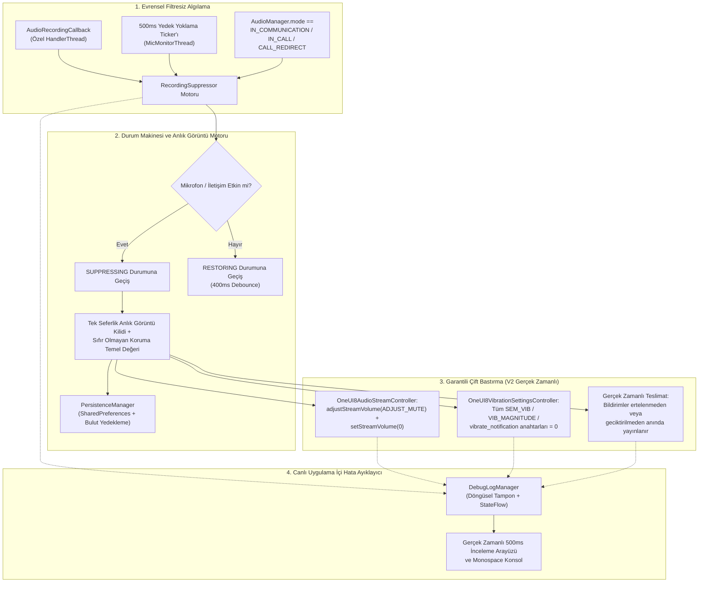

<p align="center">
  <a href="../../README.md">English</a> ·
  <a href="README.ar.md">العربية</a> ·
  <a href="README.es.md">Español</a> ·
  <a href="README.fr.md">Français</a> ·
  <a href="README.de.md">Deutsch</a> ·
  <a href="README.ru.md">Русский</a> ·
  <a href="README.pt-BR.md">Português (Brasil)</a> ·
  <b>Türkçe</b> ·
  <a href="README.ko.md">한국어</a> ·
  <a href="README.ja.md">日本語</a> ·
  <a href="README.zh-CN.md">简体中文</a>
</p>

# Samsung Mic Mute App (v3.0)

<p align="center">
  
  
  
  
  
  
</p>

> **Samsung Galaxy cihazları için, etkin mikrofon kullanımı sırasında bildirim seslerini ve titreşimlerini otomatik olarak bastıran ve bunu `RECORD_AUDIO` izni gerektirmeden yapan özel bir Android aracı. V3 ile birlikte tam çok dilli destek (11 dil), anında uygulama içi dil değiştirici ve güvenli uygulama içi PayPal bağış paneli yer alıyor.**

> [!WARNING]
> **⚠️ Önemli Not:** Bu araç sistem düzeyindeki bildirim seslerini ve titreşimlerini susturur. Ancak uygulama içi özel titreşimleri (örneğin WhatsApp, Telegram vb. uygulamaların kendi içindeki özel titreşim ayarlarını) engelleyemez. Tamamen sessiz bir deneyim için bu uygulamaların içindeki titreşimleri manuel olarak kapatmanız gerekir.

---

## 📌 Sorunun Özeti

Samsung Galaxy cihazlarında ses kaydı alırken veya sesli/görüntülü aramalara katılırken (örneğin WhatsApp sesli mesajlar, Snapchat, Instagram hikâyeleri/reels, Voice Recorder, Kamera 4K video kaydı, telefon aramaları), gelen bildirimler kaydedilen sese karışan yüksek ses patlamalarına ve dokunsal titreşim uğultusuna yol açar ve iletişimi kesintiye uğratır.

Standart Rahatsız Etmeyin (DND) modlarını manuel olarak açıp kapatmak zahmetlidir ve standart Android ses akışı yöntemleri Samsung'un tescilli titreşim motorlarını susturmada yetersiz kalır.

**Samsung Mic Mute App (V3)** bu sorunu tamamen arka planda çözer: sistemin herhangi bir yerinde mikrofon etkinleşmesini otomatik olarak algılar, bildirim ses yüksekliğini ve Samsung titreşim yoğunluğunu anında sıfıra indirir ve kayıt bittiği anda bunları tam olarak eski temel değerlerine geri yükler. Tüm bildirimler gerçek zamanlı olarak gelmeye ve ekranınızda görünmeye devam eder; sonradan ertelenmez, geciktirilmez veya birikip toplu şekilde gelmez.

---

## 🚀 Temel Özellikler ve Öne Çıkanlar

- **🔒 Sıfır `RECORD_AUDIO` İzni (%100 Gizli ve Güvenli):**
  Android'in sistem düzeyindeki `AudioManager.AudioRecordingCallback` API'sini (API 30+ ile gelen) kullanır. Uygulama mikrofon sesini **asla** kaydetmez, dinlemez veya işlemez. Yalnızca başka bir uygulamanın kayıt akışı açıp açmadığını izler.
- **🌐 11 Küresel Dil ve Anında Dil Değiştirici (V3):**
  11 dile tam olarak çevrilmiştir: Arapça (العربية), İngilizce, İspanyolca (Español), Fransızca (Français), Almanca (Deutsch), Rusça (Русский), Portekizce (Português), Türkçe (Türkçe), Korece (한국어), Japonca (日本語) ve Basitleştirilmiş Çince (简体中文). Uygulama içi dil seçici (🌐) ve Android 13+ Uygulama Başına Dil ayarı entegrasyonu içerir.
- **💳 Güvenli Uygulama İçi PayPal Destek Paneli (V3):**
  Harici bir tarayıcıya hiç yönlendirmeden, native modal BottomSheet içinde PayPal'ın resmi Hosted Buttons SDK'sı aracılığıyla doğrudan destek sağlar.
- **🛡️ Müdahaleci Olmayan Ön Plan Mikrofon Türü Yok:**
  `FOREGROUND_SERVICE_SPECIAL_USE` ön plan servisini (`audio_recording_detection` özelliği) kalıcı bir `NotificationListenerService` ile birleştirerek Android 14–16 çalışma zamanı güvenlik kısıtlamalarından kaçar.
- **⚡ Evrensel Filtresiz Algılama Motoru:**
  Gizli veya gizlenmiş paket adlarına dayanmadan **herhangi** bir uygulamadaki her mikrofon kullanımında tetiklenir (Android 10+ ayrıcalıksız uygulamalar için `clientPackageName` değerini gizler).
- **🔄 VoIP ve İletişim Modu Yedek Ticker'ı:**
  WhatsApp, Instagram ve Telegram'daki callback gecikmesini ortadan kaldırmak için VoIP aramalarını (`MODE_IN_COMMUNICATION`, `MODE_IN_CALL`, `MODE_CALL_REDIRECT`) kontrol eden, özel acil öncelikli bir iş parçacığında (`THREAD_PRIORITY_URGENT_AUDIO`) çalışan etkin 500ms'lik bir ticker içerir.
- **🎯 Çift Samsung Ses ve Çoklu Anahtar Titreşim Susturma:**
  - **Ses:** Hem `adjustStreamVolume(ADJUST_MUTE)` hem de `setStreamVolume(STREAM_NOTIFICATION, 0)` çağrılarını yürütür.
  - **Samsung Titreşimi:** Tüm One UI titreşim anahtarlarını sorgular, anlık görüntüsünü alır ve `0` değerine ayarlar:
    - `SEM_VIBRATION_NOTIFICATION_INTENSITY` & `sem_vibration_notification_intensity`
    - `VIB_NOTIFICATION_MAGNITUDE` & `vib_notification_magnitude`
    - `vibrate_notification`
    - `notification_vibration_intensity`
    - `vibrate_on` (yedek)
- **📬 Gerçek Zamanlı Sessiz Teslimat:**
  Tüm bildirimlerin sistem ses ve titreşim sürücüsü düzeyinde tamamen susturulmuş şekilde, gerçek zamanlı olarak anında gelmesini ve ekranda görünmesini sağlar.
- **🧠 Tek Seferlik Anlık Görüntü Kilidi ve Sıfır Olmayan Koruma:**
  Sistem ses ve titreşim düzeylerinin anlık görüntüsünü yalnızca `IDLE` → `SUPPRESSING` geçişinde bir kez alır. Sonraki tetiklemeler kullanıcının normal ses düzeyinin üzerine asla `0` yazmaz. Anlık görüntü alınırken değerler `0` okunursa, Sıfır Olmayan Koruma (Non-Zero Guard) sağlıklı ve kalıcı bir temel değeri geri yükler.
- **⏱️ 400ms Titreşim Önleyici Debounce:**
  Mikrofon akışları durduğunda geri yüklemeyi 400ms geciktirerek art arda gelen sesli mesajlarda hızlı aç/kapa ses titreşimlerini önler.
- **📊 Canlı Uygulama İçi Hata Ayıklayıcı ve Tanılama Konsolu:**
  Doğrudan panoda 500ms'de bir sorgulama yapan gerçek zamanlı bir inceleme paneli sunar:
  - Etkin mikrofon yapılandırmalarının sayısı, ses oturumu kimlikleri ve kaynak türleri.
  - Geçerli `AudioManager.mode`.
  - `STREAM_NOTIFICATION` canlı ses düzeyi ve susturma durumu.
  - Tüm Samsung titreşim anahtarlarının doğrudan `Settings.System` üzerinden canlı tam sayı değerleri.
  - Tek dokunuşla panoya kopyalama ve titreşim anahtarı dökümü sunan monospace kaydırmalı olay günlüğü konsolu.
- **💾 Çökme ve Yeniden Başlatma Kurtarma:**
  `BootRecoveryReceiver` ve bulutla eşitlenen `PersistenceManager` aracılığıyla cihaz yeniden başlatıldıktan sonra önbelleğe alınmış temel ayarları otomatik olarak geri yükler.
  Mikrofon akışları durduğunda geri yüklemeyi 400ms geciktirerek art arda gelen sesli mesajlarda hızlı aç/kapa ses titreşimlerini önler.
- **📊 Canlı Uygulama İçi Hata Ayıklayıcı ve Tanılama Konsolu:**
  Doğrudan panoda 500ms'de bir sorgulama yapan gerçek zamanlı bir inceleme paneli sunar:
  - Etkin mikrofon yapılandırmalarının sayısı, ses oturumu kimlikleri ve kaynak türleri.
  - Geçerli `AudioManager.mode`.
  - `STREAM_NOTIFICATION` canlı ses düzeyi ve susturma durumu.
  - Tüm Samsung titreşim anahtarlarının doğrudan `Settings.System` üzerinden canlı tam sayı değerleri.
  - Tek dokunuşla panoya kopyalama ve titreşim anahtarı dökümü sunan monospace kaydırmalı olay günlüğü konsolu.
- **💾 Çökme ve Yeniden Başlatma Kurtarma:**
  `BootRecoveryReceiver` ve bulutla eşitlenen `PersistenceManager` aracılığıyla cihaz yeniden başlatıldıktan sonra önbelleğe alınmış temel ayarları otomatik olarak geri yükler.

---

## 📱 Uyumlu Cihazlar ve İşletim Sistemi Gereksinimleri

| Bileşen | Gereksinim |
| :--- | :--- |
| **Hedef İşletim Sistemi** | Android 11, 12, 13, 14, 15, 16 (API 30 ile 36) |
| **Test Edilen Platformlar** | **Samsung One UI 6, One UI 7, One UI 8, One UI 9** |
| **Desteklenen Donanım** | Samsung Galaxy S Serisi (S20 – S25 Ultra)<br/>Samsung Galaxy Z Serisi (Fold ve Flip)<br/>Samsung Galaxy Note Serisi<br/>Samsung Galaxy A Serisi / M Serisi / Tab |
| **Samsung Dışı Cihazlar** | Standart Android bildirim sesi susturma ile uyumludur; Samsung'a özel titreşim anahtarları sorunsuz şekilde `NotificationListenerService` üzerine geri düşer. |

---

## 🏗️ Mimari ve Teknik Yığın



### Modüler Denetleyici Yığını

- **`RecordingSuppressor`:** İş parçacığı güvenli durum düzenleyicisi (`IDLE` ↔ `SUPPRESSING` ↔ `RESTORING`).
- **`AudioStreamController`:** Takılabilir ses susturma arayüzü:
  - `OneUI8AudioStreamController` (Birincil: `STREAM_NOTIFICATION` çift susturma).
  - `NotificationChannelAudioController` (Yedek: tek tek bildirim kanallarının sesini susturma).
- **`VibrationSettingsController`:** Takılabilir titreşim susturma arayüzü:
  - `OneUI8VibrationSettingsController` (Birincil: Samsung sistem ayarlarında çoklu anahtar susturma).
  - `NotificationListenerVibrationController` (Yedek: bildirim düzeyinde titreşim desenini iptal etme).
  - `AdbSecureSettingsVibrationController` (Geliştirme / Kurumsal yedek).
- **`SuppressionForegroundService`:** Kalıcı izleme bildirimi olan sticky ön plan servisi.
- **`SuppressionNotificationListener`:** Agresif işletim sistemi görev sonlandırmalarına karşı sürekli izlemenin ayakta kalmasını sağlayan sistem öncelikli ana süreç.

---

## 🛠️ Kurulum ve Ayar Kılavuzu

### Adım 1: APK'yı Yükleyin
`SamsungMicMute_V2.apk` dosyasını [Releases](https://github.com/m4wan1/SamsungMicMuteApp/releases) bölümünden indirin veya APK'yı kaynaktan yerel olarak derleyin:

```bash
git clone https://github.com/m4wan1/SamsungMicMuteApp.git
cd SamsungMicMuteApp
./gradlew assembleDebug
```
Derlenen APK şu konumda bulunur:
`app/build/outputs/apk/debug/app-debug.apk`

---

### Adım 2: İzinleri Verin
Uygulamayı başlatın. Üç temiz kurulum kartı, gerekli izinleri vermeniz için size rehberlik edecektir:

1. **Sistem Ayarlarını Yazma (`WRITE_SETTINGS`):**
   - Kart 3 üzerindeki **Grant** düğmesine dokunun.
   - *Samsung Mic Mute* için **Allow modifying system settings** seçeneğini açın.
   - *Amaç:* Uygulamanın `Settings.System` içinde Samsung titreşim yoğunluğunu ve ses düzeyini ayarlamasına izin verir.
2. **Bildirim Dinleyici Erişimi:**
   - Kart 3 üzerindeki **Grant** düğmesine dokunun.
   - Cihaz ayarlarında **Notification Vibration Suppressor** seçeneğini etkinleştirin.
   - *Amaç:* Kalıcı, sistem öncelikli arka plan izlemesi ve yedek titreşim kontrolü sağlar.
3. **Pil Optimizasyonunu Yoksay (Kısıtlamasız):**
   - Kart 3 üzerindeki **Grant** düğmesine dokunun.
   - **Allow** (Kısıtlamasız) seçeneğini seçin.
   - *Amaç:* Uygulama simge durumuna küçültüldüğünde Samsung One UI'ın arka plan ses callback iş parçacıklarını dondurmasını veya geciktirmesini önler.

#### ADB ile Alternatif Kurulum (Geliştiriciler için Hızlı Kurulum):
```bash
# Grant Write System Settings
adb shell appops set com.example.suppressor.debug WRITE_SETTINGS allow

# Grant Notification Listener Access
adb shell cmd notification set_listeners com.example.suppressor.debug/com.example.suppressor.service.SuppressionNotificationListener

# Whitelist from Battery Optimization
adb shell dumpsys deviceidle whitelist +com.example.suppressor.debug
```

---

## 🧪 Kullanım ve Test

### Bastırmanın Doğrulanması:
1. **Samsung Mic Mute** uygulamasını açın ve Kart 3 üzerindeki üç izin rozetinin de **Granted** / **Unrestricted** gösterdiğini doğrulayın.
2. Uygulamayı açık tutun veya simge durumuna küçültün.
3. **WhatsApp** (veya **Voice Recorder**, **Snapchat** ya da **Kamera** video modu) uygulamasını açın.
4. Sesli mesaj kaydetmek için mikrofon düğmesini basılı tutun.
5. Mikrofonu basılı tutarken uygulamaya bakın:
   - **Durum Rozeti** anında şu şekilde değişir: `ACTIVE - Mic in Use (Muted)`.
   - **Saved Volume / Vibration** şunu gösterir: `Saved Volume: 10 / 15 | Current: 0 (Muted)`.
6. Bir arkadaşınızdan size bildirim mesajı göndermesini isteyin (veya başka bir cihazdan e-posta/bildirim gönderin).
7. **Gözlemleyin:** Bildirim **sıfır ses** ve **sıfır titreşim** ile sessizce gelir.
8. Mikrofon düğmesini bırakın.
9. Sorunsuz bir 400ms debounce sonrasında ses ve titreşim otomatik olarak tam olarak orijinal ayarlarınıza döner.

### Uygulama İçi Canlı Hata Ayıklayıcının Kullanımı:
Ekranın alt kısmındaki **Kart 5 (LIVE IN-APP DEBUGGER)** bölümüne kaydırın:
- **Canlı İnceleyici:** Gerçek zamanlı mikrofon yapılandırma sayısını, `AudioManager.mode` değerini, akış susturma durumunu ve Samsung titreşim anahtarlarının tam sayı değerlerini gösterir.
- **Copy Logs:** Tam tanılama dökümünü ve Samsung ayar anahtarlarını panonuza kopyalar.
- **Dump Vib Keys:** `Settings.System` içinde `vib` veya `noti` ile eşleşen tüm ayarları tarar ve değerlerini yazdırır.

---

## 🔒 Temel Kısıtlamalar ve Güvenlik Garantileri

| Kısıtlama / Garanti | V2'deki Spesifikasyon ve Uygulama |
| :--- | :--- |
| **Gerçek Zamanlı Sessiz Bildirim Teslimatı** | **Sıfır Gecikme / Erteleme Yok:** Bildirimler gerçek zamanlı olarak anında gelmeli ve ekranda görünmelidir. Uygulama `snoozeNotification()`, `cancelNotification()` veya `cancelAllNotifications()` kullanımından kesinlikle kaçınır ve mikrofon bırakıldığında bildirim yağmurunu önler. Tam sessizlik yalnızca Öncelik 1 denetleyicilerine dayanır (`OneUI8AudioStreamController` `STREAM_NOTIFICATION` değerini 0 yapar ve `OneUI8VibrationSettingsController` `sem_vibration_notification_intensity` değerini 0 yapar). |
| **Mikrofon Dinleme Yok** | `AndroidManifest.xml` içinde `<uses-permission android:name="android.permission.RECORD_AUDIO" tools:node="remove" />` zorunlu kılınmıştır. Android işletim sistemi bu uygulamanın ses yakalamasını fiziksel olarak engeller. |
| **Rahatsız Etmeyin Moduna Müdahale Yok** | Android `NotificationManager.setInterruptionFilter()` değerini değiştirmez. DND programlarınız ve yıldızlı kişi istisnalarınız olduğu gibi kalır. |
| **Global Sessiz Mod Yok** | `RINGER_MODE_SILENT` ayarlanmaz. Gelen telefon aramaları ve alarmlar tam normal ses düzeyinde çalar. |
| **Yalnızca Yerel İşleme** | Sıfır analitik, sıfır ağ isteği ve sıfır uzaktan izleme içerir. |

### ⚠️ Uygulama İçi Özel Titreşimler Hakkında Feragatname
> **Önemli Not:** Bu araç sistem düzeyindeki bildirim seslerini ve titreşimlerini susturur. Ancak uygulama içi özel titreşimleri (örneğin WhatsApp, Telegram vb. uygulamaların kendi içindeki özel titreşim ayarlarını) engelleyemez. Tamamen sessiz bir deneyim için bu uygulamaların içindeki titreşimleri manuel olarak kapatmanız gerekir.

---

## 📄 Lisans ve Koşullar

**MIT License** kapsamında dağıtılmaktadır.

```
MIT License

Copyright (c) 2026 Marw (m4wan1)

Permission is hereby granted, free of charge, to any person obtaining a copy
of this software and associated documentation files (the "Software"), to deal
in the Software without restriction, including without limitation the rights
to use, copy, modify, merge, publish, distribute, sublicense, and/or sell
copies of the Software, and to permit persons to whom the Software is
furnished to do so, subject to the following conditions:

The above copyright notice and this permission notice shall be included in all
copies or substantial portions of the Software.

THE SOFTWARE IS PROVIDED "AS IS", WITHOUT WARRANTY OF ANY KIND, EXPRESS OR
IMPLIED, INCLUDING BUT NOT LIMITED TO THE WARRANTIES OF MERCHANTABILITY,
FITNESS FOR A PARTICULAR PURPOSE AND NONINFRINGEMENT. IN NO EVENT SHALL THE
AUTHORS OR COPYRIGHT HOLDERS BE LIABLE FOR ANY CLAIM, DAMAGES OR OTHER
LIABILITY, WHETHER IN AN ACTION OF CONTRACT, TORT OR OTHERWISE, ARISING FROM,
OUT OF OR IN CONNECTION WITH THE SOFTWARE OR THE USE OR OTHER DEALINGS IN THE
SOFTWARE.
```

*Feragatname: Bu proje, kullanıcı gizliliği ve kolaylığı için tasarlanmış bağımsız bir açık kaynak aracıdır. Samsung Electronics Co., Ltd. ile bağlantılı değildir ve onun tarafından onaylanmamıştır.*
