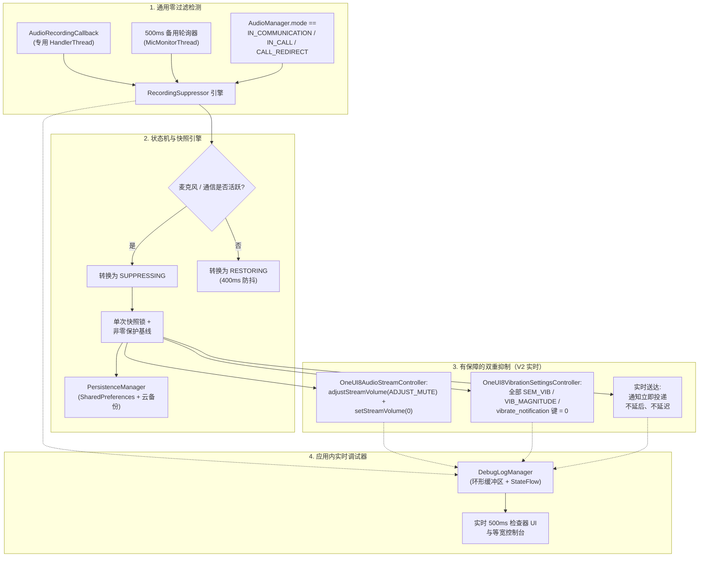

<p align="center">
  <a href="../../README.md">English</a> ·
  <a href="README.ar.md">العربية</a> ·
  <a href="README.es.md">Español</a> ·
  <a href="README.fr.md">Français</a> ·
  <a href="README.de.md">Deutsch</a> ·
  <a href="README.ru.md">Русский</a> ·
  <a href="README.pt-BR.md">Português (Brasil)</a> ·
  <a href="README.tr.md">Türkçe</a> ·
  <a href="README.ko.md">한국어</a> ·
  <a href="README.ja.md">日本語</a> ·
  <b>简体中文</b>
</p>

# Samsung Mic Mute App (v3.0)

<p align="center">
  
  
  
  
  
  
</p>

> **一款面向三星 Galaxy 设备的专用 Android 工具：在麦克风处于活跃使用状态时自动抑制通知声音与振动，且无需 `RECORD_AUDIO` 权限。在 V3 版本中，已包含完整的多语言支持（11 种语言）、应用内即时语言切换器，以及安全的应用内 PayPal 捐赠面板。**

> [!WARNING]
> **⚠️ 重要说明：** 本工具会静音系统级通知声音与振动，但无法阻止应用内自定义振动（例如 WhatsApp、Telegram 等内部的自定义振动设置）。若要获得完全静音的体验，你必须在这些具体应用内手动关闭应用内振动。

---

## 📌 问题概述

在三星 Galaxy 设备上录制音频或进行语音/视频通话时（例如 WhatsApp 语音消息、Snapchat、Instagram 快拍/Reels、录音机、相机 4K 视频录制、电话通话），来电通知会产生响亮的爆音与触觉振动，混入录制音频并打断通话。

标准免打扰（DND）模式需要手动切换，操作繁琐；而标准的 Android 音频流方法也无法让三星专有的振动引擎静音。

**Samsung Mic Mute App (V3)** 在后台彻底解决该问题：它会在系统任意位置自动检测麦克风激活，立即将通知音量与三星振动强度静音至零，并在录音结束的瞬间将其精确恢复到原始基线值。所有通知仍会实时到达并显示在屏幕上，不会被延后、延迟，也不会在之后集中爆发。

---

## 🚀 核心功能与亮点

- **🔒 零 `RECORD_AUDIO` 权限（100% 隐私与安全）：**
  使用 Android 系统级 `AudioManager.AudioRecordingCallback`（API 30+ 引入）。该应用**从不**录制、监听或处理麦克风音频，仅监测是否有其他应用打开了录音流。
- **🌐 11 种全球语言与即时切换器（V3）：**
  已完整翻译为 11 种语言：阿拉伯语（العربية）、英语、西班牙语（Español）、法语（Français）、德语（Deutsch）、俄语（Русский）、葡萄牙语（Português）、土耳其语（Türkçe）、韩语（한국어）、日语（日本語）和简体中文（简体中文）。包含应用内语言选择器（🌐）以及对 Android 13+ 按应用语言设置的集成。
- **💳 安全的应用内 PayPal 支持面板（V3）：**
  通过 PayPal 官方 Hosted Buttons SDK，在原生模态 BottomSheet 中直接提供支持，无需跳转到外部浏览器。
- **🛡️ 无侵入式前台麦克风类型：**
  通过将 `FOREGROUND_SERVICE_SPECIAL_USE` 前台服务（`audio_recording_detection` 属性）与常驻的 `NotificationListenerService` 相结合，规避 Android 14–16 的运行时安全限制。
- **⚡ 通用零过滤检测引擎：**
  可在**任意**应用的**任何**麦克风使用场景下触发，不依赖隐藏或被遮蔽的包名（Android 10+ 对非特权应用隐藏 `clientPackageName`）。
- **🔄 VoIP 与通信模式备用轮询器：**
  在专用的紧急优先级线程（`THREAD_PRIORITY_URGENT_AUDIO`）上运行 500ms 活跃轮询，检测 VoIP 通话（`MODE_IN_COMMUNICATION`、`MODE_IN_CALL`、`MODE_CALL_REDIRECT`），以消除 WhatsApp、Instagram 和 Telegram 上的回调延迟。
- **🎯 三星声音与多键振动双重静音：**
  - **音频：** 同时执行 `adjustStreamVolume(ADJUST_MUTE)` 与 `setStreamVolume(STREAM_NOTIFICATION, 0)`。
  - **三星振动：** 查询、快照并将所有 One UI 振动键设置为 `0`：
    - `SEM_VIBRATION_NOTIFICATION_INTENSITY` 与 `sem_vibration_notification_intensity`
    - `VIB_NOTIFICATION_MAGNITUDE` 与 `vib_notification_magnitude`
    - `vibrate_notification`
    - `notification_vibration_intensity`
    - `vibrate_on`（回退项）
- **📬 实时静音送达：**
  确保所有通知在系统音频与振动驱动层面被完全静音的同时，仍能实时立即到达并显示在屏幕上。
- **🧠 单次快照锁与非零保护：**
  仅在状态从 `IDLE` → `SUPPRESSING` 转换时严格快照一次系统音量与振动级别。后续触发绝不会用 `0` 覆盖用户的正常音量。若快照时读到 `0`，非零保护会恢复一份健康的持久化基线值。
- **⏱️ 400ms 防抖动：**
  当麦克风流停止时延迟 400ms 再恢复，避免连续录制语音消息时出现快速的开关音频抖动。
- **📊 应用内实时调试器与诊断控制台：**
  在仪表盘上提供每 500ms 轮询一次的实时检查面板：
  - 活跃麦克风配置数量、音频会话 ID 与来源类型。
  - 当前 `AudioManager.mode`。
  - `STREAM_NOTIFICATION` 的实时音量与静音状态。
  - 直接从 `Settings.System` 读取所有三星振动键的实时整数值。
  - 等宽滚动的日志事件控制台，支持一键复制到剪贴板与振动键转储。
- **💾 崩溃与重启恢复：**
  通过 `BootRecoveryReceiver` 与云同步的 `PersistenceManager`，在设备重启后自动恢复缓存的基线设置。
  当麦克风流停止时延迟 400ms 再恢复，避免连续录制语音消息时出现快速的开关音频抖动。
- **📊 应用内实时调试器与诊断控制台：**
  在仪表盘上提供每 500ms 轮询一次的实时检查面板：
  - 活跃麦克风配置数量、音频会话 ID 与来源类型。
  - 当前 `AudioManager.mode`。
  - `STREAM_NOTIFICATION` 的实时音量与静音状态。
  - 直接从 `Settings.System` 读取所有三星振动键的实时整数值。
  - 等宽滚动的日志事件控制台，支持一键复制到剪贴板与振动键转储。
- **💾 崩溃与重启恢复：**
  通过 `BootRecoveryReceiver` 与云同步的 `PersistenceManager`，在设备重启后自动恢复缓存的基线设置。

---

## 📱 兼容设备与系统要求

| 组件 | 要求 |
| :--- | :--- |
| **目标系统** | Android 11、12、13、14、15、16（API 30 至 36） |
| **已测试平台** | **Samsung One UI 6、One UI 7、One UI 8、One UI 9** |
| **支持的硬件** | Samsung Galaxy S 系列（S20 – S25 Ultra）<br/>Samsung Galaxy Z 系列（Fold 与 Flip）<br/>Samsung Galaxy Note 系列<br/>Samsung Galaxy A 系列 / M 系列 / Tab |
| **非三星设备** | 兼容标准的 Android 通知声音静音；三星专属振动键会优雅回退到 `NotificationListenerService`。 |

---

## 🏗️ 架构与技术栈



### 模块化控制器栈

- **`RecordingSuppressor`：** 线程安全的状态编排器（`IDLE` ↔ `SUPPRESSING` ↔ `RESTORING`）。
- **`AudioStreamController`：** 可插拔的音频静音接口：
  - `OneUI8AudioStreamController`（主要：`STREAM_NOTIFICATION` 双重静音）。
  - `NotificationChannelAudioController`（回退：逐个通知渠道的声音抑制）。
- **`VibrationSettingsController`：** 可插拔的振动静音接口：
  - `OneUI8VibrationSettingsController`（主要：三星系统设置多键静音）。
  - `NotificationListenerVibrationController`（回退：通知级振动模式取消）。
  - `AdbSecureSettingsVibrationController`（开发 / 企业回退方案）。
- **`SuppressionForegroundService`：** 带常驻监控通知的粘性前台服务。
- **`SuppressionNotificationListener`：** 系统优先级宿主，确保持续监控在被系统激进杀任务时仍能存活。

---

## 🛠️ 安装与配置指南

### 第 1 步：安装 APK
从 [Releases](https://github.com/m4wan1/SamsungMicMuteApp/releases) 部分下载 `SamsungMicMute_V2.apk`，或在本地从源码构建 APK：

```bash
git clone https://github.com/m4wan1/SamsungMicMuteApp.git
cd SamsungMicMuteApp
./gradlew assembleDebug
```
编译后的 APK 将位于：
`app/build/outputs/apk/debug/app-debug.apk`

---

### 第 2 步：授予权限
启动应用。三张简洁的配置卡片将引导你授予所需权限：

1. **写入系统设置（`WRITE_SETTINGS`）：**
   - 点击卡片 3 上的 **Grant**。
   - 为 *Samsung Mic Mute* 打开 **允许修改系统设置**。
   - *用途：* 允许应用在 `Settings.System` 中设置三星振动强度与音量。
2. **通知监听器访问权限：**
   - 点击卡片 3 上的 **Grant**。
   - 在设备设置中启用 **Notification Vibration Suppressor**。
   - *用途：* 提供常驻的系统优先级后台监控与回退振动控制。
3. **忽略电池优化（不受限制）：**
   - 点击卡片 3 上的 **Grant**。
   - 选择 **允许**（不受限制）。
   - *用途：* 防止三星 One UI 在应用最小化时冻结或延迟后台音频回调线程。

#### 通过 ADB 进行替代配置（面向开发者的快速配置）：
```bash
# Grant Write System Settings
adb shell appops set com.example.suppressor.debug WRITE_SETTINGS allow

# Grant Notification Listener Access
adb shell cmd notification set_listeners com.example.suppressor.debug/com.example.suppressor.service.SuppressionNotificationListener

# Whitelist from Battery Optimization
adb shell dumpsys deviceidle whitelist +com.example.suppressor.debug
```

---

## 🧪 使用与测试

### 如何验证抑制效果：
1. 打开 **Samsung Mic Mute**，确认卡片 3 上的三个权限徽章均显示 **Granted** / **Unrestricted**。
2. 保持应用打开或将其最小化。
3. 打开 **WhatsApp**（或 **录音机**、**Snapchat** 或 **相机**的视频模式）。
4. 按住麦克风按钮录制一条语音消息。
5. 在按住麦克风的同时查看应用：
   - **状态徽章**立即变为：`ACTIVE - Mic in Use (Muted)`。
   - **已保存的音量 / 振动**显示：`Saved Volume: 10 / 15 | Current: 0 (Muted)`。
6. 让朋友给你发一条通知消息（或从另一台设备发送邮件/通知）。
7. **观察结果：** 通知会静默到达，**零声音**、**零振动**。
8. 松开麦克风按钮。
9. 经过平滑的 400ms 防抖后，音量与振动会自动恢复到你的原始设置。

### 使用应用内实时调试器：
滚动到屏幕底部的**卡片 5（LIVE IN-APP DEBUGGER）**：
- **实时检查器：** 显示实时麦克风配置数量、`AudioManager.mode`、流静音状态以及三星振动键的精确整数值。
- **复制日志（Copy Logs）：** 将完整诊断转储与三星设置键复制到剪贴板。
- **转储振动键（Dump Vib Keys）：** 扫描 `Settings.System` 中所有匹配 `vib` 或 `noti` 的设置并打印其值。

---

## 🔒 核心约束与安全保证

| 约束 / 保证 | V2 中的规范与实施 |
| :--- | :--- |
| **实时静默通知送达** | **零延迟 / 不延后：** 通知必须实时立即到达并显示在屏幕上。应用严格避免使用 `snoozeNotification()`、`cancelNotification()` 或 `cancelAllNotifications()`，从而防止麦克风释放时出现通知洪水。完全静音仅依赖优先级 1 的控制器（`OneUI8AudioStreamController` 将 `STREAM_NOTIFICATION` 设为 0，以及 `OneUI8VibrationSettingsController` 将 `sem_vibration_notification_intensity` 设为 0）。 |
| **无麦克风窃听** | 在 `AndroidManifest.xml` 中强制执行 `<uses-permission android:name="android.permission.RECORD_AUDIO" tools:node="remove" />`。Android 系统会从物理层面阻止本应用采集音频。 |
| **不干扰免打扰模式** | 不修改 Android 的 `NotificationManager.setInterruptionFilter()`。你的 DND 时间表与星标联系人例外保持原样。 |
| **无全局静音模式** | 不设置 `RINGER_MODE_SILENT`。来电与闹钟会以正常满音量响铃。 |
| **纯本地处理** | 包含零分析、零网络请求、零远程跟踪。 |

### ⚠️ 应用内自定义振动免责声明
> **重要说明：** 本工具会静音系统级通知声音与振动，但无法阻止应用内自定义振动（例如 WhatsApp、Telegram 等内部的自定义振动设置）。若要获得完全静音的体验，你必须在这些具体应用内手动关闭应用内振动。

---

## 📄 许可与条款

基于 **MIT 许可证**分发。

```
MIT License

Copyright (c) 2026 Marw (m4wan1)

Permission is hereby granted, free of charge, to any person obtaining a copy
of this software and associated documentation files (the "Software"), to deal
in the Software without restriction, including without limitation the rights
to use, copy, modify, merge, publish, distribute, sublicense, and/or sell
copies of the Software, and to permit persons to whom the Software is
furnished to do so, subject to the following conditions:

The above copyright notice and this permission notice shall be included in all
copies or substantial portions of the Software.

THE SOFTWARE IS PROVIDED "AS IS", WITHOUT WARRANTY OF ANY KIND, EXPRESS OR
IMPLIED, INCLUDING BUT NOT LIMITED TO THE WARRANTIES OF MERCHANTABILITY,
FITNESS FOR A PARTICULAR PURPOSE AND NONINFRINGEMENT. IN NO EVENT SHALL THE
AUTHORS OR COPYRIGHT HOLDERS BE LIABLE FOR ANY CLAIM, DAMAGES OR OTHER
LIABILITY, WHETHER IN AN ACTION OF CONTRACT, TORT OR OTHERWISE, ARISING FROM,
OUT OF OR IN CONNECTION WITH THE SOFTWARE OR THE USE OR OTHER DEALINGS IN THE
SOFTWARE.
```

*免责声明：本项目是一款为保护用户隐私与便利而设计的独立开源工具，与 Samsung Electronics Co., Ltd. 无隶属关系，也未获其认可。*
